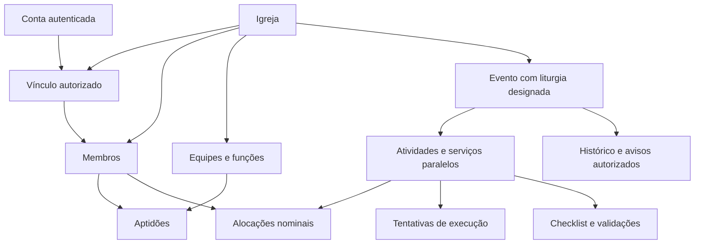

# Escala do Reino — arquitetura do banco e das permissões

Versão 4 · 2 de outubro de 2026

**Situação:** proposta de arquitetura para revisão. Este documento descreve o modelo lógico; não cria tabelas, configurações ou permissões no Supabase. As pendências de produto continuam identificadas antes da implementação dependente.

**Base de produto:** [PRD do MVP](PRD.md) e [evoluções futuras](EVOLUCAO-FUTURA.md), com as decisões confirmadas na revisão de 2 de outubro. O protótipo examinado corresponde ao commit [`e2bdad3`](https://github.com/dgnoleto/escala-do-reino/tree/e2bdad3107b28ad44355e9c30d9a6cd857f89fcf). A integração GitHub–Supabase foi confirmada pela captura enviada pelo responsável pelo projeto. A configuração atual de aplicação automática e o conteúdo interno do banco não foram inspecionados.

**Atualização desta versão:** adota Google e e-mail/senha, com recuperação via Supabase e SMTP pendente para o piloto; consolida nomes técnicos em inglês; fuso da igreja sem preferência individual; localização com endereço/link do Google Maps; início/fim previstos do evento; política opcional de bloqueio na publicação, com rascunhos permitidos; preparação dos apoios fora da janela principal. Este documento complementa o PRD do MVP, sem substituí-lo. A seção 6 e o cenário M26 do PRD acompanham a política opcional, com cenários adicionais M47–M50. A publicação desta documentação não aplica SQL nem configura o banco. O [SQL inicial](sql/001_initial_access_structure.sql) é um rascunho de estrutura fechada, ainda sem validação em PostgreSQL.

## 1. Objetivo e limites

Sustentar uma primeira entrega web que permita planejar e conduzir um culto, registrar ausências e substituições combinadas externamente e oferecer consulta conforme a responsabilidade de cada pessoa.

React/Vite permanece como base da web; propõe-se TypeScript gradual. O backend compartilhado usa PostgreSQL e serviços do Supabase. Android/iOS vem posteriormente; Flutter continua candidato. Ter um backend compartilhado não exige uma interface única para todos os canais.

Entram desde o início: acesso por convite; isolamento entre igrejas; autorização por equipe e evento; execução transacional; proteção contra SQL injection; controle de abuso; UTF-8; histórico e recuperação.

Continuam fora do MVP: participação aberta, disponibilidade autodeclarada, aceite de escala, chamadas automáticas, check-in, dashboards, delegação do andamento, turnos de retiro e edição offline. Cursos online, simpósios pagos e gestão financeira são ideias futuras, sem entidades, pagamentos, permissões ou implementação nesta arquitetura. Uma preferência individual de fuso poderá ser reavaliada em um módulo futuro de cursos online; não será criada no MVP. A estrutura futura será acrescentada por migrações quando houver regras aprovadas.

## 2. Decisões estruturais propostas

1. **Membro, conta e acesso são distintos.** Um membro pode existir e ser escalado sem login. Uma conta autenticada só consulta a igreja após vínculo autorizado.
2. **Admin é independente da liderança.** Controle do culto depende da liturgia designada para aquela edição; a permissão admin não substitui essa designação.
3. **Aptidão não é escala.** Habilitação indica que a pessoa pode exercer a função; a alocação indica que foi escolhida para o evento.
4. **Modelo e evento são distintos.** Criar um evento copia o planejamento do modelo; alterar o modelo depois não altera silenciosamente eventos existentes.
5. **Cada tentativa de execução é um registro.** Devolver para pendente encerra uma tentativa; reiniciar cria outra com a duração prevista inteira.
6. **Horários reais e de registro são distintos.** Dados completos de data/hora permitem correções e eventos que atravessam meia-noite.
7. **Dados privados permanecem privados também no transporte.** Cada consulta retorna os campos autorizados; a interface não recebe uma cópia integral para escondê-la por perfil.

**Decisão confirmada nesta etapa:** ministério e equipe representam o mesmo grupo no piloto. Haverá um único cadastro `teams`, com o rótulo de produto a definir no desenho da interface; nenhuma hierarquia adicional de ministério/equipe será criada nesta versão.

## 3. Convenções do banco

Os nomes técnicos de tabelas e campos seguem o padrão confirmado de inglês em `snake_case`; o produto mantém os rótulos em português. Cada entidade tem identificador UUID. Toda entidade pertencente a uma igreja leva `church_id` diretamente, inclusive nas tabelas filhas, para tornar explícito o isolamento.

Referências entre registros da igreja devem conferir igreja e identificador juntos. Por exemplo, uma alocação do Shalom não pode apontar para um membro de outra igreja, mesmo que a chamada informe um UUID existente. Usar chaves estrangeiras compostas onde couber, apoiadas em unicidade `(church_id, id)`. Identificadores UUID não são proteção de acesso.

Valores obrigatórios, estados, durações positivas, posições e unicidades devem ter restrições de banco. Regras entre múltiplas linhas, como conflitos de escala, precisam de validação transacional; um `CHECK` isolado não resolve todos esses casos. [Restrições no PostgreSQL](https://www.postgresql.org/docs/current/ddl-constraints.html).

Datas operacionais usam `timestamptz`, com exibição pelo fuso configurado da igreja. O membro herda o fuso da igreja consultada, sem campo de preferência ou opção de alteração individual. Uma conta vinculada a igrejas diferentes usa o contexto da igreja consultada. O cadastro guarda `timezone` como identificador IANA, além do endereço e de `google_maps_url`; nesta etapa, propõe-se um link da localização e escolha explícita do fuso, sem detecção automática por API. O fuso real do piloto precisa ser confirmado; a cidade da massa fictícia do protótipo não determina essa configuração.

Eventos guardam `planned_start_at` e `planned_end_at`, com data completa e fim posterior ao início; a duração disponível deriva da diferença entre eles e não é um terceiro valor independente. O fuso usado no planejamento fica registrado como contexto do evento. Alterar o fuso da igreja não remarca os instantes já gravados; qualquer remarcação exige ação explícita e revalidação dos conflitos. Durações dos itens usam segundos inteiros; a interface pode mostrar minutos. Dados de planejamento preservam a previsão original e alterações posteriores pertinentes. Horários reais permanecem separados dos previstos, inclusive quando a execução termina antes ou depois.

Textos, arquivos de código, migrações e intercâmbio JSON usam UTF-8. Verificar `server_encoding` e `client_encoding` no ambiente real. Propõe-se NFC para nomes e textos de cadastro, preservando acentos; não transformar tokens, assinaturas ou credenciais. Busca sem acentos é uma decisão de pesquisa separada.

## 4. Entidades e relações

O primeiro detalhamento físico está em [Schema inicial de igreja e acesso](SCHEMA-ACESSO.md). Ele especifica campos e restrições desse incremento; não é uma migração executada.

### 4.1 Igreja, acesso e pessoas

| Entidade | Conteúdo mínimo proposto | Relação e regra |
| --- | --- | --- |
| `auth.users` | Conta e identidades autenticadas | Mantida pelo Supabase Auth; a aplicação não armazena senhas; Google e e-mail/senha são gerenciados pelo Supabase Auth. |
| `churches` | Nome, `timezone`, endereço, `google_maps_url`, política padrão de duração, situação | Unidade de isolamento dos dados; fuso herdado por seus membros, sem preferência individual. Política padrão copiada para novos eventos. |
| `members` | Igreja, nome de exibição, situação, contato mínimo quando necessário | Cadastro da pessoa naquela igreja; não exigir login para cadastrar ou escalar. Nome não é identificador único. |
| `church_access` | Igreja, conta, membro, situação, permissão admin, autoria da concessão/revogação | Um vínculo por conta/igreja e um por membro/igreja. Permissões derivam de registros controlados; o cliente não se concede admin. |
| `access_invitations` | Igreja, membro existente, destinatário, resumo criptográfico do token, emissão, validade, situação, resgate e autor | Convite de acesso, sem vagas ou aceite de participação. Token imprevisível e de uso único; vínculo final validado no servidor. |
| `teams` | Igreja, nome, líder designado, situação | Cadastro único de equipe/ministério, conforme decisão confirmada nesta etapa. |
| `team_memberships` | Igreja, equipe, membro, situação | Uma pessoa pode integrar várias equipes. Pertencer à equipe não significa possuir todas as aptidões dela. |
| `team_roles` | Igreja, equipe, nome da função, classificação operacional mínima, situação | Identificador estável; regras não comparam fragmentos do nome da função. |
| `member_qualifications` | Igreja, membro, função, situação, quem habilitou e quando | Aptidão administrada pela liderança competente. A alocação deve validar aptidão ativa e vínculos. |

Uma conta poderá ter vínculos autorizados com mais de uma igreja sem compartilhar cadastros entre elas. O convite concede acesso básico; designação de liderança e concessão de admin são operações separadas. A inicialização do primeiro admin precisa de procedimento controlado e registrado, fora de um formulário público de autoconcessão.

### 4.2 Planejamento e escala

| Entidade | Conteúdo mínimo proposto | Relação e regra |
| --- | --- | --- |
| `event_types` | Igreja, nome, situação | Categoria do evento; inicialmente culto. |
| `activity_types` | Igreja, nome, duração padrão, natureza principal/paralela, situação | Cadastro reutilizável de atividade. Alterar o padrão não reescreve eventos existentes. |
| `event_templates` | Igreja, tipo, nome, duração prevista, situação | Modelo reutilizável, sem escalar pessoas automaticamente. |
| `template_items` | Igreja, modelo, atividade, posição principal ou preparação paralela, duração padrão | Estrutura copiada para cada evento; apoio paralelo não aumenta a soma principal. |
| `events` | Igreja, tipo/modelo de origem, título, `planned_start_at`, `planned_end_at`, fuso de planejamento, `duration_policy`, marco de publicação, liturgia designada, estado, marcos reais do culto, versão | Uma edição concreta. Duração disponível calculada a partir de início/fim. Política registrada no evento; sem contador persistido do culto. Liturgia deve estar vinculada à igreja com acesso ativo quando operar. |
| `event_items` | Igreja, evento, atividade de origem, título e duração próprios, natureza, posição/bloco, equipe responsável pelo planejamento, responsável nominal quando houver, estado | Instância da atividade. Louvor é um bloco principal comum às funções simultâneas. Serviços contínuos de apoio acompanham os marcos do culto, sem controles individuais. |
| `assignments` | Igreja, evento, item, membro, equipe/função, situação, autoria e referência à alocação substituída quando houver | Escala nominal. A equipe da função determina a autoridade sobre a alocação; preservar a anterior e o registro da ausência/substituição. Não criar aceite eletrônico. |
| `activity_music` | Igreja, evento/item, equipe responsável, participação pertinente quando necessária, ordem, nome, referência/intérprete, tom, URL do YouTube, observação | Ficha daquela participação, com âmbito explícito de manutenção e consulta. Sem biblioteca global, upload, player ou letras/cifras. |
| `cancellation_reasons` | Igreja, descrição, situação | Cadastro previamente disponível; cancelamento em execução exige motivo válido. |

O responsável nominal por uma atividade e o líder autorizado a operar sua equipe são conceitos diferentes. Estar escalado para dirigir uma etapa não concede administração ou controle da sequência.

No louvor, canto, instrumentos e dança podem ter alocações de equipes diferentes vinculadas ao mesmo bloco de vinte minutos. Cada liderança mantém as alocações da própria equipe; a equipe responsável pelo planejamento do bloco não ganha autoridade sobre todas elas. A duração continua sendo vinte minutos. A execução da dança dentro desse bloco não é um serviço contínuo que começa e termina junto do culto.

Para alocações, a consulta de candidatos cruza aptidão ativa, vínculos e conflitos conhecidos. Continua sem garantir disponibilidade real, presença física ou aceite.

### 4.3 Execução, preparação e histórico

| Entidade | Conteúdo mínimo proposto | Relação e regra |
| --- | --- | --- |
| `activity_executions` | Igreja, evento/item, número da tentativa, duração prevista nessa tentativa, início/fim reais, resultado, motivo, responsável e autor/momento do registro | Cada tentativa fica separada. Uma execução principal aberta por evento, garantida por restrição e transação. |
| `checklist_items` | Igreja, evento/item, descrição, âmbito responsável, uma ou duas validações exigidas | Preparação informativa; nunca bloqueia inclusão ou início de atividade. |
| `checklist_validations` | Igreja, item de checklist, posição/âmbito validador, líder designado, estado, autor e momento | Item conjunto exige duas validações distintas. Quem pode confirmar/desmarcar permanece dependente do detalhamento do PRD. |
| `audit_entries` | Igreja, entidade/ação, autor, momento do registro, valores anteriores/novos pertinentes, comando relacionado | Histórico com retenção de um ano, sem alteração por usuários comuns. Expiração autorizada é distinta de edição do histórico. |
| `notifications` | Igreja, destinatário autorizado, tipo, referência ao evento/item, criação e leitura | Avisos internos por destinatário. A autorização atual também é verificada ao abrir o aviso. |
| `command_receipts` | Igreja, evento quando aplicável, conta, identificador do comando, ação, resumo dos parâmetros, versão e resultado mínimo | Reconhece repetições e permite consultar resultado após resposta perdida; não armazenar respostas completas com dados pessoais. |

Essas são entidades lógicas; o número final de tabelas e os campos serão definidos nas migrações. Contadores de abuso são infraestrutura de curta duração, separados do histórico de produto.

### 4.4 Mapa das relações principais

## 5. Matriz de permissões

Os papéis podem ser acumulados. A coluna admin considera alguém que não possui outra liderança; ela não concede os direitos das demais colunas. Todo acesso exige vínculo ativo com a igreja.

| Ação/dado | Membro | Líder de equipe/atividade | Liturgia daquele evento | Somente admin |
| --- | --- | --- | --- | --- |
| Cronograma macro | Consulta | Consulta | Consulta | Consulta |
| Detalhes da própria participação | Consulta quando escalado | Consulta quando escalado | Consulta quando escalado | Consulta quando escalado |
| Bastidores do evento | Não | Somente seu âmbito | Todos os âmbitos do evento | Acesso adicional ainda pendente; negar por padrão |
| Cadastro administrativo web | Não | Apenas aptidões/configurações autorizadas do próprio âmbito | Conforme atribuições de planejamento, sem assumir admin | Administração da igreja |
| Convites de acesso e designação de lideranças | Não | Não | Não | Sim |
| Sequência principal e planejamento macro | Não | Somente conteúdo sob sua responsabilidade | Sim | Não por ser apenas admin |
| Escala inicial de equipes | Não | Sua equipe | Não monta inicialmente equipes de outros líderes | Não por ser apenas admin |
| Ausência/substituição antes do início | Não | Sua equipe, com aptidão e conflitos validados | Âmbito próprio; exceções adicionais exigem detalhamento | Não por ser apenas admin |
| Substituição durante execução | Não | Não | Sim, conforme PRD | Não por ser apenas admin |
| Iniciar/avançar/concluir/devolver/cancelar/corrigir/encerrar | Não | Não | Sim | Não |
| Checklist | Não | Seu âmbito e validação designada | Acompanha todos; alcance de marcação pendente | Não por ser apenas admin |
| Histórico | Não | Pertinente ao próprio âmbito | Pertinente a todo o evento | Cadastros administrados; alcance operacional pendente |

Os limites futuros do aplicativo são requisitos de canal e produto. Navegador de celular continua sendo web. Esconder controles ou verificar o tipo do aparelho não constitui autorização. O cliente Android/iOS oferecerá somente os fluxos previstos; nenhuma identidade ganha privilégios adicionais por trocar de cliente.

## 6. Contratos de consulta e alteração

Consultas separadas: cronograma macro; minha escala; bastidores do âmbito autorizado; manutenção administrativa. O macro contém títulos, ordem, durações e estado/contagem da atividade principal. Não deve trazer e-mails, motivos, ausências, checklists ou repertório privado por conveniência técnica.

Comandos específicos substituem a atualização irrestrita do objeto inteiro do evento: criar evento a partir do modelo; alterar programação; alocar/substituir; validar checklist; iniciar; concluir; concluir e iniciar próxima; devolver para pendente; cancelar; corrigir horários; encerrar; designar liturgia; conceder/revogar acesso.

Cada comando carrega identificador único e, quando há alteração concorrente, versão esperada. Igreja, autor, permissão e horário de registro são conferidos/obtidos no servidor; a aplicação não confia em campos enviados como prova de autorização.

Fluxo transacional:

1. Validar sessão, vínculo ativo, âmbito e parâmetros; aplicar limite de uso adequado.
2. Abrir a transação e bloquear os registros necessários em ordem consistente.
3. Conferir autorização novamente contra o estado protegido, incluindo liturgia atual.
4. Reconhecer comando já aplicado; rejeitar reutilização do identificador com parâmetros diferentes. Revalidar o acesso antes de devolver qualquer resultado anterior.
5. Conferir versão, transição permitida, aptidões e conflitos; na publicação do planejamento, validar também a política de duração registrada no evento.
6. Gravar alteração, tentativa pertinente, recibo, histórico e avisos internos juntos.
7. Confirmar e informar a nova versão. Falha na transação não deixa execução sem histórico.

Transações de alocação devem proteger também conflitos entre eventos da mesma igreja para o mesmo membro. Serializar apenas cada evento não basta quando duas lideranças alocam a pessoa em eventos diferentes. Usar bloqueio por membro/igreja, em ordem estável, ou outra garantia equivalente validada por teste concorrente.

## 7. Estados e tempo

### 7.1 Planejamento e política de duração

Decisão confirmada: o limite de duração pode ser configurado como `warn` ou `block`. Recomenda-se `warn` como padrão inicial, preservando o comportamento anterior. O padrão pertence à igreja e é copiado para o evento; mudar o padrão não altera silenciosamente eventos existentes. Propõe-se administração do padrão pelo admin da igreja, conforme seu âmbito de configuração. Permissão e procedimento para mudar a política de um evento existente permanecem pendentes; não pressupor exceções individuais por liderança.

Em `warn`, o excesso produz alerta e permite salvar/publicar sem aprovação ou justificativa. Em `block`, pode-se salvar e reorganizar rascunhos com excesso, mas a programação precisa caber antes da publicação. Uma revisão de planejamento já publicado que introduza excesso não pode ser publicada como válida enquanto continuar em `block`. O marco de publicação é separado do estado operacional planejado/em andamento/encerrado; o comportamento de consulta das revisões em rascunho deve ser detalhado antes de implementar esse fluxo.

A regra soma somente a sequência principal, sem duplicar canto, instrumentos e dança no mesmo bloco, nem incluir serviços paralelos. Para um evento de 19h a 21h, a capacidade principal é 120 minutos. Os blocos principais devem caber nessa janela no modo `block`; eventuais espaços previstos entre blocos também precisam caber. A preparação dos apoios pode começar antes, como uma preparação de câmeras às 18h30; seu intervalo completo continua participando da validação de conflitos das pessoas.

O bloqueio pertence à publicação do planejamento, não ao cronômetro ou à condução real. Durante a execução, imprevistos podem encurtar ou prolongar as etapas e o culto, sem encerramento automático ao atingir o fim previsto. Não impor uma restrição universal que coloque todos os `event_items` ou todos os horários reais dentro da janela prevista. Alterações operacionais autorizadas continuam seguindo as regras de execução do PRD.

Implementar esta política específica não cria um mecanismo genérico de regras parametrizáveis. Publicação e edições concorrentes precisam validar o mesmo planejamento protegido pela transação, para impedir que uma edição torne inválida a programação entre a conferência e a publicação.

### 7.2 Execução e conflitos

Evento: planejado → em andamento → encerrado. A sequência pode ficar sem atividade principal aberta durante o andamento. Não há avanço por horário.

Atividade principal: pendente → em execução → concluída/cancelada. O retorno interrompe a tentativa e deixa o item pendente; o reinício cria outra tentativa. Retirar uma atividade futura da programação não cancela uma execução atual. Estados finais e edição após encerramento precisam seguir as regras de correção aprovadas, sem reabertura silenciosa.

O cronômetro deriva do início real, da duração prevista da tentativa e da referência de horário do servidor. A tela atualiza visualmente a contagem sem salvar um segundo por vez nem consultar o banco a cada segundo. Correção e recuperação de suspensão recalculam a referência; após zero, mostrar excesso e manter execução aberta.

Intervalos são derivados das execuções da sequência principal: fim real de uma tentativa até início real da seguinte, dentro dos marcos do culto. Conclusão e início no mesmo instante dão intervalo zero; a espera anterior à primeira atividade fica fora. Não é necessário manter um contador de intervalo no banco. Correções recalculam a projeção, com rastreabilidade dos valores anteriores. Rejeitar fim anterior ao início; política para sobreposição de registros corrigidos permanece pendente.

Os marcos dos serviços paralelos derivam do início/fim reais do culto. A preparação prévia é planejamento para conflito e não cria cronômetro operacional. Propõe-se offset de preparação antes do início previsto; o uso desse offset em recalculações posteriores exige a confirmação descrita nas pendências.

Conflitos mínimos: exclusividade entre cantar, tocar e dançar no mesmo bloco de louvor; consideração dos intervalos completos dos serviços contínuos e preparação; revalidação após alteração da programação. Não acrescentar um motor genérico de compatibilidade. Compatibilidades entre outras funções precisam ser explicitadas quando necessárias ao piloto.

## 8. Acesso por convite — decisões e detalhamento pendente

Decisões confirmadas: Google e e-mail/senha no MVP; sem CPF; convite de uso único com validade de 72 horas desde a emissão. Apple e Microsoft ficam para evolução posterior. O Supabase Auth gerencia as credenciais; nenhuma tabela da aplicação armazena senha, hash de senha ou token de recuperação. Admin da igreja não define ou altera a senha de outra pessoa; pode solicitar o envio da recuperação sem receber seu link. A pessoa define a nova senha pelo fluxo do Supabase. A recuperação da conta Google continua externa. Habilitar somente Google e Email no serviço de autenticação; esconder formulários não basta.

**Configuração informada pelo responsável pelo projeto em 02/10/2026:** Google salvo; Email habilitado, troca segura de e-mail e senha, exigência de senha atual na troca normal, mínimo de 15 caracteres sem regra adicional de composição, OTP de 8 dígitos e expiração de 3600 segundos. Retorno de desenvolvimento em `http://localhost:3000`, com `http://localhost:3000/**` na lista permitida. Esses relatos não comprovam login integrado ou fluxos testados. Recuperação autenticada de senha não exige a senha esquecida. Não aplicar normalização NFC às senhas.

O SMTP personalizado permanece pendente: não há domínio próprio. Desenvolvimento pode usar o envio padrão restrito à equipe do projeto; antes de liberar e-mail/senha aos membros, configurar e testar confirmação, recuperação, limites e proteção contra abuso com um serviço de envio adequado. Para produção, usar endereços de retorno HTTPS específicos e substituir o Site URL local. O prazo de uma hora dos links/códigos do Auth não muda as 72 horas do convite de acesso da aplicação.

O admin escolhe um membro existente e emite um convite com destinatário, validade de 72 horas e token de uso único. A pessoa autentica com Google ou e-mail e senha e apresenta o convite. O resgate é atômico: confirma validade, destinatário, ausência de vínculo incompatível e vincula a conta ao membro, sem conceder liderança ou admin por padrão.

Não associar pessoas por igualdade de nome. O vínculo entre Google e e-mail/senha não deve ser inventado pela aplicação com base em nomes ou e-mails não verificados. Associação de identidades exige procedimento seguro; recursos automáticos do Auth precisam ser avaliados junto ao vínculo único por igreja/membro.

No primeiro acesso autenticado, solicitar confirmação/preenchimento do nome, mantendo o vínculo com o membro previamente cadastrado. A reconciliação de divergências de nome permanece pendente. Não criar um segundo membro por concluir esse formulário. Restrição de unicidade do vínculo por conta/igreja e por membro/igreja impede duplicar o acesso ao mesmo cadastro; não garante que uma pessoa nunca crie outra conta no provedor.

**Pendentes de produto:** comprovação do destinatário quando a conta usa outro endereço, convite enviado à pessoa errada, revogação, reconciliação do nome e associação de provedores à mesma pessoa. Propõe-se acesso negado até resolução segura quando houver dúvida de identidade; o procedimento de resolução será aprovado antes da implementação.

Revogar acesso deve impedir novas consultas e comandos, limpar dados em cache ao detectar revogação e invalidar o recebimento de detalhes privados. Informação já vista não pode ser recuperada do aparelho por garantia técnica; minimizar armazenamento local persistente e retornar somente o necessário. Não usar respostas privadas em cache público compartilhado.

## 9. Proteção contra SQL injection e exposição

Usar parâmetros para valores e listas permitidas para identificadores dinâmicos inevitáveis. Evitar SQL dinâmico onde uma consulta fixa basta. Validar tipos, comprimentos e relações no servidor; não depender de bloquear palavras SQL ou apenas validar o formulário. [Defesas contra SQL injection — OWASP](https://cheatsheetseries.owasp.org/cheatsheets/SQL_Injection_Prevention_Cheat_Sheet.html).

Tabelas internas devem permanecer fora do esquema exposto pela Data API. Expor somente consultas/comandos necessários, com privilégios explícitos, acesso negado por padrão e RLS nas tabelas pertinentes. Inspecionar privilégios efetivos do projeto; não presumir que toda tabela nova recebeu padrões seguros. [Segurança da Data API](https://supabase.com/docs/guides/api/securing-your-api).

Propõe-se uma fachada pequena de funções autorizadas em um esquema de API e módulos internos separados. Funções com privilégios elevados, se necessárias, exigem auditoria de `search_path`, autorização explícita e permissões de execução restritas; RLS não deve ser apresentada como proteção automática de toda função privilegiada. Uma rota TypeScript não pode virar um caminho de acesso amplo por usar chave privilegiada.

O navegador pode receber chave publicável conforme o modelo do Supabase; acesso aos dados continua dependendo das regras. Chaves secretas, senha de banco e credenciais de manutenção permanecem no servidor. Admin da igreja é papel da aplicação, sem capacidade técnica de executar alterações de estrutura ou apagar a base.

## 10. Limites de requisição e consumo

Requisitos para a primeira aplicação utilizável: limitar operações por conta e IP; distinguir leitura, edição, resgate de convite e autenticação; limitar tamanho de entrada/resposta, paginação e duração das consultas; retornar excesso com resposta apropriada, sem continuar a operação cara. Contagem compartilhada entre instâncias é necessária; contador apenas na memória de uma função não resolve.

A camada de entrada deve bloquear abuso antes do processamento pesado quando possível. Proteções precisam cobrir também chamadas diretas aos endpoints do Supabase. Caso a fachada de comandos seja acessível diretamente pela Data API, seus limites devem ser aplicados ali; adicionar um gateway sem restringir a rota alternativa não resolve.

Os controles da Data API, Auth, Realtime e funções têm alcances diferentes. O mecanismo `db_pre_request` só cobre a Data API e já envolve o banco; não substitui um filtro de entrada contra tráfego volumétrico. A escolha da camada de limitação compartilhada/perímetro fica condicionada ao orçamento e à validação operacional. A documentação mostra [limitação em Edge Functions](https://supabase.com/docs/guides/functions/examples/rate-limiting) e [limites do Auth](https://supabase.com/docs/guides/auth/rate-limits).

Nenhum valor numérico de limite está aprovado nesta versão. Medir consultas de usuários legítimos, várias pessoas no Wi-Fi da igreja, reconexões e comandos operacionais antes de fixar valores. Limite por IP isolado pode bloquear a igreja inteira. Bloqueios ainda podem consumir parte dos recursos da infraestrutura; não prometer consumo zero ou proteção absoluta contra ataques distribuídos.

Monitorar uso e alertar sobre aumento inesperado, sem guardar um registro de produto por segundo ou por requisição rejeitada. Registros técnicos de abuso devem ser mínimos, agregados e ter retenção própria. Limites de custo não substituem disponibilidade; no Pro, o Spend Cap cobre somente determinados itens. [Controle de custos](https://supabase.com/docs/guides/platform/cost-control).

## 11. Conexão, atualização e privacidade

Avisos de atualização enviados após confirmação informam identificador/versão, com payload mínimo. As telas consultam novamente o conteúdo autorizado. Realtime não substitui banco, consulta de recuperação ou autorização de leitura.

Propõe-se considerar conexão perdida, canal com erro ou falha de atualização como condição de consulta desatualizada. O prazo máximo sem confirmação de atualização precisa de medição e configuração para o piloto; estado silencioso por si só não significa falha. Usar verificação leve e reconciliação em reconexão/foco, sem envio contínuo de conteúdo completo.

Sem dados na primeira carga e sem conexão: informar indisponibilidade, sem fabricar cronograma. Com dados anteriores: manter consulta e horário da última sincronização bem-sucedida, desabilitando alterações. Comando enviado sem resposta: marcar resultado incerto; consultar recibo e estado antes de reenviar. Nunca criar fila de edição offline.

## 12. Histórico, exclusão e recuperação

Proposta: desativar cadastros já utilizados, impedir exclusão em cascata de registros operacionais e preservar referências. É decisão pendente do PRD, não regra automaticamente aprovada por este documento. Desativação, revogação de acesso e remoção de atividade futura são operações diferentes.

O histórico funcional é próprio da aplicação, com retenção de um ano. Definir expiração por data do registro, campos mínimos e acesso antes da implantação. A expiração do histórico não deve apagar cadastro ou evento por inferência; o ciclo de vida dos registros de execução e sua relação com análises futuras precisa ser detalhado. Recibos de comando devem ter prazo e estratégia de repetição definidos sem permitir reexecução indevida após expiração.

Antes do piloto: backup automatizado compatível com o plano, cópia independente protegida quando necessária e restauração em ambiente separado com conferência de vínculos, permissões e execuções. Incluir esquema e dados da aplicação; documentar separadamente a recuperação de identidades Auth, funções e configurações. Não pressupor que uma cópia de tabelas recupera todos os serviços.

Definir perda máxima de dados e tempo de recuperação aceitáveis; selecionar plano e procedimento em função disso. O plano gratuito não inclui backups automáticos, segundo os [limites oficiais](https://supabase.com/pricing). Não existe garantia de recuperação aprovada enquanto esse procedimento não for testado.

## 13. Pendências que antecedem as partes dependentes

| Tema | Recomendação para avaliação | O que ainda precisa ser decidido |
| --- | --- | --- |
| Convite e identidade | Token de uso único, membro prévio e resgate atômico | Destinatário divergente, revogação, reconciliação do nome, Google ou e-mail e senha e recuperação de vínculo; validade de 72 horas já confirmada. |
| Transferência de liturgia | Troca atômica por admin, com versão e revalidação da liderança em cada comando | Tratamento da ação em curso e comunicação da transferência. |
| Checklist conjunto | Guardar duas validações separadas; ninguém substituir silenciosamente os dois validadores | Quem valida, alcance da liturgia, troca/desmarcação e correção. |
| Cadastros utilizados | Desativar e preservar referências | Confirmação da regra e tratamento de alocações futuras afetadas. |
| Mudança gera conflito | Sinalizar sem alterar pessoas automaticamente | Se a mudança fica pendente ou é salva com conflito não resolvido; quais operações posteriores ficam disponíveis. |
| Correção e projeção | Preservar previsão e recalcular execução/intervalos | Sobreposições, sequência restante e tratamento de registros incompatíveis. |
| Preparação paralela | Offset planejado independente dos marcos operacionais | Efeito de atrasos/correções nos conflitos de preparação. |
| Política e publicação | `warn`/`block`, rascunhos permitidos e política registrada no evento | Confirmar padrão inicial `warn`, autoridade para mudar a política de evento existente e consulta/edição de revisões em rascunho. |
| Histórico/admin | Acesso mínimo pertinente | Alcance administrativo, eventos de login e política detalhada de expiração. |
| Consumo e recuperação | Limitação compartilhada e restauração testada | Camada de entrada, limites, orçamento e objetivos de recuperação. |

## 14. Ordem de construção e evidências exigidas

| Incremento | Entrega | Evidência de funcionamento |
| --- | --- | --- |
| 1 — Acesso | Igreja, membros, vínculo e convite após fechar identidade; consultas mínimas | Login sem vínculo não libera dados; segunda igreja permanece isolada; revogação impede novos acessos. |
| 2 — Planejamento | Equipes, funções, aptidões, modelo, evento, programação e escala | Aptidão separada de escala; duração sem duplicação; `warn` permite publicação com alerta; `block` permite rascunho e rejeita publicação com excesso; preparação prévia participa dos conflitos, inclusive concorrentes. |
| 3 — Execução | Comandos atômicos, tentativas, contador derivado e correções | Dois aparelhos, recarga, toque repetido e resposta perdida não duplicam transição; reinícios preservam tentativas. |
| 4 — Preparação e comunicação | Checklist após fechar validadores, avisos internos e bastidores | Membro não recebe detalhes alheios; líder vê próprio âmbito; validação conjunta exige as duas confirmações. |
| 5 — Piloto protegido | Limites ajustados, alertas, recuperação e tratamento da conexão | Abuso limitado; uso legítimo no mesmo Wi-Fi funciona; backup restaurado e dados conferidos. |

SQL parametrizado, UTF-8, permissões mínimas e autorização acompanham todos os incrementos. O incremento 5 valida e completa a operação; não adia a segurança básica.

Testes adicionais: nomes com acentos, cedilha e apóstrofo preservados após gravação/recarga; entrada semelhante a SQL tratada como dado; chamadas diretas sem permissão rejeitadas; parâmetro com igreja divergente rejeitado; consulta macro sem campos privados; admin sem liturgia não controla culto; conflito concorrente entre eventos; correção cruzando meia-noite; falha em gravação desfaz toda a transação.

Cenários adicionados nesta revisão: membros consultam o mesmo fuso da igreja sem preferência individual; mudança do fuso da igreja não remarca eventos; fim previsto anterior/igual ao início é rejeitado; preparação de 30 minutos antes do culto é válida e integra conflitos; louvor simultâneo conta uma vez; rascunho acima de 120 minutos é salvo, mas sua publicação é rejeitada em `block`; em `warn`, a mesma publicação é permitida com alerta; edição concorrente não contorna a validação; execução termina antes/depois sem bloqueio. Esses cenários também são um plano de validação, não resultados executados.

Esta lista é um plano de validação, não resultados de testes executados. Os 50 cenários do PRD continuam sendo a referência funcional; cenários próprios do aplicativo serão verificados na etapa Android/iOS.

## 15. Primeiro conjunto a fechar

O próximo detalhamento deve concentrar-se em igreja, membro, conta, vínculo, convite e autorização. Definir o fluxo seguro de entrada permite escrever a primeira migração útil sem antecipar as regras ainda abertas de execução e checklist.

Ao iniciar implementação, preparar arquivos UTF-8 de migração e testes no repositório, revisar privilégios efetivos e validar com dados fictícios. A integração com o GitHub não substitui essa revisão nem comprova aplicação das migrações. A configuração de deploy automático deve ser conferida antes da primeira publicação de arquivos do Supabase.
