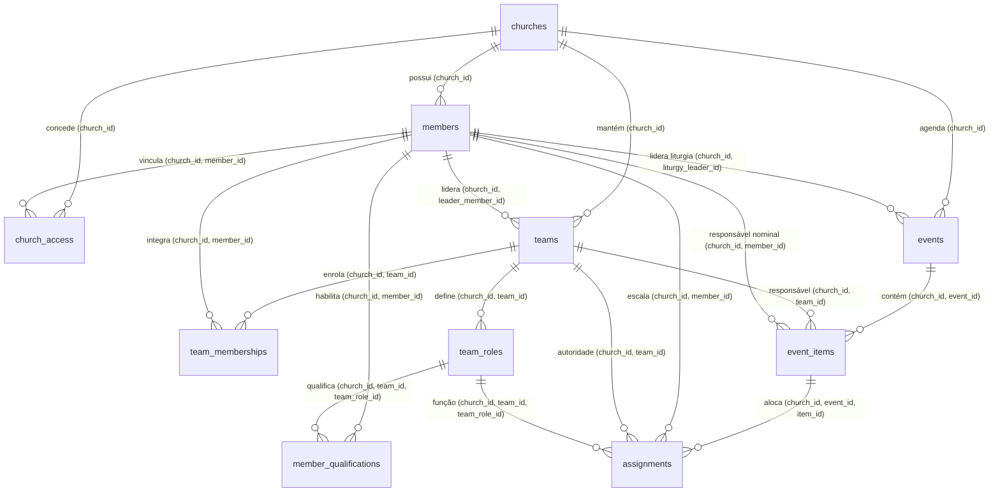
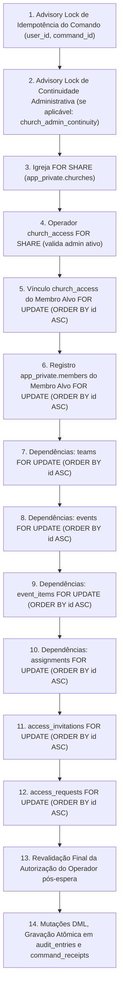

# Contrato Técnico Integrado: Fonte Real de Dependências Litúrgicas, Concorrência e Ciclo Efetivo

- **Data da Versão Integrada:** 16/10/2026
- **Status de Governança:** Desenho Técnico Integrado Corrigido (Bloco 1 — Em Revisão para Implementação)
- **Documentos Normativos de Referência:** `docs/PRD.md`, `docs/ARQUITETURA-BANCO.md`, `docs/CADASTRO-MEMBROS.md`, `docs/CONTRATO-CONVITES-ACESSO.md`, `MATRIZ-ACEITE.md`, `PARECER-CODEX.md`
- **Atendimento de Critérios da Matriz:** `M18-01` e `M18-12` (fundação para `M18-02` a `M18-10`)
- **Limites Estritos do Bloco:** Desenho e contratos revisáveis; sem execução de SQL contra banco físico (laboratório ou piloto), sem alteração de contêineres e sem publicação.

---

## 1. Decisão de Produto Confirmada pelo Responsável em 16/10/2026

> [!IMPORTANT]
> **Regra de Liderança de Ministério Ativo (16/10/2026):**
> O responsável pelo projeto confirmou formalmente que **quem lidera um ministério/equipe ativa só pode ser excluído logicamente após transferir a liderança da equipe para outro membro ativo, mesmo que não existam cultos ou eventos futuros agendados ou em andamento.**
> Uma equipe ativa não pode ficar acéfala nem apontar para membro inativo. A transferência de liderança é uma operação administrativa prévia obrigatória.

---

## 2. Integridade Relacional Composta e Isolamento Multi-Tenant

A integridade do isolamento entre igrejas não pode depender apenas de uma chave simples de `church_id` em cada tabela isolada, pois uma linha poderia declarar `church_id = A` e referenciar chaves estrangeiras de membros, equipes ou eventos pertencentes à `church_id = B`. 

Para garantir **defesa estrutural em profundidade no catálogo do PostgreSQL**, todas as tabelas operacionais em `app_private` utilizam **chaves únicas compostas e chaves estrangeiras compostas obrigatórias**, amarrando estritamente `church_id` e a hierarquia relacional (`item -> evento` e `função -> equipe`):



### 2.1 Esquema DDL Físico em `app_private`

Todas as tabelas possuem `RLS` habilitada, sem privilégios para papéis de conexão (`anon`, `authenticated`, `service_role`).

#### 2.1.1 `app_private.members` (Ajuste de Suporte a FKs Compostas)
- `id` (uuid, PK, default `gen_random_uuid()`)
- `church_id` (uuid, FK `app_private.churches(id)` ON DELETE RESTRICT, NOT NULL)
- `display_name` (text, NOT NULL)
- `status` (text, NOT NULL, default `'active'`, check: `status in ('active', 'inactive')`)
- `created_at` (timestamptz, NOT NULL, default `clock_timestamp()`)
- `updated_at` (timestamptz, NOT NULL, default `clock_timestamp()`)
- **Unicidade Composta para Chave Estrangeira:**
  ```sql
  alter table app_private.members
    add constraint members_church_id_id_key unique (church_id, id);
  ```

#### 2.1.2 `app_private.teams` (Equipes / Ministérios)
- `id` (uuid, PK, default `gen_random_uuid()`)
- `church_id` (uuid, NOT NULL)
- `name` (text, NOT NULL, 1 a 100 caracteres normalizados NFC)
- `leader_member_id` (uuid, NULLABLE — preenchida por membro ativo)
- `status` (text, NOT NULL, default `'active'`, check: `status in ('active', 'inactive')`)
- `created_at` (timestamptz, NOT NULL, default `clock_timestamp()`)
- `updated_at` (timestamptz, NOT NULL, default `clock_timestamp()`)
- **Restrições e FKs Compostas:**
  ```sql
  alter table app_private.teams
    add constraint teams_church_fkey
      foreign key (church_id) references app_private.churches(id) on delete restrict,
    add constraint teams_church_leader_fkey
      foreign key (church_id, leader_member_id) references app_private.members(church_id, id) on delete restrict,
    add constraint teams_church_id_id_key unique (church_id, id),
    add constraint teams_church_name_key unique (church_id, name);

  create index teams_church_leader_active_idx
    on app_private.teams (church_id, leader_member_id)
    where status = 'active' and leader_member_id is not null;
  ```

#### 2.1.3 `app_private.team_memberships` (Vínculo de Pessoas às Equipes)
- `id` (uuid, PK, default `gen_random_uuid()`)
- `church_id` (uuid, NOT NULL)
- `team_id` (uuid, NOT NULL)
- `member_id` (uuid, NOT NULL)
- `status` (text, NOT NULL, default `'active'`, check: `status in ('active', 'inactive')`)
- `created_at` (timestamptz, NOT NULL, default `clock_timestamp()`)
- `updated_at` (timestamptz, NOT NULL, default `clock_timestamp()`)
- **Restrições e FKs Compostas:**
  ```sql
  alter table app_private.team_memberships
    add constraint tm_church_team_fkey
      foreign key (church_id, team_id) references app_private.teams(church_id, id) on delete restrict,
    add constraint tm_church_member_fkey
      foreign key (church_id, member_id) references app_private.members(church_id, id) on delete restrict,
    add constraint tm_church_team_member_key unique (church_id, team_id, member_id);

  create index tm_church_member_active_idx
    on app_private.team_memberships (church_id, member_id)
    where status = 'active';
  ```

#### 2.1.4 `app_private.team_roles` (Funções Técnicas da Equipe)
- `id` (uuid, PK, default `gen_random_uuid()`)
- `church_id` (uuid, NOT NULL)
- `team_id` (uuid, NOT NULL)
- `name` (text, NOT NULL, 1 a 80 caracteres normalizados NFC)
- `classification` (text, NOT NULL, default `'operational'`)
- `status` (text, NOT NULL, default `'active'`, check: `status in ('active', 'inactive')`)
- `created_at` (timestamptz, NOT NULL, default `clock_timestamp()`)
- `updated_at` (timestamptz, NOT NULL, default `clock_timestamp()`)
- **Restrições e FKs Compostas:**
  ```sql
  alter table app_private.team_roles
    add constraint tr_church_team_fkey
      foreign key (church_id, team_id) references app_private.teams(church_id, id) on delete restrict,
    add constraint tr_church_team_id_key unique (church_id, team_id, id),
    add constraint tr_church_team_name_key unique (church_id, team_id, name);
  ```

#### 2.1.5 `app_private.member_qualifications` (Aptidões Homologadas do Membro)
- `id` (uuid, PK, default `gen_random_uuid()`)
- `church_id` (uuid, NOT NULL)
- `member_id` (uuid, NOT NULL)
- `team_id` (uuid, NOT NULL)
- `team_role_id` (uuid, NOT NULL)
- `status` (text, NOT NULL, default `'active'`, check: `status in ('active', 'inactive')`)
- `qualified_by_user_id` (uuid, NOT NULL)
- `created_at` (timestamptz, NOT NULL, default `clock_timestamp()`)
- `updated_at` (timestamptz, NOT NULL, default `clock_timestamp()`)
- **Restrições e FKs Compostas:**
  ```sql
  alter table app_private.member_qualifications
    add constraint mq_church_member_fkey
      foreign key (church_id, member_id) references app_private.members(church_id, id) on delete restrict,
    add constraint mq_church_team_role_fkey
      foreign key (church_id, team_id, team_role_id) references app_private.team_roles(church_id, team_id, id) on delete restrict,
    add constraint mq_church_member_role_key unique (church_id, member_id, team_role_id);
  ```

#### 2.1.6 `app_private.events` (Cultos e Eventos Concretos)
- `id` (uuid, PK, default `gen_random_uuid()`)
- `church_id` (uuid, NOT NULL)
- `title` (text, NOT NULL, 1 a 120 caracteres)
- `event_type` (text, NOT NULL, default `'culto'`, check: `event_type in ('culto', 'ensaio', 'reuniao', 'especial')`)
- `planned_start_at` (timestamptz, NOT NULL)
- `planned_end_at` (timestamptz, NOT NULL)
- `timezone` (text, NOT NULL) -- herdado obrigatoriamente de app_private.churches.timezone
- `liturgy_leader_member_id` (uuid, NULLABLE)
- `status` (text, NOT NULL, default `'scheduled'`, check: `status in ('draft', 'scheduled', 'in_progress', 'completed', 'cancelled')`)
- `real_start_at` (timestamptz, NULLABLE)
- `real_end_at` (timestamptz, NULLABLE)
- `cancel_reason` (text, NULLABLE)
- `version` (integer, NOT NULL, default 1)
- `created_at` (timestamptz, NOT NULL, default `clock_timestamp()`)
- `updated_at` (timestamptz, NOT NULL, default `clock_timestamp()`)
- **Restrições e FKs Compostas:**
  ```sql
  alter table app_private.events
    add constraint events_church_fkey
      foreign key (church_id) references app_private.churches(id) on delete restrict,
    add constraint events_church_liturgy_leader_fkey
      foreign key (church_id, liturgy_leader_member_id) references app_private.members(church_id, id) on delete restrict,
    add constraint events_church_id_id_key unique (church_id, id),
    add constraint events_time_window_check check (planned_end_at > planned_start_at);

  create index events_church_liturgy_leader_active_idx
    on app_private.events (church_id, liturgy_leader_member_id)
    where status in ('draft', 'scheduled', 'in_progress') and liturgy_leader_member_id is not null;
  ```

#### 2.1.7 `app_private.event_items` (Atividades Principais e Serviços Paralelos)
- `id` (uuid, PK, default `gen_random_uuid()`)
- `church_id` (uuid, NOT NULL)
- `event_id` (uuid, NOT NULL)
- `title` (text, NOT NULL, 1 a 120 caracteres)
- `sequence_order` (integer, NOT NULL)
- `item_nature` (text, NOT NULL, default `'main'`, check: `item_nature in ('main', 'parallel')`)
- `planned_duration_seconds` (integer, NOT NULL, default 300, check: `planned_duration_seconds > 0`) -- convenção do PRD em segundos
- `responsible_team_id` (uuid, NULLABLE)
- `nominal_responsible_member_id` (uuid, NULLABLE)
- `status` (text, NOT NULL, default `'pending'`, check: `status in ('pending', 'in_progress', 'completed', 'cancelled')`)
- `real_start_at` (timestamptz, NULLABLE)
- `real_end_at` (timestamptz, NULLABLE)
- `cancel_reason` (text, NULLABLE)
- `version` (integer, NOT NULL, default 1)
- `created_at` (timestamptz, NOT NULL, default `clock_timestamp()`)
- `updated_at` (timestamptz, NOT NULL, default `clock_timestamp()`)
- **Restrições e FKs Compostas:**
  ```sql
  alter table app_private.event_items
    add constraint ei_church_event_fkey
      foreign key (church_id, event_id) references app_private.events(church_id, id) on delete cascade,
    add constraint ei_church_team_fkey
      foreign key (church_id, responsible_team_id) references app_private.teams(church_id, id) on delete restrict,
    add constraint ei_church_nominal_resp_fkey
      foreign key (church_id, nominal_responsible_member_id) references app_private.members(church_id, id) on delete restrict,
    add constraint ei_church_event_id_key unique (church_id, event_id, id);

  create index ei_church_nominal_resp_active_idx
    on app_private.event_items (church_id, nominal_responsible_member_id)
    where status in ('pending', 'in_progress') and nominal_responsible_member_id is not null;
  ```

#### 2.1.8 `app_private.assignments` (Escala Nominal de Voluntários)
- `id` (uuid, PK, default `gen_random_uuid()`)
- `church_id` (uuid, NOT NULL)
- `event_id` (uuid, NOT NULL)
- `item_id` (uuid, NULLABLE — preenchido para atividades de bloco, nulo para apoios contínuos do culto)
- `member_id` (uuid, NOT NULL)
- `team_id` (uuid, NOT NULL)
- `team_role_id` (uuid, NULLABLE)
- `status` (text, NOT NULL, default `'scheduled'`, check: `status in ('scheduled', 'confirmed', 'absent', 'replaced', 'cancelled')`)
  *(Nota: `'confirmed'` indica validação operacional pela liderança da equipe, NÃO aceite eletrônico pelo voluntário).*
- `replaced_assignment_id` (uuid, NULLABLE)
- `notes` (text, NULLABLE)
- `created_at` (timestamptz, NOT NULL, default `clock_timestamp()`)
- `updated_at` (timestamptz, NOT NULL, default `clock_timestamp()`)
- **Restrições e FKs Compostas Estritas:**
  ```sql
  alter table app_private.assignments
    add constraint asg_church_event_fkey
      foreign key (church_id, event_id) references app_private.events(church_id, id) on delete cascade,
    add constraint asg_church_event_item_fkey
      foreign key (church_id, event_id, item_id) references app_private.event_items(church_id, event_id, id) on delete cascade,
    add constraint asg_church_member_fkey
      foreign key (church_id, member_id) references app_private.members(church_id, id) on delete restrict,
    add constraint asg_church_team_fkey
      foreign key (church_id, team_id) references app_private.teams(church_id, id) on delete restrict,
    add constraint asg_church_team_role_fkey
      foreign key (church_id, team_id, team_role_id) references app_private.team_roles(church_id, team_id, id) on delete restrict,
    add constraint asg_church_id_id_key unique (church_id, id),
    add constraint asg_replaced_fkey
      foreign key (church_id, replaced_assignment_id) references app_private.assignments(church_id, id) on delete restrict;

  create index asg_church_member_active_idx
    on app_private.assignments (church_id, member_id, status)
    where status in ('scheduled', 'confirmed');
  ```

### 2.2 Política de Ações de Remoção e Preservação de Histórico
- **Sem Exclusão Física no Produto:** Nenhum endpoint da aplicação realiza `DELETE` físico em tabelas operacionais. Eventos, atividades e escalas concluídas são mantidos permanentemente com `status = 'completed'` ou `'cancelled'`.
- **Chaves Estrangeiras:** O uso de `ON DELETE RESTRICT` nas relações com membros (`members`) impede qualquer remoção acidental de registros que possuam histórico de serviço na igreja.
- **`ON DELETE CASCADE` Restrito a Eventos:** O cascateamento de `event_items` e `assignments` aplica-se exclusivamente se uma fixture de teste ou um evento inteiro for fisicamente expurgado por scripts de manutenção com autorização explícita, nunca no fluxo de vida do membro.

---

## 3. Matriz de Operações, Permissões e Não-Absorção de Papéis

Conforme o PRD e `docs/ARQUITETURA-BANCO.md`, os papéis operacionais operam em separação estrita:

| Operação | Admin da Igreja (`is_admin = true`) | Líder da Equipe / Ministério | Líder da Liturgia do Culto | Membro |
| :--- | :--- | :--- | :--- | :--- |
| **Cadastrar / Inativar Membro** | **Sim** (valida dependências) | Não | Não | Não |
| **Criar Equipe / Designar Líder de Equipe** | **Sim** | Não | Não | Não |
| **Criar Evento / Designar Liturgia** | **Sim** | Conforme escopo planejado | Não | Não |
| **Alocar Voluntário Inicialmente** | **Não** (respeita liderança da equipe) | **Sim** (na sua equipe) | Não | Não |
| **Substituição de Voluntário Pré-Atividade** | **Não** | **Sim** (antes de a atividade iniciar) | Não | Não |
| **Substituição Emergencial em Execução** | **Não** | Não | **Sim** (durante atividade/culto) | Não |
| **Iniciar / Encerrar Atividades e Culto** | **Não** | Não | **Sim** | Não |
| **Consultar Cronograma Macro** | **Sim** (visão geral) | **Sim** (visão geral) | **Sim** (visão geral) | **Sim** (visão geral) |
| **Consultar Bastidores / Fichas Privadas** | Não (salvo se tiver papel na equipe) | **Sim** (somente do seu ministério) | **Sim** (de todo o culto ativo) | Não |

> [!IMPORTANT]
> **Fronteira Temporal de Substituição por Papel:**
> - O **Líder de Equipe** pode alocar, substituir ou retirar voluntários da sua equipe **até o instante imediatamente anterior ao início real daquela atividade específica** (`event_items.status = 'pending'`), mesmo que o culto como um todo já tenha começado (`events.status = 'in_progress'`). Para serviços paralelos contínuos (Som, Transmissão), a fronteira é o início real do culto.
> - A partir do momento em que a atividade ou culto entra em execução física (`status = 'in_progress'`), a autoridade sobre substituições de emergência transfere-se com exclusividade para o **Líder da Liturgia**, que comanda o evento em tempo real.

---

## 4. Tabela de Cobertura Operacional da Fonte Real de Dependências

A tabela abaixo mapeia cada dependência impeditiva da exclusão, seu ponto de escrita autorizado, consulta no produto, estratégia de lock, predicado de bloqueio e critério de aceite:

| Origem da Dependência | Comando Autorizado de Manutenção | Consulta Usada no Produto | Bloqueio Transacional | Predicado de Exclusão (Bloqueia se...) | Critério de Aceite / Erro |
| :--- | :--- | :--- | :--- | :--- | :--- |
| **Liderança de Ministério Ativo** | `assign_team_leader(p_church_id, p_team_id, p_new_leader_id)` | `list_church_teams(p_church_id)` | `teams` FOR UPDATE | `exists (select 1 from teams where church_id = c and leader_member_id = m and status = 'active')` | **`P0022`** — Recusa mesmo sem culto agendado (decisão de 16/10/2026). Aceite: M18-12. |
| **Liderança da Liturgia** | `assign_event_liturgy_leader(p_church_id, p_event_id, p_new_liturgy_id)` | `get_event_schedule(p_church_id, p_event_id)` | `events` FOR UPDATE | `exists (select 1 from events where church_id = c and liturgy_leader_member_id = m and status in ('draft','scheduled','in_progress'))` | **`P0023`** — Recusa enquanto o evento não for encerrado ou liderança alterada. Aceite: M18-12. |
| **Responsabilidade Nominal por Atividade** | `assign_nominal_responsible(p_church_id, p_event_id, p_item_id, p_member_id)` | `get_event_schedule_details(p_church_id, p_event_id)` | `event_items` FOR UPDATE | `exists (select 1 from event_items ei join events e on e.id = ei.event_id where ei.church_id = c and ei.nominal_responsible_member_id = m and ei.status in ('pending','in_progress') and e.status in ('draft','scheduled','in_progress'))` | **`P0024`** — Recusa enquanto a atividade e o culto estiverem ativos. Aceite: M18-12. |
| **Escala Nominal Ativa (Assignment)** | `assign_event_participant(...)` / `replace_event_participant(...)` | `get_my_assignments(p_church_id)` / `get_team_roster(...)` | `assignments` FOR UPDATE | `exists (select 1 from assignments a join events e on e.id = a.event_id where a.church_id = c and a.member_id = m and a.status in ('scheduled','confirmed') and e.status in ('draft','scheduled','in_progress'))` | **`P0024`** — Recusa enquanto houver alocação ativa em evento não encerrado. Histórico concluído NÃO bloqueia. Aceite: M18-12. |
| **Evento Expirado sem Encerramento Conclusivo** | `finish_event_service(p_church_id, p_event_id)` / `cancel_church_event(...)` | `list_church_events(p_church_id)` | `events` FOR UPDATE | `exists (select 1 from events e join assignments a on a.event_id = e.id where a.church_id = c and a.member_id = m and a.status in ('scheduled','confirmed') and e.status in ('scheduled','in_progress') and e.planned_end_at < clock_timestamp())` | **`P0025`** — Recusa por estado inconclusivo; relógio não encerra evento. Exige encerramento formal. Aceite: M18-12. |
| **Último Administrador Ativo** | `grant_admin_access(...)` / `create_my_church(...)` | `get_my_church_access()` | Advisory `church_admin_continuity` + `church_access` FOR UPDATE | `not exists (select 1 from church_access ca where ca.church_id = c and ca.is_admin = true and ca.status = 'active' and ca.member_id <> m)` | **`P0015`** — Proteção de continuidade administrativa. Gatilhos preservados. Aceite: M18-06. |
| **Autoexclusão** | *Nenhum (vedada)* | Contexto Auth da sessão | Verificação inline `auth.uid()` | `exists (select 1 from church_access ca where ca.church_id = c and ca.member_id = m and ca.user_id = auth.uid())` | **`P0016`** — Operador não pode inativar a si mesmo. Aceite: M18-05. |
| **Convites Abertos e Solicitações Pendentes** | `issue_church_invitation(...)` / `decide_access_request(...)` | `list_church_invitations(p_church_id)` | `access_invitations` FOR UPDATE, `access_requests` FOR UPDATE | `exists (select 1 from access_invitations where church_id = c and member_id = m and redeemed_at is null and revoked_at is null)` | Convites abertos são invalidados (`revoked_at`). Solicitações `pending` **não expiradas** são canceladas (`status = 'cancelled'`); solicitações já vencidas mantêm sua semântica temporal histórica. Aceite: M18-03. |

---

## 5. Plano Global de Bloqueios e Eliminação de Deadlocks

### 5.1 Eliminação do Ciclo de Concorrência com `013`
O script aprovado `013_member_lifecycle.sql` (na RPC `restore_church_member`) adquire locks na ordem:
1. `app_private.church_access` `FOR UPDATE`
2. `app_private.members` `FOR UPDATE`

Para eliminar qualquer possibilidade de ciclo de deadlock entre restaurações e exclusões concorrentes, o novo contrato **adota rigorosamente a mesma ordem canônica de 013**, travando o acesso antes do registro de membro, complementado pela serialização de continuidade administrativa e ordenação determinística de múltiplas linhas:



### 5.2 Tabela de Ordem de Bloqueios por Operação

| Script / Operação | Advisory Lock | Tabelas em Modo Compartilhado (`FOR SHARE`) | Tabelas em Modo Exclusivo (`FOR UPDATE`) — Ordem Rígida |
| :--- | :--- | :--- | :--- |
| **007: `create_church_member`** | `create_church_member_quota` (user) | `churches`, `church_access` (operador) | *(Nenhum lock de linha prévia; inserção atômica)* |
| **009: `create_my_church`** | `church_admin_continuity` (user) | `auth.users` | *(Criação atômica de igreja, membro, acesso admin e auditoria)* |
| **011: `issue_church_invitation`** | *(user, command)* | `churches`, `church_access` (operador) | `members` (alvo), `access_invitations` (alvo) |
| **011: `accept_invitation_*`** | *(user, command)* | `churches` | `members` (alvo), `access_invitations`, `access_requests` |
| **013: `restore_church_member`** | `(user, command)` | *(auth.users)* | `church_access` (alvo) $\rightarrow$ `members` (alvo) |
| **015: `assign_event_participant`** | `(user, command)` | `churches`, `church_access` (operador) | `events` (alvo) $\rightarrow$ `event_items` $\rightarrow$ `members` (candidato `FOR SHARE`) $\rightarrow$ `assignments` |
| **015: `replace_event_participant`** | `(user, command)` | `churches`, `church_access` (operador) | `events` $\rightarrow$ `event_items` $\rightarrow$ `members` (ordenado por id: `M_old` e `M_new`) $\rightarrow$ `assignments` |
| **016: `deactivate_church_member`** | `(user, command)` + `church_admin_continuity` | `churches`, `church_access` (operador) | `church_access` (alvo) $\rightarrow$ `members` (alvo) $\rightarrow$ `teams` $\rightarrow$ `events` $\rightarrow$ `event_items` $\rightarrow$ `assignments` $\rightarrow$ `invitations` $\rightarrow$ `requests` |

### 5.3 Entrelaçamentos e Análise Determinística de Corridas
*Nota Metodológica: O comportamento abaixo constitui a **garantia pretendida no desenho** arquitetural. A comprovação física definitiva de imunidade contra deadlocks e serialização requer ensaio físico em duas conexões sob PostgreSQL.*

1. **Disputa Exclusão vs. Restauração (Mesmo Membro):**
   - Ambas as operações adquirem `church_access` `FOR UPDATE` antes de `members` `FOR UPDATE`.
   - Se a Restauração adquirir o lock primeiro: O membro torna-se `active`. A Exclusão aguarda no lock de `church_access`. Ao ser liberada, a Exclusão reavalia o membro e a revisão `expected_updated_at`, detectando divergência de versão e rejeitando com `P0019`.
   - Se a Exclusão adquirir o lock primeiro: O membro torna-se `inactive` e o acesso `revoked`. A Restauração aguarda no lock. Ao ser liberada, a Restauração reavalia `expected_updated_at` (ou estado) e rejeita com `P0019` sem causar deadlock.
2. **Disputa Exclusão vs. Nova Alocação em Escala:**
   - A Exclusão bloqueia `members` do voluntário `FOR UPDATE`.
   - A Alocação (`assign_event_participant`) avalia se o membro está elegível e adquire `members` `FOR SHARE`.
   - Se a Exclusão rodar antes: A alocação aguarda. Quando liberada, lê `members.status = 'inactive'` e rejeita com `P0002` ("Membro inativo não pode ser escalado").
   - Se a Alocação rodar antes: O assignment é inserido e comitado. Quando a Exclusão prossegue, seu SELECT nas tabelas de dependência (`assignments` ativas em eventos não encerrados) localiza a alocação recém-criada e aborta a transação com `P0024`.
3. **Disputa Exclusão de Membro vs. Revogação de Acesso do Operador:**
   - A Exclusão revalida a elegibilidade administrativa do operador no início (`church_access` `FOR SHARE`) e **obrigatoriamente repete a checagem no instante final pós-espera de todos os locks**. Se o operador perdeu o papel admin enquanto aguardava os locks, a operação é abortada no servidor com `42501`.

---

## 6. Tratamento Temporal de Solicitações e Histórico

### 6.1 Preservação da Semântica Temporal de Solicitações de Acesso
Ao inativar um membro, as solicitações vinculadas em `app_private.access_requests` são tratadas respeitando estritamente seu estado no relógio:
- Solicitações com `status = 'pending'` cujo prazo de validade expirou (`expires_at <= clock_timestamp()`) **não são transformadas em canceladas**; elas permanecem registradas com seu encerramento temporal de expiração.
- Apenas solicitações com `status = 'pending'` ainda dentro da validade (`expires_at > clock_timestamp()`) são canceladas administrativamente (`status = 'cancelled'`).

---

## 7. Sequência Versionada de Incrementos SQL e Plano de Cliente

O instalador canônico `docs/sql/013_member_lifecycle.sql` permanece intacto com seu hash canônico preservado (`40709A4FE9FEB...`). A implementação das dependências reais e da exclusão efetiva ocorre em incrementos versionados novos:

1. **Incremento 015: Estrutura e RPCs Litúrgicas (`015_liturgical_dependencies.sql`)**
   - Criação física de `teams`, `team_memberships`, `team_roles`, `member_qualifications`, `events`, `event_items` e `assignments` com as chaves compostas deste contrato.
   - Triggers monotônicos de `updated_at`.
   - Endpoints públicos com privilégios mínimos: `create_church_team`, `assign_team_leader`, `create_church_event`, `assign_event_liturgy_leader`, `assign_event_participant`, `replace_event_participant`, `finish_event_service`.
   - Acompanhado de `015_preflight_*.sql`, `015_validate_*.sql` (ensaio transacional com ROLLBACK) e `015_verify_*.sql`.
2. **Incremento 016: Exclusão Efetiva e Fechamento Integral (`016_member_lifecycle_effective.sql`)**
   - Substituição de `public.deactivate_church_member` pela implementação que consulta as tabelas de 015, executando a ordem de bloqueio compatível deste contrato e retornando os códigos padronizados:
     - `P0015`: Último administrador.
     - `P0016`: Autoexclusão recusada.
     - `P0018`: Restauração com vínculo ativo legado.
     - `P0019`: Divergência de revisão concorrente (`expected_updated_at`).
     - `P0022`: Líder de ministério ativo.
     - `P0023`: Líder da liturgia em evento ativo.
     - `P0024`: Alocação ou responsabilidade nominal em evento ativo.
     - `P0025`: Evento expirado sem encerramento formal.
   - Acompanhado de `016_preflight_*.sql`, `016_validate_*.sql` e `016_verify_*.sql`.
3. **Plano de Atualização do Cliente Web:**
   - Mapeamento explícito dos novos códigos em `src/utils/memberErrors.js`.
   - Adaptação do modal de exclusão em `src/components/MembersPage.jsx` para apresentar orientações claras (ex.: indicar o ministério ou evento impeditivo).
   - Preservação da lógica resiliente de retenção no `sessionStorage` e recuperação por recibo.

---

## 8. Questões de Produto Identificadas para Decisão Prévia

Nenhuma regra faltante impede o início da modelagem do Bloco 2. As decisões críticas de domínio foram consolidadas:
- [x] Liderança de ministério ativo bloqueia exclusão logicamente (confirmado em 16/10/2026).
- [x] Eventos concluídos/cancelados não bloqueiam exclusão e preservam histórico.
- [x] Passagem do relógio não encerra culto automaticamente (bloqueio preventivo preservado).
- [x] Sem aceite eletrônico em alocações nominais.
- [x] Restauração reativa cadastro sem devolver acessos revogados ou liderança.
