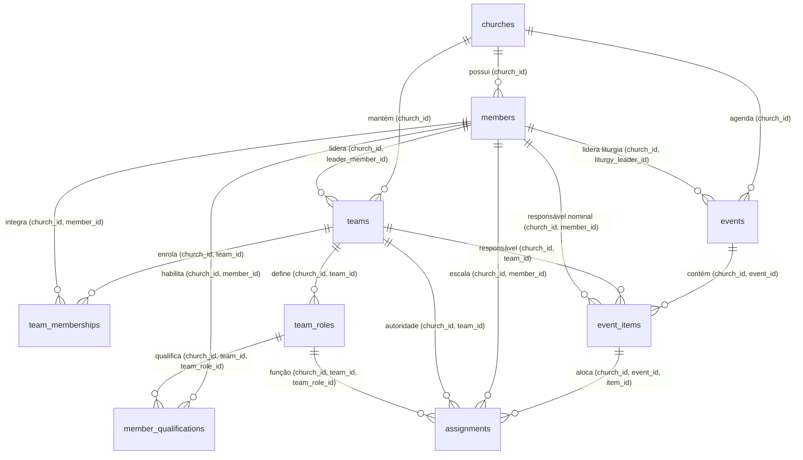

# Contrato Técnico Integrado: Fonte Real de Dependências Litúrgicas, Concorrência e Ciclo Efetivo

- **Data da Versão Integrada:** 16/10/2026
- **Status de Governança:** Desenho Técnico e Contrato Operacional do Bloco 2 (Implementação Local)
- **Documentos Normativos de Referência:** `docs/PRD.md`, `docs/ARQUITETURA-BANCO.md`, `docs/CADASTRO-MEMBROS.md`, `docs/CONTRATO-CONVITES-ACESSO.md`, `MATRIZ-ACEITE.md`, `PARECER-CODEX.md`, `DECISAO-REVISAO.md`
- **Atendimento de Critérios da Matriz:** `M18-01`, `M18-05`, `M18-06`, `M18-07`, `M18-10`, `M18-12`
- **Limites Estritos do Bloco:** Implementação local em código e scripts versionados; sem execução de SQL contra banco físico (laboratório ou piloto), sem alteração de contêineres e sem publicação.

---

## 1. Decisões de Produto Confirmadas pelo Responsável em 16/10/2026

1. **Regra de Liderança de Ministério Ativo:**
   - **Quem lidera um ministério/equipe ativa só pode ser excluído logicamente após transferir a liderança da equipe para outro membro ativo, mesmo que não existam cultos ou eventos futuros agendados ou em andamento.**
   - Uma equipe ativa não pode ficar acéfala nem apontar para membro inativo. A transferência de liderança é uma operação administrativa prévia obrigatória (`P0022`).
2. **Autorização para Criação de Eventos/Cultos:**
   - **Administradores e Líderes de Ministério Ativos podem criar cultos/eventos na própria igreja**, com autorização conferida no servidor via `church_access` (admin) ou `teams` (líder de equipe ativa).
   - **A designação e a troca da liderança da liturgia permanecem exclusivas do Administrador.**
   - O comando de criação (`create_church_event`), quando invocado por Líder de Ministério, **não aceita parâmetro de liturgia** (ou exige que seja nulo). Criar o evento não concede ao criador a liderança da liturgia ou o controle da condução do culto.
   - **A condução do culto e controle do cronômetro permanecem exclusivos do Líder da Liturgia designado.**

---

## 2. Estratégia Comum de Concorrência e Eliminação Global de Ciclos (Anti-Deadlock)

### 2.1 Análise e Resolução do Ciclo entre Escritores
Conforme apontado na revisão técnica, se a exclusão bloquear `members` antes de `events`, e a alocação de participantes bloquear `events` antes de `members`, duas transações concorrentes causam deadlock:
- *Transação A (Exclusão):* Adquire lock em `members` do voluntário M e tenta inspecionar/bloquear `events` E onde ele está escalado.
- *Transação B (Alocação):* Adquire lock em `events` E e tenta validar/bloquear `members` M para nova escala.

Para eliminar esse ciclo de forma estrutural e determinística em todos os escritores do sistema, define-se uma **Ordem Canônica Global Única de Tabelas**:

$$\text{church\_access} \longrightarrow \text{members} \longrightarrow \text{teams} \longrightarrow \text{team\_memberships} \longrightarrow \text{member\_qualifications} \longrightarrow \text{events} \longrightarrow \text{event\_items} \longrightarrow \text{assignments} \longrightarrow \text{access\_invitations} \longrightarrow \text{access\_requests}$$

### 2.2 Regras Estritas de Bloqueio Compartilhadas por Todas as RPCs

1. **Prioridade de `members` sobre `events`:**
   - Toda e qualquer operação que envolva membros e eventos (inclusive criação de alocação `assign_event_participant`, substituição `replace_event_participant` e exclusão `deactivate_church_member`) **adquire os locks dos membros candidatos/envolvidos ANTES de adquirir os locks do evento e dos itens**.
2. **Ordenação Determinística de Múltiplas Linhas (`ORDER BY id ASC`):**
   - Quando uma transação bloqueia mais de uma linha da mesma tabela (ex.: substituição envolvendo membro substituído $M_1$ e membro substituto $M_2$), as linhas são ordenadas obrigatoriamente por `id ASC`:
     ```sql
     perform 1 from app_private.members m
     where m.church_id = p_church_id and m.id in (p_old_member_id, p_new_member_id)
     order by m.id asc
     for share; -- ou for update
     ```
3. **Mecanismos de Advisory Locks Distintos (de 007 e 009):**
   - `pg_advisory_xact_lock(hashtext('create_church_member_quota'), hashtext(v_user_id::text))`: Quota de criação de membros por usuário (007).
   - `pg_advisory_xact_lock(hashtext('create_my_church_quota'), hashtext(v_user_id::text))`: Quota de criação de igreja por conta Auth (009).
   - `pg_advisory_xact_lock(hashtext('church_admin_continuity'), hashtext(v_church_id::text))`: Proteção contra corridas de destituição simultânea do último administrador de uma igreja (gatilhos de 009 e mutações administrativas em 016).
   - `pg_advisory_xact_lock(hashtext(v_user_id::text), hashtext(p_command_id::text))`: Serialização de idempotência e resposta perdida por comando individual.

### 2.3 Tabela de Ordem de Bloqueios de Todas as Operações

| Operação | Advisory Lock | Modo Compartilhado (`FOR SHARE`) | Modo Exclusivo (`FOR UPDATE`) — Ordem Global Fixa |
| :--- | :--- | :--- | :--- |
| **`restore_church_member` (013)** | `(user, command)` | *(auth.users)* | `church_access` (alvo) $\rightarrow$ `members` (alvo) |
| **`deactivate_church_member` (016)** | `(user, command)` + `church_admin_continuity` (se admin) | `churches`, `church_access` (operador) | `church_access` (alvo) $\rightarrow$ `members` (alvo) $\rightarrow$ `teams` $\rightarrow$ `events` $\rightarrow$ `event_items` $\rightarrow$ `assignments` $\rightarrow$ `invitations` $\rightarrow$ `requests` |
| **`create_church_team` (015)** | `(user, command)` | `churches`, `church_access` (operador), `members` (se líder indicado, `FOR SHARE`) | *(Inserção atômica em teams)* |
| **`assign_team_leader` (015)** | `(user, command)` | `churches`, `church_access` (operador) | `members` (novo líder `FOR SHARE` ou `FOR UPDATE`) $\rightarrow$ `teams` (alvo `FOR UPDATE`) |
| **`create_church_event` (015)** | `(user, command)` | `churches`, `church_access` (operador ou líder), `members` (se liturgia indicada, `FOR SHARE`) | *(Inserção atômica em events)* |
| **`assign_event_liturgy_leader` (015)**| `(user, command)` | `churches`, `church_access` (operador) | `members` (nova liturgia `FOR SHARE`) $\rightarrow$ `events` (alvo `FOR UPDATE`) |
| **`assign_event_participant` (015)** | `(user, command)` | `churches`, `church_access` (operador) | `members` (voluntário `FOR SHARE`) $\rightarrow$ `teams` (`FOR SHARE`) $\rightarrow$ `events` (`FOR UPDATE`) $\rightarrow$ `event_items` (`FOR UPDATE`) $\rightarrow$ *(insert assignments)* |
| **`replace_event_participant` (015)**| `(user, command)` | `churches`, `church_access` (operador) | `members` (`ORDER BY id ASC`: M_atual e M_novo `FOR SHARE`) $\rightarrow$ `teams` $\rightarrow$ `events` $\rightarrow$ `event_items` $\rightarrow$ `assignments` (`FOR UPDATE`) |

### 2.4 Entrelaçamentos Analisados e Resultados Determinísticos

1. **Corrida: Exclusão de Membro M vs. Alocação de Membro M em Evento E:**
   - Como ambas as operações bloqueiam `members` antes de `events`:
     - *Cenário 1 (Exclusão adquire M primeiro):* A Alocação tenta travar M `FOR SHARE` e aguarda. A Exclusão torna M inativo (`status = 'inactive'`) e comita. A Alocação é liberada, lê M inativo e recusa imediatamente com `P0002` ("Membro inativo não pode ser escalado").
     - *Cenário 2 (Alocação adquire M primeiro):* A Alocação adquire M `FOR SHARE`, depois adquire E `FOR UPDATE`, cria a alocação e comita. A Exclusão, que aguardava pelo lock de M, é liberada, adquire M `FOR UPDATE`, inspeciona `assignments` ativas de M no evento E (que agora existe) e recusa a exclusão com `P0024`.
   - **Resultado:** Zero deadlocks e zero estados inconsistentes.

---

## 3. Integridade Relacional Composta Multi-Tenant em `app_private`

Reaproveitando a constraint composta `members_church_id_id_unique` já instalada no incremento `001_initial_access_structure.sql`, todas as novas tabelas operacionais em `app_private` amarram `church_id` e suas dependências hierárquicas:



- **`app_private.teams`:**
  - `(church_id, id)` UNIQUE.
  - `FOREIGN KEY (church_id, leader_member_id) REFERENCES app_private.members(church_id, id) ON DELETE RESTRICT`.
- **`app_private.team_memberships`:**
  - `FOREIGN KEY (church_id, team_id) REFERENCES app_private.teams(church_id, id) ON DELETE RESTRICT`.
  - `FOREIGN KEY (church_id, member_id) REFERENCES app_private.members(church_id, id) ON DELETE RESTRICT`.
  - `UNIQUE (church_id, team_id, member_id)`.
- **`app_private.team_roles`:**
  - `(church_id, team_id, id)` UNIQUE.
  - `FOREIGN KEY (church_id, team_id) REFERENCES app_private.teams(church_id, id) ON DELETE RESTRICT`.
  - `UNIQUE (church_id, team_id, name)`.
- **`app_private.member_qualifications`:**
  - `FOREIGN KEY (church_id, member_id) REFERENCES app_private.members(church_id, id) ON DELETE RESTRICT`.
  - `FOREIGN KEY (church_id, team_id, team_role_id) REFERENCES app_private.team_roles(church_id, team_id, id) ON DELETE RESTRICT`.
  - `UNIQUE (church_id, member_id, team_role_id)`.
- **`app_private.events`:**
  - `(church_id, id)` UNIQUE.
  - `timezone text not null` (herdado de `churches.timezone`).
  - `FOREIGN KEY (church_id, liturgy_leader_member_id) REFERENCES app_private.members(church_id, id) ON DELETE RESTRICT`.
- **`app_private.event_items`:**
  - `(church_id, event_id, id)` UNIQUE.
  - `planned_duration_seconds integer not null default 300 check (planned_duration_seconds > 0)`.
  - `FOREIGN KEY (church_id, event_id) REFERENCES app_private.events(church_id, id) ON DELETE CASCADE`.
  - `FOREIGN KEY (church_id, responsible_team_id) REFERENCES app_private.teams(church_id, id) ON DELETE RESTRICT`.
  - `FOREIGN KEY (church_id, nominal_responsible_member_id) REFERENCES app_private.members(church_id, id) ON DELETE RESTRICT`.
- **`app_private.assignments`:**
  - `FOREIGN KEY (church_id, event_id) REFERENCES app_private.events(church_id, id) ON DELETE CASCADE`.
  - `FOREIGN KEY (church_id, event_id, item_id) REFERENCES app_private.event_items(church_id, event_id, id) ON DELETE CASCADE`.
  - `FOREIGN KEY (church_id, member_id) REFERENCES app_private.members(church_id, id) ON DELETE RESTRICT`.
  - `FOREIGN KEY (church_id, team_id) REFERENCES app_private.teams(church_id, id) ON DELETE RESTRICT`.
  - `FOREIGN KEY (church_id, team_id, team_role_id) REFERENCES app_private.team_roles(church_id, team_id, id) ON DELETE RESTRICT`.

---

## 4. Contratos Operacionais das RPCs Públicas do Incremento 015

Todas as funções são qualificadas em `public`, `security definer`, `set search_path = ''`, `set statement_timeout = '5s'`, acessíveis com exclusividade pelo papel `authenticated`.

### 4.1 Gestão de Equipes e Integrantes

1. `public.create_church_team(p_church_id uuid, p_command_id uuid, p_name text, p_leader_member_id uuid)`
   - **Autorização:** Administrador ativo da igreja (`42501`).
   - **Validações:** Nome 1 a 100 caracteres NFC; se `p_leader_member_id` informado, deve ser membro ativo da mesma igreja.
   - **Retorno:** JSONB com `team_id`, `name`, `leader_member_id`, `status`.
2. `public.assign_team_leader(p_church_id uuid, p_command_id uuid, p_team_id uuid, p_expected_version integer, p_new_leader_member_id uuid)`
   - **Autorização:** Administrador ativo da igreja (`42501`).
   - **Validações:** Validação de versão otimista; `p_new_leader_member_id` deve ser membro ativo.
3. `public.add_team_member(p_church_id uuid, p_command_id uuid, p_team_id uuid, p_member_id uuid)`
   - **Autorização:** Administrador ativo OU Líder daquela equipe (`42501`).
   - **Validações:** Membro ativo; insere em `team_memberships`.
4. `public.remove_team_member(p_church_id uuid, p_command_id uuid, p_team_id uuid, p_member_id uuid)`
   - **Autorização:** Administrador ativo OU Líder daquela equipe (`42501`).
5. `public.list_church_teams(p_church_id uuid)`
   - **Autorização:** Qualquer membro ativo com acesso à igreja.
   - **Retorno:** Lista de equipes com líder atual e contagem de integrantes.

### 4.2 Funções e Aptidões (Qualificações)

1. `public.create_team_role(p_church_id uuid, p_command_id uuid, p_team_id uuid, p_name text, p_classification text)`
   - **Autorização:** Administrador ativo OU Líder daquela equipe (`42501`).
2. `public.grant_member_qualification(p_church_id uuid, p_command_id uuid, p_member_id uuid, p_team_id uuid, p_team_role_id uuid)`
   - **Autorização:** Administrador ativo OU Líder daquela equipe (`42501`).
   - **Validações:** Valida que o membro é integrante da equipe (`team_memberships`) e registra a habilitação em `member_qualifications`.
3. `public.revoke_member_qualification(p_church_id uuid, p_command_id uuid, p_member_id uuid, p_team_id uuid, p_team_role_id uuid)`
   - **Autorização:** Administrador ativo OU Líder daquela equipe (`42501`).

### 4.3 Gestão de Eventos, Cultos e Liturgia

1. `public.create_church_event(p_church_id uuid, p_command_id uuid, p_title text, p_event_type text, p_planned_start_at timestamptz, p_planned_end_at timestamptz, p_liturgy_leader_member_id uuid)`
   - **Autorização:** Administrador ativo OU Líder de Equipe ativa na igreja (`42501`).
   - **Regra Estrita de Liturgia:** Se o operador for Líder de Equipe (não-admin), `p_liturgy_leader_member_id` DEVE ser nulo (rejeita com `42501` se tentar designar). Se for Admin, pode designar membro ativo como liturgia.
   - **Timezone:** Herdado de `app_private.churches.timezone`.
2. `public.assign_event_liturgy_leader(p_church_id uuid, p_command_id uuid, p_event_id uuid, p_expected_version integer, p_new_liturgy_id uuid)`
   - **Autorização:** Exclusivo Administrador ativo (`42501`).
3. `public.start_event_service(p_church_id uuid, p_command_id uuid, p_event_id uuid, p_expected_version integer)`
   - **Autorização:** Líder da Liturgia daquele evento (`42501`). Altera status para `'in_progress'`.
4. `public.finish_event_service(p_church_id uuid, p_command_id uuid, p_event_id uuid, p_expected_version integer)`
   - **Autorização:** Líder da Liturgia daquele evento (`42501`). Altera status para `'completed'`.
5. `public.cancel_church_event(p_church_id uuid, p_command_id uuid, p_event_id uuid, p_expected_version integer, p_cancel_reason text)`
   - **Autorização:** Líder da Liturgia daquele evento OU Administrador (`42501`).

### 4.4 Alocação e Substituição de Voluntários

1. `public.assign_event_participant(p_church_id uuid, p_command_id uuid, p_event_id uuid, p_item_id uuid, p_team_id uuid, p_member_id uuid, p_team_role_id uuid, p_notes text)`
   - **Autorização:** Líder da Equipe `p_team_id` (`42501`).
   - **Validações:** Membro ativo; possui qualificação ativa em `member_qualifications` para a função; evento não concluído.
   - **Ordem de Locks:** `members` `FOR SHARE` $\rightarrow$ `teams` `FOR SHARE` $\rightarrow$ `events` `FOR UPDATE` $\rightarrow$ `event_items` `FOR UPDATE` $\rightarrow$ insert `assignments`.
2. `public.replace_event_participant(p_church_id uuid, p_command_id uuid, p_assignment_id uuid, p_replacement_member_id uuid, p_reason text)`
   - **Fronteira Temporal de Autorização:**
     - Se o item ou culto ainda não iniciou (`event_items.status = 'pending'`): Autorizado ao **Líder da Equipe**.
     - Se o item ou culto já iniciou (`event_items.status = 'in_progress'`): Autorizado com exclusividade ao **Líder da Liturgia do evento** (substituição emergencial PRD 7).
   - **Validações:** Substituto é membro ativo e qualificado; marca assignment anterior como `'replaced'` com referência a `replaced_assignment_id`.
   - **Ordem de Locks:** `members` (`ORDER BY id ASC` entre antigo e novo) $\rightarrow$ `teams` $\rightarrow$ `events` $\rightarrow$ `event_items` $\rightarrow$ `assignments`.
