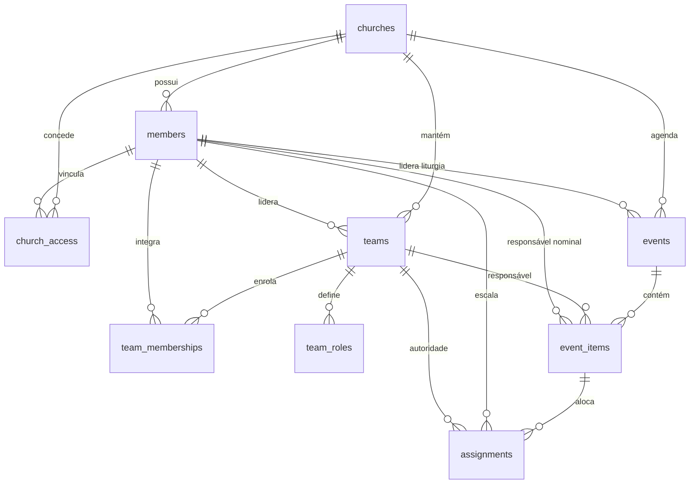
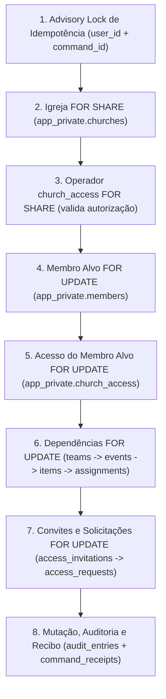

# Contrato Técnico e Desenho Implementável: Fonte Real de Dependências Litúrgicas e Ciclo Efetivo

- **Data:** 16/10/2026
- **Status:** Desenho Técnico Aprovado para Execução (Bloco 1)
- **Documento Normativo de Governança:** `PROMPT-EXECUCAO-ANTIGRAVITY.md` e `MATRIZ-ACEITE.md`
- **Atendimento de Critérios da Matriz:** `M18-01` e `M18-12` (fundação para `M18-02` a `M18-10`)
- **Limites Observados:** Desenho local puro; sem execução SQL contra banco de dados, sem alteração de contêineres e sem publicação.

---

## 1. Modelo Lógico e Físico da Fonte Real de Dependências

Para que o encerramento da issue #18 ocorra com verificação real e íntegra (eliminando a trava provisória `P0021` de forma autoritativa e sem criar cadastros paralelos de "impedimentos"), as entidades operacionais previstas no PRD e em `docs/ARQUITETURA-BANCO.md` são formalizadas em esquema físico dentro de `app_private`.

Todas as tabelas compartilham:
- Chave estrangeira estrita para `app_private.churches(id)` com `ON DELETE RESTRICT`, garantindo isolamento absoluto entre igrejas.
- RLS habilitada em `app_private`, sem concessão de privilégios diretos a papéis de conexão (`anon`, `authenticated`, `service_role`).
- Atualização monotônica rastreável de `updated_at`.



### 1.1 Entidades Estruturais

#### 1.1.1 Equipes / Ministérios: `app_private.teams`
Representa o cadastro institucional das equipes de serviço (ex.: Louvor, Sonoplastia, Mídia, Liturgia, Portaria).
- `id` (uuid, PK, default `gen_random_uuid()`)
- `church_id` (uuid, FK `app_private.churches(id)`, NOT NULL)
- `name` (text, NOT NULL, 1 a 100 caracteres normalizados)
- `leader_member_id` (uuid, FK `app_private.members(id)`, NULLABLE — pode estar vaga, mas quando preenchida aponta para membro ativo)
- `status` (text, NOT NULL, default `'active'`, check: `status in ('active', 'inactive')`)
- `created_at` (timestamptz, NOT NULL, default `clock_timestamp()`)
- `updated_at` (timestamptz, NOT NULL, default `clock_timestamp()`)
- **Restrição de Unicidade:** `UNIQUE (church_id, name)`
- **Índice de Bloqueio Rápido:**
  ```sql
  create index teams_church_leader_active_idx
    on app_private.teams (church_id, leader_member_id)
    where status = 'active' and leader_member_id is not null;
  ```

#### 1.1.2 Membros da Equipe: `app_private.team_memberships`
Cadastro de vinculação de pessoas ao rol de uma equipe.
- `id` (uuid, PK, default `gen_random_uuid()`)
- `church_id` (uuid, FK `app_private.churches(id)`, NOT NULL)
- `team_id` (uuid, FK `app_private.teams(id)`, NOT NULL)
- `member_id` (uuid, FK `app_private.members(id)`, NOT NULL)
- `status` (text, NOT NULL, default `'active'`, check: `status in ('active', 'inactive')`)
- `created_at` (timestamptz, NOT NULL, default `clock_timestamp()`)
- `updated_at` (timestamptz, NOT NULL, default `clock_timestamp()`)
- **Restrição de Unicidade:** `UNIQUE (church_id, team_id, member_id)`
- **Índice Operacional:**
  ```sql
  create index team_memberships_member_active_idx
    on app_private.team_memberships (church_id, member_id)
    where status = 'active';
  ```

#### 1.1.3 Funções da Equipe: `app_private.team_roles`
Funções operacionais estáveis vinculadas à equipe (ex.: Canto, Teclado, Bateria, Mesa Digital, Câmera).
- `id` (uuid, PK, default `gen_random_uuid()`)
- `church_id` (uuid, FK `app_private.churches(id)`, NOT NULL)
- `team_id` (uuid, FK `app_private.teams(id)`, NOT NULL)
- `name` (text, NOT NULL, 1 a 80 caracteres)
- `classification` (text, NOT NULL, default `'operational'`)
- `status` (text, NOT NULL, default `'active'`, check: `status in ('active', 'inactive')`)
- `created_at` (timestamptz, NOT NULL, default `clock_timestamp()`)
- `updated_at` (timestamptz, NOT NULL, default `clock_timestamp()`)
- **Restrição de Unicidade:** `UNIQUE (church_id, team_id, name)`

### 1.2 Entidades de Eventos e Escalas

#### 1.2.1 Eventos / Cultos: `app_private.events`
Uma edição concreta de culto ou celebração com marcos de tempo e liderança designada.
- `id` (uuid, PK, default `gen_random_uuid()`)
- `church_id` (uuid, FK `app_private.churches(id)`, NOT NULL)
- `title` (text, NOT NULL, 1 a 120 caracteres)
- `event_type` (text, NOT NULL, default `'culto'`, check: `event_type in ('culto', 'ensaio', 'reuniao', 'especial')`)
- `planned_start_at` (timestamptz, NOT NULL)
- `planned_end_at` (timestamptz, NOT NULL)
- `timezone` (text, NOT NULL, default `'America/Sao_Paulo'`)
- `liturgy_leader_member_id` (uuid, FK `app_private.members(id)`, NULLABLE — designado pelo admin no planejamento)
- `status` (text, NOT NULL, default `'scheduled'`, check: `status in ('draft', 'scheduled', 'in_progress', 'completed', 'cancelled')`)
- `real_start_at` (timestamptz, NULLABLE)
- `real_end_at` (timestamptz, NULLABLE)
- `cancel_reason` (text, NULLABLE)
- `version` (integer, NOT NULL, default 1)
- `created_at` (timestamptz, NOT NULL, default `clock_timestamp()`)
- `updated_at` (timestamptz, NOT NULL, default `clock_timestamp()`)
- **Restrição Temporal de Planejamento:** `CHECK (planned_end_at > planned_start_at)`
- **Índice de Bloqueio Rápido de Liturgia:**
  ```sql
  create index events_liturgy_leader_active_idx
    on app_private.events (church_id, liturgy_leader_member_id)
    where status in ('draft', 'scheduled', 'in_progress') and liturgy_leader_member_id is not null;
  ```

#### 1.2.2 Itens / Atividades do Evento: `app_private.event_items`
Blocos cronológicos e serviços paralelos que compõem o culto.
- `id` (uuid, PK, default `gen_random_uuid()`)
- `church_id` (uuid, FK `app_private.churches(id)`, NOT NULL)
- `event_id` (uuid, FK `app_private.events(id)` ON DELETE CASCADE, NOT NULL)
- `title` (text, NOT NULL, 1 a 120 caracteres)
- `sequence_order` (integer, NOT NULL)
- `item_nature` (text, NOT NULL, default `'main'`, check: `item_nature in ('main', 'parallel')`)
- `planned_duration_minutes` (integer, NOT NULL, default 5, check: `planned_duration_minutes > 0`)
- `responsible_team_id` (uuid, FK `app_private.teams(id)`, NULLABLE)
- `nominal_responsible_member_id` (uuid, FK `app_private.members(id)`, NULLABLE — ex.: pregador convidado, dirigente da oração)
- `status` (text, NOT NULL, default `'pending'`, check: `status in ('pending', 'in_progress', 'completed', 'cancelled')`)
- `real_start_at` (timestamptz, NULLABLE)
- `real_end_at` (timestamptz, NULLABLE)
- `cancel_reason` (text, NULLABLE)
- `version` (integer, NOT NULL, default 1)
- `created_at` (timestamptz, NOT NULL, default `clock_timestamp()`)
- `updated_at` (timestamptz, NOT NULL, default `clock_timestamp()`)
- **Índice de Bloqueio Rápido de Responsável Nominal:**
  ```sql
  create index event_items_nominal_resp_active_idx
    on app_private.event_items (church_id, nominal_responsible_member_id)
    where status in ('pending', 'in_progress') and nominal_responsible_member_id is not null;
  ```

#### 1.2.3 Escala Nominal: `app_private.assignments`
Alocação real de pessoas para funções específicas nas atividades e equipes do evento.
- `id` (uuid, PK, default `gen_random_uuid()`)
- `church_id` (uuid, FK `app_private.churches(id)`, NOT NULL)
- `event_id` (uuid, FK `app_private.events(id)` ON DELETE CASCADE, NOT NULL)
- `item_id` (uuid, FK `app_private.event_items(id)` ON DELETE CASCADE, NULLABLE — nulo se for escala contínua de equipe)
- `member_id` (uuid, FK `app_private.members(id)`, NOT NULL)
- `team_id` (uuid, FK `app_private.teams(id)`, NOT NULL)
- `team_role_id` (uuid, FK `app_private.team_roles(id)`, NULLABLE)
- `status` (text, NOT NULL, default `'scheduled'`, check: `status in ('scheduled', 'confirmed', 'absent', 'replaced', 'cancelled')`)
- `replaced_assignment_id` (uuid, FK `app_private.assignments(id)` ON DELETE SET NULL, NULLABLE)
- `notes` (text, NULLABLE)
- `created_at` (timestamptz, NOT NULL, default `clock_timestamp()`)
- `updated_at` (timestamptz, NOT NULL, default `clock_timestamp()`)
- **Índice de Bloqueio Rápido de Escalas Ativas:**
  ```sql
  create index assignments_member_active_idx
    on app_private.assignments (church_id, member_id, status)
    where status in ('scheduled', 'confirmed');
  ```

---

## 2. Pontos de Entrada, Gravação e Transição do Contexto Simulado

### 2.1 RPCs Canônicas de Escrita e Mutação
As tabelas internas em `app_private` jamais são manipuladas diretamente pelo frontend. Toda alteração ocorre por RPCs qualificadas em `public`, `security definer`, `search_path = ''`:

1. **Gestão de Equipes e Lideranças:**
   - `public.create_church_team(p_church_id uuid, p_command_id uuid, p_name text, p_leader_member_id uuid)`
   - `public.assign_team_leader(p_church_id uuid, p_command_id uuid, p_team_id uuid, p_new_leader_member_id uuid)`
   - *Efeito:* Grava/altera `app_private.teams.leader_member_id` e registra auditoria.

2. **Planejamento de Culto e Liturgia:**
   - `public.create_church_event(p_church_id uuid, p_command_id uuid, p_title text, p_start_at timestamptz, p_end_at timestamptz, p_liturgy_leader_member_id uuid)`
   - `public.assign_event_liturgy_leader(p_church_id uuid, p_command_id uuid, p_event_id uuid, p_expected_version integer, p_new_liturgy_leader_id uuid)`
   - *Efeito:* Grava/altera `app_private.events.liturgy_leader_member_id`.

3. **Escalação e Substituição Nominal de Voluntários:**
   - `public.assign_event_participant(p_church_id uuid, p_command_id uuid, p_event_id uuid, p_item_id uuid, p_team_id uuid, p_member_id uuid, p_team_role_id uuid)`
   - `public.replace_event_participant(p_church_id uuid, p_command_id uuid, p_assignment_id uuid, p_replacement_member_id uuid, p_reason text)`
   - `public.cancel_event_assignment(p_church_id uuid, p_command_id uuid, p_assignment_id uuid, p_reason text)`
   - *Efeito:* Cria e altera linhas em `app_private.assignments` com status `'scheduled'`, `'replaced'` e `'cancelled'`.

4. **Condução e Encerramento do Culto:**
   - `public.start_event_service(p_church_id uuid, p_command_id uuid, p_event_id uuid)`
   - `public.finish_event_service(p_church_id uuid, p_command_id uuid, p_event_id uuid)`
   - `public.cancel_church_event(p_church_id uuid, p_command_id uuid, p_event_id uuid, p_cancel_reason text)`
   - *Efeito:* Altera `app_private.events.status` para `'in_progress'`, `'completed'` ou `'cancelled'`.

### 2.2 Transição do Contexto Simulado para a Fonte Autoritativa
O estado simulado presente em `src/context/AppContext.jsx` e `src/data/initialData.js` (`INITIAL_EVENT`, `INITIAL_TEAMS`, `INITIAL_MEMBERS`) serviu como protótipo de desenvolvimento. A transição definitiva respeita:
1. **Fonte Única da Verdade:** A autoridade sobre escalas e impedimentos reside exclusivamente nas tabelas do PostgreSQL via RPC.
2. **Consultas de Contexto Ativo:** O cliente web consulta as listas paginadas e dados do evento ativo via endpoints RPC parametrizados por `church_id`.
3. **Invalidacão em Troca de Igreja:** Trocar de igreja no seletor limpa todo o cache e memória volátil de eventos e equipes, impedindo vazamento de contexto entre igrejas distintas.

---

## 3. Matriz de Operações e Permissões Estritas

Conforme estabelecido na Seção 5 de `docs/ARQUITETURA-BANCO.md` e Seção 3.2 do PRD, a autorização no servidor respeita a estrita separação de competências:

| Operação de Domínio | Administrador Geral (`is_admin = true`) | Líder da Equipe Competente | Líder da Liturgia do Culto | Membro Comum |
| :--- | :--- | :--- | :--- | :--- |
| **Cadastrar Membro / Inativar Membro** | **Sim** (valida dependências) | Não | Não | Não |
| **Criar Equipe / Designar Líder de Equipe** | **Sim** | Não | Não | Não |
| **Criar Evento / Designar Líder Litúrgico** | **Sim** | Não | Não | Não |
| **Escalar Voluntário Inicialmente** | **Não** (respeita autonomia da equipe) | **Sim** (na sua equipe) | Não | Não |
| **Substituição de Voluntário Pré-Culto** | **Não** (somente se acumular papel) | **Sim** (na sua equipe) | Não | Não |
| **Substituição Emergencial em Execução** | **Não** | Não | **Sim** (conforme PRD 7) | Não |
| **Iniciar / Encerrar Atividades e Culto** | **Não** | Não | **Sim** | Não |
| **Consultar Cronograma Macro / Detalhes** | Consulta ampla | Consulta seu âmbito | Consulta todo o culto | Consulta própria escala |

> [!IMPORTANT]
> **Regra de Não-Absorção:** O papel de administrador geral da igreja **não confere automaticamente** os direitos operacionais de líder de equipe ou de líder da liturgia. Um administrador que não seja o líder do Louvor não pode escalar voluntários no Louvor. Da mesma forma, o líder da liturgia não pode alterar cadastros institucionais de membros.

---

## 4. Estados, Tempo e Tratamento de Informação Inconclusiva

### 4.1 Ciclo de Estados de Eventos e Atividades
- **`events.status`:**
  - `draft`: Planejamento não publicado. Se possuir escalas ou liturgia vinculadas ao membro, **bloqueia** a exclusão (pois há intenção registrada de participação futura).
  - `scheduled`: Culto agendado/publicado com escalas ativas. **Bloqueia** a exclusão.
  - `in_progress`: Culto em andamento físico. **Bloqueia** a exclusão.
  - `completed`: Culto concluído conclusivamente. **NÃO bloqueia** a exclusão; preserva o histórico íntegro.
  - `cancelled`: Culto cancelado formalmente. **NÃO bloqueia** a exclusão; preserva o histórico íntegro.

- **`assignments.status`:**
  - `scheduled` / `confirmed`: Alocação ativa. **Bloqueia** a exclusão.
  - `absent` / `replaced` / `cancelled`: Alocação desfeita ou substituída. **NÃO bloqueia** a exclusão.

### 4.2 Invariante Temporal: O Relógio Não Encerra Evento
- **Regra Fundamental de Domínio:** A simples passagem do relógio (`clock_timestamp() > planned_end_at`) **NÃO encerra** um evento automaticamente. Cultos e conferências frequentemente atrasam, estendem-se ou sofrem interrupções operacionais.
- **Tratamento de Estado Inconclusivo:** Se a data/hora planejada está no passado, mas o evento permanece registrado com `status = 'scheduled'` ou `status = 'in_progress'`, o estado físico do evento é considerado **inconclusivo**.
- **Diretriz de Segurança:** **PRESERVAR O BLOQUEIO!** O sistema recusa a exclusão do membro e retorna erro explícito (`P0025`), instruindo a liderança a encerrar formalmente o culto via liturgia ou desescalar o membro antes de inativar o cadastro.
- **Ausência de Fonte Verificável:** Sem fonte verificável ou se houver falha de infraestrutura, a exclusão permanece bloqueada com o código `P0021`. É estritamente vedado inventar dispensa por ausência de registro.

---

## 5. Desenho Transacional Único e Ordem Global de Bloqueios

Para garantir concorrência segura, atomicidade integral e imunidade contra deadlocks em disputas simultâneas (ex.: Sessão A inativando um membro enquanto Sessão B tenta alocá-lo em uma escala ou promovê-lo a líder de equipe), define-se uma **Ordem Canônica Estrita de Bloqueios** compartilhada por todas as transações do sistema.

### 5.1 Ordem Canônica Global de Locks



1. **Advisory Lock de Transação:** `pg_advisory_xact_lock(hashtext(v_user_id::text), hashtext(p_command_id::text))` (serializa idempotência do comando).
2. **Igreja:** `app_private.churches` `FOR SHARE` (garante que a igreja existe e permanece ativa).
3. **Operador:** `app_private.church_access` do operador chamador `FOR SHARE` (revalidação estrita de credenciais).
4. **Membro Alvo:** `app_private.members` `FOR UPDATE` (ponto único de serialização sobre a pessoa).
5. **Vínculo de Acesso Alvo:** `app_private.church_access` do membro alvo `FOR UPDATE` (se existir).
6. **Dependências Litúrgicas (em ordem fixa de catálogo):**
   - `app_private.teams` `FOR UPDATE` (onde `leader_member_id = p_member_id` e `status = 'active'`)
   - `app_private.events` `FOR UPDATE` (onde `liturgy_leader_member_id = p_member_id` e `status in ('draft', 'scheduled', 'in_progress')`)
   - `app_private.event_items` `FOR UPDATE` (onde `nominal_responsible_member_id = p_member_id` e `status in ('pending', 'in_progress')`)
   - `app_private.assignments` `FOR UPDATE` (onde `member_id = p_member_id` e `status in ('scheduled', 'confirmed')`)
7. **Convites e Solicitações:**
   - `app_private.access_invitations` `FOR UPDATE` (onde `member_id = p_member_id` e convite aberto)
   - `app_private.access_requests` `FOR UPDATE` (onde `member_id = p_member_id` e solicitação pendente)
8. **Gravações Finais Atômicas:**
   - Mutação em `members` (`status = 'inactive'`)
   - Revogação de `church_access` (`status = 'revoked'`)
   - Invalidação de `access_invitations` (`revoked_at = clock_timestamp()`)
   - Encerramento de `access_requests` (`status = 'cancelled'`)
   - Registro em `app_private.audit_entries`
   - Registro em `app_private.command_receipts`

### 5.2 Prova de Imunidade contra Corridas
- **Cenário de Corrida (Exclusão vs. Nova Alocação):**
  - **Sessão A (Exclusão):** Adquire lock `FOR UPDATE` em `members` para o membro M.
  - **Sessão B (Escala):** Tenta alocar o membro M no evento E. Na RPC `assign_event_participant`, tenta adquirir lock `FOR SHARE` (ou `FOR UPDATE`) em `members` para o membro M.
  - **Resultado:** A Sessão B é obrigada a esperar pelo commit da Sessão A. Quando a Sessão A conclui e efetiva a inativação de M (`status = 'inactive'`), a Sessão B desperta, reavalia o status de M, constata que ele está inativo e recusa a operação com `P0002` ("Membro inativo não pode ser escalado").
  - **Caso Inverso (Escala conclui antes):** Se a Sessão B comitar primeiro a alocação de M, a Sessão A adquire o lock de M em seguida, executa o SELECT de dependências ativas em `assignments`, detecta a alocação recém-criada e recusa a inativação com `P0024`. Em nenhum dos casos ocorre estado inconsistente.

---

## 6. Sequência de Incrementos SQL Versionados e Mudanças no Cliente Web

Para preservar rigorosamente as evidências aprovadas e o hash canônico do script `013_member_lifecycle.sql` (`40709A4FE9FEB688D3BE92564B821DCAC4142F6A588E4ACA585D42FBDB964AF7`), a implementação definitiva é organizada em incrementos novos e revisados:

### 6.1 Incremento 015: Fundação da Fonte Real de Dependências
- **Arquivo Principal:** `docs/sql/015_liturgical_dependencies.sql`
  - Criação das tabelas `teams`, `team_memberships`, `team_roles`, `events`, `event_items` e `assignments` em `app_private`.
  - Configuração de chaves estrangeiras, constraints e índices de bloqueio.
  - Triggers monotônicos de `updated_at`.
  - RPCs públicas para gestão de equipes, liturgia e escalas com autorização estrita.
- **Arquivos de Suporte:**
  - `docs/sql/015_preflight_liturgical_dependencies.sql` (inspeção prévia somente leitura).
  - `docs/sql/015_validate_liturgical_dependencies.sql` (ensaio transacional com ROLLBACK).
  - `docs/sql/016_verify_liturgical_dependencies.sql` (verificação pós-instalação com asserções booleanas).

### 6.2 Incremento 016: Exclusão Lógica Efetiva e Fechamento Integral
- **Arquivo Principal:** `docs/sql/016_member_lifecycle_effective.sql`
  - Substitui a RPC `public.deactivate_church_member` (atualmente travada em P0021) pelo corpo transacional definitivo:
    1. Validação estrita de autorização administrativa e autoexclusão.
    2. Bloqueio na ordem canônica global.
    3. Verificação real de impedimentos nas tabelas de 015:
       - Líder de Equipe Ativa (`P0022`)
       - Líder de Liturgia Ativo (`P0023`)
       - Escala Ativa ou Responsabilidade Nominal Ativa (`P0024`)
       - Evento Expirado sem Encerramento Conclusivo (`P0025`)
    4. Inativação do membro (`status = 'inactive'`).
    5. Invalidação de convites abertos e cancelamento de solicitações pendentes.
    6. Revogação de acesso administrativo/membro estritamente nesta igreja (preservando conta Auth e outras igrejas).
    7. Proteção do último administrador via gatilhos prévios e verificação inline (`P0015`).
    8. Gravação atômica em `audit_entries` e `command_receipts`.
- **Arquivos de Suporte:**
  - `docs/sql/016_preflight_member_lifecycle_effective.sql`.
  - `docs/sql/016_validate_member_lifecycle_effective.sql` (ensaio com ROLLBACK simulando concorrência e dependências).
  - `docs/sql/017_verify_member_lifecycle_effective.sql` (verificação pós-instalação).

### 6.3 Mudanças no Cliente Web
1. **Mapeamento de Erros em `src/utils/memberErrors.js`:**
   - Adicionar tratamento amigável e informativo para:
     - `P0022`: "Este membro é o líder ativo de uma ou mais equipes. Transfira a liderança da equipe antes de excluí-lo."
     - `P0023`: "Este membro está designado como líder da liturgia em um culto futuro ou em andamento. Reatribua a liturgia antes de excluí-lo."
     - `P0024`: "Este membro possui escalas ativas em cultos futuros ou em andamento. Remova ou substitua suas escalas antes de excluí-lo."
     - `P0025`: "Existe culto com horário expirado sem encerramento formal. Conclua ou cancele o culto formalmente antes de alterar membros escalados."
2. **Atualização da Interface em `src/components/MembersPage.jsx`:**
   - Integração do retorno dos novos códigos de erro na modal de confirmação de exclusão.
   - Preservação da lógica resiliente de resposta incerta e retenção no `sessionStorage`.
3. **Testes Unitários e de Componente:**
   - Ampliar `test/member-lifecycle-cycle.test.js` para cobrir os novos cenários de recusa por impedimento litúrgico e a recuperação de recibos pós-exclusão efetiva.
