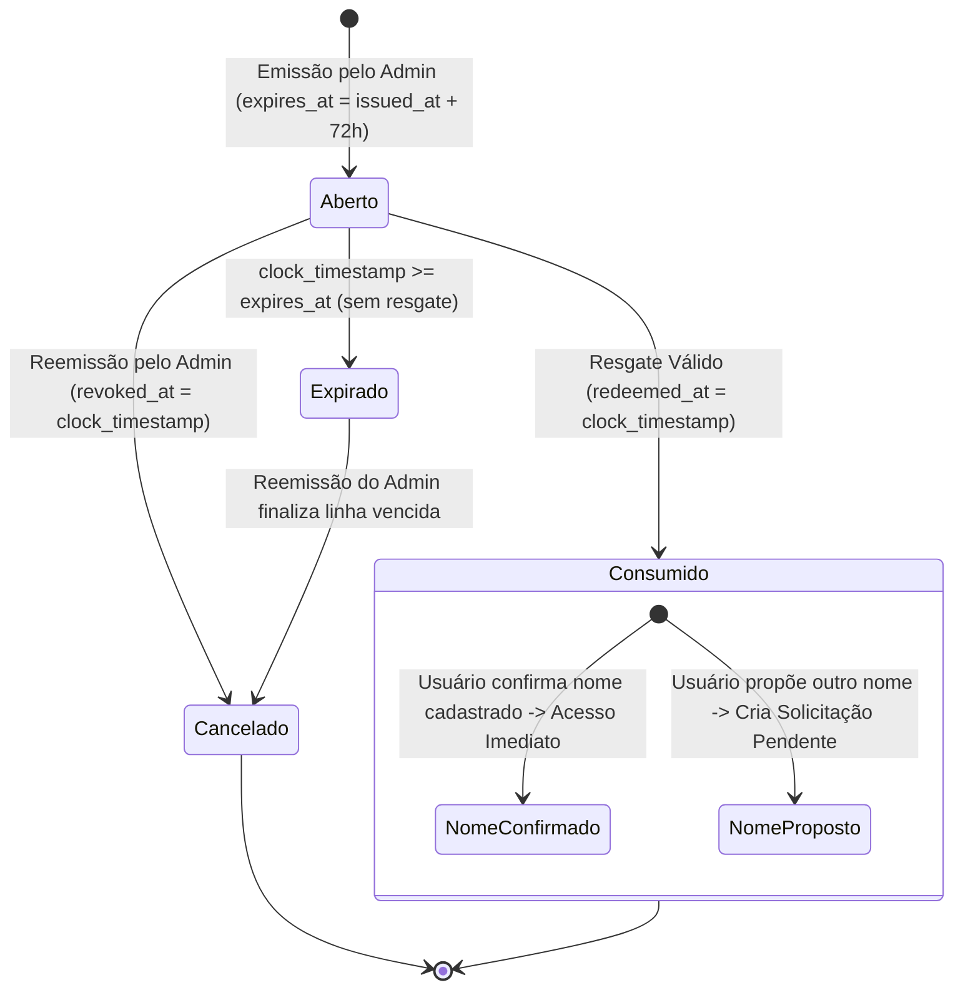
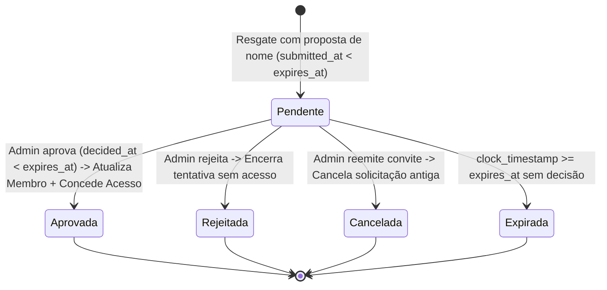

# Escala do Reino — Contrato de Convites de Acesso, Aprovação de Nome e Seleção de Igreja

Versão 2 (06/10/2026) · Contextualização histórica e entrega consolidada em 11/10/2026

**Incremento:** Convites de acesso vinculados a membros existentes, fluxo de primeiro acesso (confirmação ou proposta de outro nome), análise administrativa de solicitações, ciclo de recibos idempotente e integração com a seleção explícita de contexto de igreja.

**Nota de contextualização documental:** Este documento registra a especificação normativa original e as propostas técnicas formuladas durante a preparação da etapa de convites (Seções 1 a 10), bem como a **implementação factual da interface e os limites contratuais vigentes** consolidados na **Seção 11** após a integração de código e testes via PR #8 (`04be37e`, head `de97085`) e PR #9 (`84bf20f`, head `ba85259`). As propostas técnicas iniciais (Seção 2.2) permanecem identificadas em sua origem de engenharia, sem conversão retroativa em decisões normativas amplas além do código e dos contratos efetivamente verificados. Para a visão vigente do projeto, consultar também o [Índice da documentação](../README.md) e o [Estado atual](../ESTADO-ATUAL.md).

---

## 1. Resumo Executivo e Enquadramento da Etapa

- **Origem Documental:** Branch `docs/access-invitations-contract`, elaborada em 06/10/2026 com base no merge do PR #7 (`d372a58d600d9d7789b3aec25431542301e5c423`), que incorporou o head `018e3508bb12378d3fa6d4714218e7dc87874fc8` (branch `feat/create-my-church` preservada).
- **Sequência Histórica e Integração:** Os contratos, RPCs (scripts `011_*.sql`), componentes web em `src/` e a suíte com testes de componentes reais foram implementados e integrados à branch `main` pelo PR #8 (10/10/2026), com refinamento de primeiro acesso e proteção de sessão na mesma aba pelo PR #9 (11/10/2026).
- **Estrutura Prévia no Piloto:** Scripts `009_create_my_church.sql` e `010_verify_create_my_church.sql` já aplicados e verificados no piloto (Ministério Shalom); não foram reaplicados.
- **Natureza das Seções Iniciais:** As Seções 1 a 10 refletem o documento original de desenho e propostas técnicas para revisão pelo responsável. O código implementado, as rotas e os contratos de interface efetivamente integrados encontram-se documentados e delimitados na **Seção 11**.

---

## 2. Classificação Rigorosa do Escopo

Para clareza de governança e alinhamento com o [PRD](../PRD.md) e a [Arquitetura do Banco](../arquitetura/ARQUITETURA-BANCO.md), o incremento é dividido em quatro blocos rigorosos:

### 2.1 Regras Aprovadas (Consolidadas pelo Responsável)
1. **Vínculo Obrigatório a Membro Existente e Ativo:** Todo convite é emitido para uma pessoa já cadastrada na tabela `app_private.members` da igreja, com situação `status = 'active'`. Não há convite para membro inexistente ou inativo.
2. **Destinatário com Mesmo E-mail Confirmado:** O e-mail do destinatário (`recipient_email`) é fornecido obrigatoriamente pelo administrador na emissão. O resgate exige conta autenticada (`auth.users`) cujo e-mail confirmado (`email_confirmed_at IS NOT NULL`) seja idêntico ao do convite (normalizado em caixa baixa sem espaços externos). E-mail divergente impede a consulta de detalhes e o resgate.
3. **Prazo Original Estrito de 72 Horas:** O convite expira exatamente 72 horas após a emissão (`expires_at = issued_at + interval '72 hours'`). Não há prorrogação, renovação ou extensão do prazo.
4. **Uso Único e Terminalidade:** O convite só pode ser consumido uma única vez. Resgate e cancelamento são mutuamente exclusivos e finais.
5. **Um Convite Aberto por Membro:** Cada membro pode possuir no máximo um convite aberto (não consumido e não cancelado) por vez, assegurado fisicamente pelo índice `app_private.access_invitations_one_open_per_member`.
6. **Decisão Confirmada 1 (Reemissão Cancela Proposta Pendente):** Se um convite for reemitido pelo administrador para um membro que possua uma solicitação de outro nome pendente (`access_requests.status = 'pending'`), a solicitação anterior é cancelada transacionalmente (`status = 'cancelled'`), o histórico de auditoria e a linha do convite consumido original são preservados (sem violar restrições físicas de terminalidade), e um novo convite aberto é emitido.
7. **Decisão Confirmada 2 (Rejeição Encerra a Tentativa):** Se o administrador rejeitar a solicitação de outro nome (`status = 'rejected'`), a tentativa de acesso daquele convite é definitivamente encerrada sem criação de vínculo. Uma nova tentativa de entrada exigirá que o administrador emita um novo convite.
8. **Decisão Confirmada 3 (Compartilhamento Manual do Link pelo Administrador):** No primeiro incremento, o link de convite é copiado e compartilhado manualmente pelo administrador com o destinatário (WhatsApp, mensagem direta, e-mail pessoal). Não há disparo automático de mensagens pelo sistema nesta fase.
9. **Confirmação de Nome Concede Acesso Básico:** Se o convidado confirmar o nome cadastrado no membro, o vínculo de acesso em `app_private.church_access` é criado imediatamente com `is_admin = false`, `status = 'active'`, `onboarding_completed_at = clock_timestamp()`.
10. **Proposta de Nome Não Altera Cadastro nem Libera Acesso:** Se o convidado sugerir outro nome, o convite é consumido, registrando uma linha em `app_private.access_requests` com `status = 'pending'`. Nenhum acesso é liberado e o cadastro do membro permanece inalterado até a decisão de um administrador.
11. **Análise de Nome Dentro do Prazo Original:** A proposta e a decisão do administrador precisam ocorrer estritamente antes do vencimento original de 72 horas do convite. Solicitação vencida não pode ser aprovada.
12. **Isolamento de Contexto e Seleção Explícita:** A mesma conta Auth pode ter vínculos com igrejas distintas (ex.: admin na igreja A e membro básico na igreja B). A seleção de igreja é explícita; a troca de igreja invalida caches e consultas, impedindo contaminação entre contextos (implementada na web no PR #7 via `SelectChurchPage` e `AuthContext`).
13. **Sem CPF e Sem Credenciais na Aplicação:** A aplicação não gerencia nem armazena senhas, tokens de provedores ou CPF.
14. **Auditoria Transacional Atômica:** Todas as operações (emissão, reemissão, resgate com confirmação, submissão de proposta, aprovação e rejeição) gravam entradas imutáveis em `app_private.audit_entries` na mesma transação.

---

### 2.2 Proposta Técnica a Revisar (Desenho desta Etapa)
1. **Nomes e Assinaturas das Funções RPC em `public`:**
   - `public.issue_church_invitation(...)` (Emissão e Reemissão)
   - `public.get_invitation_details(...)` (Consulta Autorizada Estrita)
   - `public.redeem_invitation_confirm_name(...)` (Resgate com Confirmação Segura de Nome)
   - `public.redeem_invitation_propose_name(...)` (Resgate com Proposta de Outro Nome)
   - `public.get_my_access_request(...)` (Consulta do Próprio Solicitante)
   - `public.list_church_invitations(...)` (Listagem Administrativa)
   - `public.list_church_access_requests(...)` (Listagem Administrativa de Solicitações)
   - `public.decide_access_request(...)` (Aprovação ou Rejeição de Nome)
   - `public.get_invitation_command_receipt(...)` (Consulta Idempotente de Recibo)
2. **Formato Criptográfico do Token e Digest:** Geração no servidor de token de alta entropia (256 bits, formato Base64URL de 32 bytes gerado via CSPRNG) e armazenamento exclusivo de seu resumo SHA-256 (`token_digest bytea`) no banco de dados. O token permanece exato e sensível à caixa, sem qualquer normalização de texto (sem lower/upper, trim ou NFC).
3. **Evolução Compatível de `command_receipts` para Replay Inequívoco:** Adição das colunas `result_entity_id uuid` e `result_payload jsonb` à tabela existente `app_private.command_receipts`, mantendo `result_member_id` preenchido. Isso viabiliza replay estruturado e desacoplado para todas as mutações (incluindo aprovação e rejeição) sob compatibilidade arquitetural projetada com as RPCs dos incrementos 007 e 009, cuja compatibilidade funcional efetiva será validada por testes de regressão.
4. **Tratamento de Idempotência e Não-Recuperabilidade do Token Bruto:** Como o banco armazena apenas o hash (`token_digest`), consultas subsequentes de recibo confirmam a execução mas sinalizam `link_unrecoverable = true` exclusivamente para emissão/reemissão (`issue_church_invitation`). A UI oferece opção explícita de reemissão caso o link não tenha sido copiado pelo administrador. Proíbe-se expressamente reemissão automática silenciosa como retentativa. Não apresentar reemissão a destinatário ou em replay de decisão.
5. **Hierarquia Canônica de Bloqueios e Serialização Transacional:** Serialização prévia de cada comando pelo par `(auth.uid(), command_id)` antes dos bloqueios de domínio, seguida de reconsulta de recibo e ordem padronizada de bloqueios transacionais (`churches` SHARE → `church_access` SHARE [admin] → `members` UPDATE → `access_invitations` UPDATE → `access_requests` UPDATE) para mitigar sistematicamente o risco de deadlocks e corridas sob concorrência.
6. **Tratamento Transacional Coerente da Expiração:** Adoção de retorno estruturado de negócio para expiração com finalização persistida em banco e registro de auditoria, evitando o uso de `RAISE EXCEPTION` abortivo que reverteria a persistência do encerramento.
7. **Padrão de URL e Limpeza Temporária no Navegador:** Padrão `/#/invite?token=...` ou `/invite#token=...`, captura imediata para `sessionStorage`, limpeza da barra de endereços (`window.history.replaceState`) para proteção contra vazamento em histórico/Referer, e redirecionamento de login social com `redirectTo: window.location.origin`.

---

### 2.3 Dependências Externas
1. **Supabase Auth com Confirmação de E-mail Habilitada:** Validação rigorosa de `auth.users.email_confirmed_at IS NOT NULL`. A entrega manual do link pelo administrador NÃO substitui a exigência de e-mail confirmado da conta Auth.
2. **Configuração de Provedor SMTP Dedicado no Supabase:** O serviço padrão de e-mail embutido no Supabase possui limitações mutáveis e é expressamente restrito pela plataforma para testes da equipe de desenvolvimento. Antes de disponibilizar o fluxo a membros reais via e-mail e senha, a configuração de provedor SMTP dedicado (com domínio próprio e taxas de entrega adequadas) e a validação de confirmação e recuperação são pré-requisitos operacionais indispensáveis.
3. **URL de Redirecionamento Dinâmico no Supabase Auth:** Configuração das URLs de redirecionamento permitidas no Supabase Auth para comportar o domínio de produção/homologação além de `http://localhost:3000`.
4. **Preservação dos Objetos Físicos Instalados:** Manutenção das 7 tabelas internas em `app_private` e 7 RPCs em `public` (incrementos 001–009) sem reaplicação de scripts.

---

### 2.4 Fora do Escopo Deste Incremento
1. **Exclusão Lógica e Restauração de Membros:** Objeto da Etapa 4 da sequência de governança.
2. **Promoção Administrativa ou Concessão de Liderança via Convite:** O convite concede estritamente acesso de membro básico (`is_admin = false`).
3. **Revogação ou Reativação Administrativa de `church_access`:** O manuseio de acessos previamente revogados é um fluxo separado; a concessão de convite não reativa acessos revogados nem contorna a unicidade de vínculo.
4. **Retirada de Proposta de Nome pelo Próprio Convidado ("Self-service cancel"):** Decisão e fluxo mantidos separados para avaliação futura.
5. **Associação Automática entre Múltiplos Provedores de Identidade:** A aplicação não implementa mecanismo customizado de mesclagem de credenciais. A associação nativa do Supabase Auth (Identity Linking) opera sob regras do próprio Auth; autenticar-se não concede acesso à igreja.
6. **Envio Automático de E-mails / WhatsApp pelo Sistema:** Sem disparos transacionais em background nesta fase.

---

## 3. Estados e Ciclo de Vida dos Objetos

### 3.1 Convite de Acesso (`app_private.access_invitations`)

O estado de um convite é determinado por suas colunas físicas e pelo relógio do servidor:



#### Definição Rigorosa dos Estados:
| Estado | Condição Física no Banco | Descrição |
| :--- | :--- | :--- |
| **Aberto (`open`)** | `redeemed_at IS NULL AND revoked_at IS NULL AND clock_timestamp() < expires_at` | Convite ativo e elegível para apresentação. Ocupa o índice de unicidade `access_invitations_one_open_per_member`. |
| **Consumido (`redeemed`)** | `redeemed_at IS NOT NULL AND redeemed_by_user_id IS NOT NULL AND revoked_at IS NULL` | Convite apresentado legitimamente por conta com e-mail correspondente. Concedeu acesso imediato ou abriu solicitação de nome. |
| **Cancelado (`revoked`)** | `revoked_at IS NOT NULL AND revoked_by_user_id IS NOT NULL AND redeemed_at IS NULL` | Convite cancelado em decorrência de reemissão. Não pode mais ser resgatado. |
| **Expirado (`expired`)** | `redeemed_at IS NULL AND revoked_at IS NULL AND clock_timestamp() >= expires_at` | Prazo de 72 horas transcorrido sem apresentação. Não pode ser resgatado. **Atenção:** Ainda ocupa fisicamente o índice de convite aberto até ser finalizado na reemissão. |

> [!CRITICAL]
> **Restrição Física `access_invitations_terminal_state`:**
> O schema físico impõe `CHECK (NOT (redeemed_at IS NOT NULL AND revoked_at IS NOT NULL))`. Uma linha de convite que já foi consumida (`redeemed_at IS NOT NULL`) **NUNCA PODE RECEBER `revoked_at`**. Ao reemitir um convite enquanto uma proposta de nome estiver sob análise, o cancelamento incide estritamente sobre a linha de `access_requests`, mantendo a linha do convite consumido intacta.

---

### 3.2 Solicitação de Alteração de Nome (`app_private.access_requests`)

Criada exclusivamente quando um convite válido é consumido com proposta de nome diferente do cadastro original.



#### Definição dos Estados:
| Estado | Condição Física (`status`) | Condições Adicionais e Regras |
| :--- | :--- | :--- |
| **Pendente (`pending`)** | `status = 'pending'` | `decided_at IS NULL`, `decided_by_user_id IS NULL`. Aguarda análise administrativa antes de `expires_at`. |
| **Aprovada (`approved`)** | `status = 'approved'` | `decided_at < expires_at` (imposto por CHECK físico), `decided_by_user_id` preenchido. Atualiza `members.display_name` e cria `church_access`. |
| **Rejeitada (`rejected`)** | `status = 'rejected'` | `decided_at IS NOT NULL`, `decided_by_user_id` preenchido. Encerra a tentativa. Nova entrada exige novo convite emitido pelo admin. |
| **Cancelada (`cancelled`)** | `status = 'cancelled'` | `decided_at IS NOT NULL`, `decided_by_user_id = admin`. Solicitação cancelada em decorrência de reemissão. |
| **Expirada (`expired`)** | `status = 'expired'` | `clock_timestamp() >= expires_at`. Se persistida, `decided_by_user_id IS NULL` e `decided_at >= expires_at`. Não pode ser aprovada. |

---

## 4. Comportamentos Críticos, Concorrência e Tratamento Transacional

### 4.1 Hierarquia Canônica de Bloqueios (Lock Ordering) e Concorrência
Para assegurar execução determinística e mitigar sistematicamente o risco de deadlocks entre emissão, reemissão, resgate pelo convidado e decisão administrativa (meta arquitetural cuja ausência de deadlocks deve ser demonstrada por testes com concorrência real e interação com gatilhos/funções existentes, sem constituir garantia absoluta presumida sem evidência), todas as transações de mutação adquirem bloqueios estritamente na seguinte ordem canônica:

```
0. Serialização Transacional do Comando por (auth.uid(), command_id)
   (advisory lock transacional no par, ativo antes de existir linha em command_receipts)
   ↓
[Reconsulta do Recibo: se existir, autorização atual precede entrega do replay; se não existir, segue aos locks de domínio]
   ↓
1. Bloqueio Compartilhado da Igreja (FOR SHARE em app_private.churches)
   ↓
2. Bloqueio Compartilhado do Acesso do Operador (FOR SHARE em app_private.church_access — apenas em operações administrativas)
   ↓
3. Bloqueio Exclusivo do Membro Alvo (FOR UPDATE em app_private.members)
   ↓
4. Bloqueio Exclusivo do Convite (FOR UPDATE em app_private.access_invitations)
   ↓
5. Bloqueio Exclusivo da Solicitação de Nome (FOR UPDATE em app_private.access_requests)
```

#### Resolução Concorrente de Corridas:
- **Duas Chamadas Concorrentes do Mesmo Comando Sem Recibo Prévio:**
  - Ambas as chamadas tentam serializar o par `(auth.uid(), command_id)` antes dos bloqueios de domínio.
  - A primeira chamada obtém o bloqueio transacional; consulta `command_receipts` e constata que o recibo ainda não existe. Em seguida, adquire os bloqueios de domínio na ordem canônica, valida as regras de negócio, persiste as mutações, a auditoria e grava o recibo em `command_receipts`.
  - A segunda chamada aguarda na serialização transacional. Ao ser liberada (após o commit da transação externa da primeira), reconsulta o recibo: encontra a linha recém-gravada, valida que a ação interna da RPC e os parâmetros canônicos conferem, revalida a autorização atual aplicável e retorna o replay idêntico do resultado original, sem repetir mutações, sem duplicar vínculos, sem duplicar auditoria e sem violar a restrição de unicidade de `command_receipts`.
- **Reemissão vs. Resgate:**
  - Ambas as operações bloqueiam o registro de `members FOR UPDATE`.
  - Se a **Reemissão** vencer o lock: o convite aberto anterior é revogado (`revoked_at = clock_timestamp()`). Quando a transação de Resgate adquirir o lock, constatará que o convite foi revogado e abortará com erro `INVITATION_REVOKED`.
  - Se o **Resgate** vencer o lock: o convite é consumido (`redeemed_at = clock_timestamp()`). Quando a Reemissão adquirir o lock, identificará que o convite foi consumido: se gerou solicitação pendente válida, cancela-a e emite novo convite; se gerou acesso imediato, aborta informando que o membro já possui acesso ativo.
- **Duas Decisões Concorrentes na Mesma Solicitação:**
  - Ambas bloqueiam `access_requests FOR UPDATE`.
  - A primeira decide a solicitação (`status = 'approved'` ou `'rejected'`). A segunda adquire o lock, detecta `status <> 'pending'` e falha com erro estruturado `REQUEST_ALREADY_DECIDED`.
- **Espera por Lock com Vencimento na Fila:**
  - O cálculo de expiração (`expires_at > clock_timestamp()`) é realizado **após a obtenção dos bloqueios** no instante final da execução. Se uma transação aguardar na fila de espera de lock e o prazo de 72 horas expirar antes de sua vez, a operação é rejeitada como expirada imediatamente ao obter o lock.

---

### 4.2 Timestamps, Geração e Derivação de Prazos
Na emissão (`issue_church_invitation`):
- O timestamp deve ser capturado **após a aquisição dos locks**:
  ```sql
  v_now := clock_timestamp();
  v_expires_at := v_now + interval '72 hours';
  ```
- O comando grava explicitamente `issued_at = v_now` e `expires_at = v_expires_at`.
- Isso cumpre com precisão cirúrgica a restrição física do PostgreSQL:
  `constraint access_invitations_expiration check (expires_at = issued_at + interval '72 hours')`.
- É **vedado** deixar `issued_at` no valor padrão (`statement_timestamp()`) enquanto `expires_at` é calculado com `clock_timestamp()`, pois causaria violação da restrição de igualdade em transações com espera de lock.

---

### 4.3 Tratamento Transacional Coerente da Expiração
Em PostgreSQL, o comando `RAISE EXCEPTION` aborta toda a transação, revertendo qualquer atualização de tabela executada no bloco. Logo, uma RPC não pode prometer atualizar o status para `'expired'` e simultaneamente lançar uma exceção SQL.

#### Proposta Técnica Recomendada (Retorno Estruturado com Finalização Persistida):
Quando o administrador tenta aprovar ou rejeitar uma solicitação cujo prazo de 72 horas já expirou (`clock_timestamp() >= expires_at`):
1. A RPC atualiza o registro:
   ```sql
   UPDATE app_private.access_requests
   SET status = 'expired',
       decided_at = clock_timestamp(),
       decided_by_user_id = NULL
   WHERE id = p_request_id;
   ```
2. Grava a auditoria `'expire_access_request'` e o recibo de comando em `command_receipts`.
3. Retorna uma linha de resposta estruturada com `decision = 'expired'`, `access_granted = false` e `error_code = 'REQUEST_EXPIRED'`.
4. A transação é confirmada externamente (`COMMIT` gerenciado pelo cliente ou PostgREST, sendo expressamente vedado invocar instruções de controle transacional `COMMIT`/`ROLLBACK` dentro do corpo de funções RPC em PL/pgSQL), persistindo o encerramento da solicitação no banco e impedindo reavaliações futuras. Todas as etapas (atualização de status para `expired`, auditoria e recibo) compõem a mesma transação atômica; uma falha na auditoria ou no recibo desfaz também a finalização para expirada (`ROLLBACK`).

#### Tratamento na Reemissão:
Ao reemitir um convite para membro que possui solicitação em `pending`:
- Se `clock_timestamp() < expires_at`: a solicitação estava em prazo válido e é cancelada administrativamente (`status = 'cancelled'`, `decided_by_user_id = auth.uid()`, `decided_at = clock_timestamp()`).
- Se `clock_timestamp() >= expires_at`: a solicitação já havia vencido por decurso de prazo. Ela é finalizada como expirada (`status = 'expired'`, `decided_by_user_id = NULL`, `decided_at = clock_timestamp()`), preservando a verdade histórica de que não foi cancelada em tempo hábil.

---

### 4.4 Matriz de Autorização e Revalidações Estritas por Operação

Para prevenir inconsistências e assegurar que papéis administrativos não sejam exigidos indevidamente de convidados em primeiro acesso, as operações seguem uma matriz explícita de autorização e conjunto de validações pós-locks:

#### Matriz Explícita de Papéis e Autorizações:
| Operação | Papel / Autorização Exigida |
| :--- | :--- |
| **Emitir / Reemitir convite** (`issue_church_invitation`), **Listar convites** (`list_church_invitations`), **Listar solicitações** (`list_church_access_requests`), **Aprovar / Rejeitar solicitação** (`decide_access_request`) | Administrador atual elegível da igreja indicada (`church_access.is_admin = true AND church_access.status = 'active'`), com vínculo e membro ativos na igreja. |
| **Consultar detalhes** (`get_invitation_details`), **Confirmar nome** (`redeem_invitation_confirm_name`), **Propor outro nome** (`redeem_invitation_propose_name`) | Conta Auth elegível (ativa, não excluída, não bloqueada, não anônima) e e-mail confirmado correspondente ao convite (`lower(auth.users.email) = lower(recipient_email)`); **nenhum vínculo prévio ou administração na igreja destinatária é exigido** (a imposição desse papel bloquearia o primeiro acesso legítimo). |
| **Consultar solicitação própria** (`get_my_access_request`) | Conta Auth atual elegível e autoria da proposta (`access_requests.requester_user_id = auth.uid()`); não exige concessão prévia de acesso à igreja. |
| **Consultar recibo / Replay** (`get_invitation_command_receipt` ou replay interno em RPCs) | Conta Auth atual elegível, autoria do comando (`command_receipts.user_id = auth.uid()`) e ação correspondente ao fluxo. Para resultados de operações administrativas, a autorização administrativa atual do operador é revalidada antes da devolução do resultado; o destinatário recupera a própria tentativa antes de possuir `church_access`. O recibo é prova de execução passada, não prova de acesso atual. |

#### Revalidações Pós-Locks no Instante Final (Primeira Execução de Resgate ou Proposta):
Após a aquisição dos bloqueios e imediatamente antes da persistência das mutações:
1. **Conta do Chamador Elegível:** `auth.users` não excluída (`deleted_at IS NULL`), não bloqueada (`banned_until IS NULL OR banned_until <= clock_timestamp()`) e não anônima (`is_anonymous IS NOT TRUE`).
2. **Token Exato Aberto e Válido:** O convite existe por correspondência exata de `token_digest = sha256(p_raw_token::bytea)` e encontra-se aberto (`redeemed_at IS NULL AND revoked_at IS NULL`).
3. **Prazo Revalidado no Instante Final Pós-Lock:** `clock_timestamp() < expires_at`. Se o convite expirou enquanto aguardava na fila de locks, a operação é encerrada sem efetuar o resgate.
4. **E-mail Confirmado Correspondente:** O e-mail confirmado da conta Auth (`email_confirmed_at IS NOT NULL`) coincide estritamente com `recipient_email` do convite (espaços externos aparados e comparação de caixa `lower()`).
5. **Igreja e Membro Ativos:** `churches.status = 'active'` e `members.status = 'active'`.
6. **Ausência de Vínculos Incompatíveis e Proibição de Bypass de Revogação:**
   - O solicitante não pode já possuir vínculo ativo com a igreja (`church_access.user_id = auth.uid()` com `status = 'active'`).
   - O membro alvo não pode estar vinculado a outra conta (`church_access.member_id = member_id` ativo).
   - **Proibição Estrita de Bypass de Revogação:** Se houver registro prévio de `church_access` com `status = 'revoked'` para a conta ou para o membro na igreja, é terminantemente proibido apagar, recriar ou reativar a linha revogada. O resgate de convite não reativa acessos revogados; a presença de vínculo revogado impede a criação de novo acesso.
7. **Condições Específicas da Confirmação de Nome (`redeem_invitation_confirm_name`):**
   - O nome cadastrado no membro deve coincidir exatamente com o nome esperado: `members.display_name = p_expected_display_name`. Se o nome foi alterado por um admin após a leitura do convite, o resgate aborta com `MEMBER_NAME_CHANGED_BEFORE_REDEMPTION`.
8. **Condições Específicas da Proposta de Nome (`redeem_invitation_propose_name`):**
   - Nome proposto em formato Unicode NFC, espaços externos aparados (`btrim`), preservando estritamente caixa, acentos e apóstrofos, com tamanho de 1 a 120 caracteres.
   - Nome proposto deve ser diferente do nome atualmente cadastrado no membro: `p_proposed_display_name <> members.display_name`.
9. **Replay de Operação Confirmada:**
   - A repetição de um comando já executado com recibo válido não exige que o convite ainda esteja em estado aberto (`open`), visto que a primeira execução consumiu a linha. A validação do replay fundamenta-se na correspondência de ação/hash e na elegibilidade atual da conta.

#### Separação Rigorosa entre Aprovação e Rejeição de Solicitação:
- **Aprovação (`p_decision = 'approve'`):**
  - Exige administrador atual elegível da igreja.
  - Exige solicitação em `status = 'pending'` e dentro do prazo original (`clock_timestamp() < expires_at`).
  - **Comparação Obrigatória do Nome Original:** O servidor confere `members.display_name = access_requests.original_display_name`. Se o cadastro do membro foi alterado por outro admin durante a tramitação da proposta, a aprovação **NÃO sobrescreve silenciosamente** o cadastro! A RPC aborta com erro de conflito de concorrência (`MEMBER_NAME_MODIFIED_CONCURRENTLY`), exigindo revisão humana.
  - Revalida conta do solicitante elegível e ausência de vínculo incompatível/revogado.
  - Atualiza `members.display_name = access_requests.proposed_display_name`, cria vínculo em `church_access` (`is_admin = false`, `status = 'active'`) e transita a solicitação para `status = 'approved'`.
- **Rejeição (`p_decision = 'reject'`):**
  - Exige administrador atual elegível da igreja, solicitação em `status = 'pending'` e prazo original válido (`clock_timestamp() < expires_at`).
  - **NÃO altera** o cadastro do membro (`members.display_name` permanece intocado).
  - **NÃO concede** acesso e **NÃO cria** vínculo em `church_access`.
  - Portanto, a rejeição **NÃO depende** da verificação de `original_display_name` e **NÃO depende** de criação de vínculo que ela não vai conceder. Ela transita a solicitação para `status = 'rejected'`, encerrando definitivamente aquela tentativa de acesso sem alterar membros ou acessos.

---

## 5. Idempotência, Recibos e Replay (`app_private.command_receipts`)

### 5.1 Limitação do Schema Atual e Proposta de Adaptação Compatível
A tabela física atual `command_receipts` possui apenas:
`(id, church_id, user_id, command_id, action, params_hash, result_member_id, created_at)`.

- **Problema Técnico:** `result_member_id` aponta para o membro alvo, mas **não identifica** qual convite (`invitation_id`) ou qual solicitação (`request_id`) foi produzido pela operação. Buscar a "linha mais recente" do membro é frágil e incorreto sob reemissões sucessivas ou comandos simultâneos.
- **Proposta Técnica a Revisar (Evolução Compatível):**
  Adicionar duas colunas opcionais à tabela `app_private.command_receipts`:
  ```sql
  ALTER TABLE app_private.command_receipts
    ADD COLUMN IF NOT EXISTS result_entity_id uuid,
    ADD COLUMN IF NOT EXISTS result_payload jsonb;
  ```
  - **Compatibilidade Arquitetural Projetada:** Como as novas colunas são adicionadas sem restrição `NOT NULL` e com nomes explícitos, as RPCs existentes dos incrementos 007 (`create_church_member`) e 009 (`create_my_church`) mantêm seus inserts e consultas preservados. A compatibilidade funcional efetiva deverá ser comprovada por testes de regressão dos módulos 007 e 009, evitando afirmações categóricas de 100% sem ensaios empíricos.
  - `result_member_id` continua preenchido com o membro associado.
  - `result_entity_id` armazena o UUID exato do objeto produzido (`invitation_id`, `request_id` ou `church_access.id`).
  - `result_payload` armazena o resultado canônico original em JSON estruturado por ação (metadados, status e flags de sucesso), com limite de tamanho e campos permitidos, **sem o token bruto e sem segredos**:
    - `issue_invitation`: `{"invitation_id": uuid, "church_id": uuid, "member_id": uuid, "recipient_email": text, "expires_at": timestamptz, "issued_at": timestamptz, "previous_invitation_revoked": boolean, "previous_request_cancelled": boolean, "link_unrecoverable": boolean}`
    - `redeem_confirm_name`: `{"church_id": uuid, "church_name": text, "member_id": uuid, "access_id": uuid, "display_name": text, "access_granted": true, "onboarding_completed_at": timestamptz}`
    - `redeem_propose_name`: `{"request_id": uuid, "church_id": uuid, "member_id": uuid, "original_display_name": text, "proposed_display_name": text, "status": "pending", "expires_at": timestamptz, "submitted_at": timestamptz}`
    - `decide_access_request`: `{"request_id": uuid, "member_id": uuid, "final_display_name": text, "decision": text, "access_granted": boolean, "decided_at": timestamptz, "error_code": text|null}`

---

### 5.2 Normalização Específica por Campo, Serialização Transacional e Replay

1. **Normalização Específica por Campo no Hash (`params_hash`):**
   A representação canônica inclui versão do contrato, ação definida no servidor, identificadores tipados e todos os parâmetros relevantes. Cada campo segue sua própria regra:
   - **E-mail (`recipient_email`):** utiliza espaços externos aparados (`btrim`) e comparação de caixa (`lower`) consistente com o Auth; não remover pontos nem sufixos de e-mail.
   - **Nomes (`display_name`, `expected_display_name`, `proposed_display_name`):** utilizam normalização Unicode NFC e espaços externos aparados (`btrim`), preservando estritamente caixa (maiúsculas e minúsculas), acentos e apóstrofos.
   - **Token bruto (`raw_token`):** é validado em formato e tamanho (32 bytes Base64URL) e **preservado com exatidão**, sem `lower`, `upper`, `trim`, NFC ou qualquer equivalência aproximada. Tokens Base64URL diferenciam maiúsculas e minúsculas. Pode-se incluir no hash o digest criptográfico (`sha256(raw_token::bytea)`) calculado a partir da representação exata do token, sem persistir o segredo em claro no recibo ou no hash canônico.
   - **Ação (`action`):** é identificada e definida internamente pelo servidor / RPC em execução, não constituindo declaração livre do cliente.
   - **Serialização Canônica:** é inequívoca, padronizada e definida no servidor. O reúso do mesmo comando (`command_id`) com outro token, outro alvo, outra decisão ou nome semanticamente diferente gera conflito de comando (`409 Conflict` / `COMMAND_ID_REUSED_WITH_DIFFERENT_PARAMS`).

2. **Ciclo de Replay e Serialização Transacional:**
   Cada mutação autentica e verifica a elegibilidade atual do chamador.
   - **Antes dos bloqueios de domínio**, serializa o par `(auth.uid(), command_id)` por mecanismo transacional que funcione mesmo sem recibo existente. Uma opção a detalhar na implementação é advisory lock transacional derivado desse par (`pg_advisory_xact_lock`), sem incluir ação ou alvo na chave, pois a unicidade do recibo em `command_receipts` é por conta/comando (`user_id, command_id`).
   - **Após adquirir o bloqueio transacional**, consulta novamente a tabela `app_private.command_receipts`:
     ```sql
     SELECT action, params_hash, church_id, result_member_id, result_entity_id, result_payload, created_at
     FROM app_private.command_receipts
     WHERE user_id = auth.uid() AND command_id = p_command_id;
     ```
   - **Se o recibo já existir:**
     - Compara a ação interna da RPC com `command_receipts.action` e o hash canônico calculado com `command_receipts.params_hash`.
     - Se houver divergência de ação ou parâmetros: aborta imediatamente com erro de conflito de comando (`409 Conflict` / `COMMAND_ID_REUSED_WITH_DIFFERENT_PARAMS`). Trata colisões com comandos dos incrementos 007 e 009 sem repetir efeitos ou retornar resultado de outra ação.
     - Se ação e hash forem equivalentes: retorna o resultado original contido em `result_payload` e metadados. **A autorização atual precede a entrega do resultado**: o recibo é prova de execução passada, não prova de acesso atual. `access_granted` registrado no recibo não substitui consulta atual das permissões para liberar tela/dados; para resultados administrativos, a autorização administrativa atual do operador é revalidada antes da devolução do replay. O destinatário recupera a própria tentativa antes de possuir `church_access`. Se a ação original for emissão de convite, sinaliza `link_unrecoverable = true`. O replay não reinserir registros, não concede novo vínculo e não duplica auditoria.
   - **Se o recibo não existir:**
     - Adquire os bloqueios de domínio na ordem canônica estabelecida (Igreja SHARE → Operador SHARE [se admin] → Membro UPDATE → Convite UPDATE → Solicitação UPDATE).
     - Revalida todas as condições de negócio e integridade no instante final pós-lock.
     - Executa mutação, auditoria em `audit_entries` e gravação do recibo em `command_receipts` na mesma transação atômica.
     - Todos os novos comandos seguem a mesma ordem canônica. Preservar a unicidade e tratar colisões com comandos 007/009 sem repetir efeitos ou retornar resultado de outra ação. Não depender de `SELECT ... FOR UPDATE` sobre linha inexistente.

---

### 5.3 Cobertura Integral de Recibos
Todas as operações de mutação registram recibos:
- `issue_church_invitation` (`action = 'issue_invitation'`)
- `redeem_invitation_confirm_name` (`action = 'redeem_confirm_name'`)
- `redeem_invitation_propose_name` (`action = 'redeem_propose_name'`)
- `decide_access_request` (`action = 'decide_access_request'`)

---

### 5.4 Autorização da Consulta de Recibo pelo Solicitante
A RPC de recibo `get_invitation_command_receipt(p_command_id uuid)` valida:
`command_receipts.user_id = auth.uid()`.
Isso garante que um convidado que submeteu o resgate ou uma proposta de nome consiga consultar o recibo de sua própria operação em caso de queda de rede, **mesmo antes de possuir um vínculo ativo em `church_access`**.
Para recibos referentes a comandos administrativos (ex.: emissão de convite ou decisão de solicitação), a autorização administrativa atual do operador na respectiva igreja é revalidada antes da devolução do payload de resultado. O recibo comprova uma execução passada, mas não substitui a verificação de autorização atual para entrega de dados protegidos.

---

### 5.5 Não-Recuperabilidade do Token Bruto e Comportamento da UI
- O token bruto (`raw_token`) existe na memória do servidor e é retornado **exclusivamente na resposta da chamada inicial** `issue_church_invitation` ao administrador.
- O banco de dados persiste apenas `token_digest bytea`. O `raw_token` **nunca** é gravado em `command_receipts.result_payload` nem exposto em logs ou auditoria.
- Se a chamada inicial sofrer timeout de rede e o administrador consultar o recibo (ou executar o replay de `issue_church_invitation`), o recibo confirma a execução da operação mas sinaliza `link_unrecoverable = true`. A sinalização `link_unrecoverable` aplica-se estritamente à emissão/reemissão; não se apresenta reemissão ao destinatário nem em replay de decisão administrativa.
- A interface administrativa exibe: *"Convite emitido com sucesso, mas o link exclusivo não pôde ser recuperado por medidas de segurança. Deseja reemitir um novo link agora?"*
- É terminantemente proibida a reemissão automática silenciosa como efeito colateral de retentativa.

---

## 6. Contrato Detalhado das Funções RPC em `public` (Proposta Técnica a Revisar)

Todas as funções serão expostas no schema `public`, com `SECURITY DEFINER`, `search_path = ''`, `statement_timeout = '5s'` e permissão de execução restrita a `authenticated`. Identidade do operador derivada exclusivamente de `auth.uid()`.

---

### 6.1 RPC: `public.issue_church_invitation`
- **Finalidade:** Emite um novo convite de acesso para um membro existente ou reemite cancelando o convite aberto anterior e qualquer proposta de nome sob análise.
- **Assinatura Proposta:**
  ```sql
  public.issue_church_invitation(
    p_command_id uuid,
    p_church_id uuid,
    p_member_id uuid,
    p_recipient_email text
  )
  returns table (
    invitation_id uuid,
    church_id uuid,
    member_id uuid,
    recipient_email text,
    raw_token text,
    expires_at timestamptz,
    issued_at timestamptz,
    previous_invitation_revoked boolean,
    previous_request_cancelled boolean
  )
  ```
- **Autorização:** Conta chamadora (`auth.uid()`) com vínculo de administrador ativo (`is_admin = true AND status = 'active'`) em `church_access` para `p_church_id`.
- **Efeitos Transacionais:**
  1. Serialização transacional do par `(auth.uid(), p_command_id)` antes dos bloqueios de domínio (advisory lock transacional).
  2. Reconsulta de recibo existente em `command_receipts`: se existir, compara ação interna (`'issue_invitation'`) e hash canônico. Se divergirem, aborta com `COMMAND_ID_REUSED_WITH_DIFFERENT_PARAMS`. Se conferirem, revalida autorização de admin atual e retorna replay original com `link_unrecoverable = true`.
  3. Se não existir recibo, adquire bloqueios de domínio na ordem canônica (igreja SHARE, operador SHARE, membro UPDATE).
  4. Revalida operador como administrador ativo da igreja, igreja e membro ativos e ausência de vínculo ativo para o membro.
  5. Finaliza convite aberto anterior em `access_invitations` (inclusive vencido, para liberar o índice parcial único), marcando `revoked_at = clock_timestamp()`, `revoked_by_user_id = auth.uid()`.
  6. Se houver `access_requests` em `pending`:
     - Se `clock_timestamp() < expires_at`: marca `status = 'cancelled'`, `decided_at = clock_timestamp()`, `decided_by_user_id = auth.uid()`.
     - Se `clock_timestamp() >= expires_at`: marca `status = 'expired'`, `decided_at = clock_timestamp()`, `decided_by_user_id = NULL`.
     - Preserva o convite consumido anterior sem alterar `revoked_at`.
  7. Gera `raw_token` (32 bytes Base64URL via CSPRNG) preservado exatamente, e calcula `token_digest = sha256(raw_token::bytea)`.
  8. Captura `v_now := clock_timestamp();` e insere `access_invitations` com `issued_at = v_now` e `expires_at = v_now + interval '72 hours'`.
  9. Grava `command_receipts` com `result_entity_id = invitation_id` e `result_payload` estruturado (sem `raw_token`, com `link_unrecoverable = false`).
  10. Grava auditoria atômica `'issue_access_invitation'`.
  11. Retorna a linha contendo o `raw_token` exclusivamente nesta primeira execução. Transação externa do chamador confirma (`COMMIT`).

---

### 6.2 RPC: `public.get_invitation_details`
- **Finalidade:** Consulta autorizada estrita de detalhes de um convite a partir do token apresentado pelo convidado.
- **Assinatura Proposta:**
  ```sql
  public.get_invitation_details(
    p_raw_token text
  )
  returns table (
    invitation_id uuid,
    church_id uuid,
    church_name text,
    member_id uuid,
    member_display_name text,
    expires_at timestamptz,
    is_valid boolean
  )
  ```
- **Autorização e Validação Estrita:**
  1. Chamador obrigatoriamente autenticado (`auth.uid() IS NOT NULL`).
  2. Conta Auth ativa, elegível (não excluída, não bloqueada, não anônima) e e-mail confirmado (`email_confirmed_at IS NOT NULL`). **Nenhum vínculo ou papel administrativo prévio na igreja destinatária é exigido.**
  3. Token exato (sem lower/upper/trim/NFC): localiza convite por correspondência exata de `token_digest = sha256(p_raw_token::bytea)`.
  4. Valida correspondência de e-mail: `lower(btrim(auth.users.email)) = lower(btrim(invitation.recipient_email))`.
  5. Valida estado: `redeemed_at IS NULL AND revoked_at IS NULL`.
  6. Valida prazo: `clock_timestamp() < expires_at`.
  7. Valida igreja e membro ativos (`churches.status = 'active'`, `members.status = 'active'`).
- **Política de Privacidade e Proteção Contra Enumeração:**
  - Se **TODAS** as validações forem satisfeitas: retorna os dados reais (`is_valid = true`, `church_name`, `member_display_name`, `expires_at`).
  - Se houver **QUALQUER divergência** (e-mail diferente, token inexistente, convite já consumido, cancelado, expirado ou membro inativo):
    - Retorna resposta estritamente **genérica**: `is_valid = false`, com todos os outros campos nulos (ou erro genérico neutro).
    - **NÃO revela** nome da igreja, nome do membro ou e-mail do destinatário (nem mascarado).
    - A tentativa divergente **não consome** o convite e não altera seu estado.
  - A opção `anon` é **terminantemente removida**.

---

### 6.3 RPC: `public.redeem_invitation_confirm_name`
- **Finalidade:** Convidado autenticado resgata o convite confirmando o nome cadastrado no membro. Concede acesso imediato à igreja.
- **Assinatura Proposta:**
  ```sql
  public.redeem_invitation_confirm_name(
    p_command_id uuid,
    p_raw_token text,
    p_expected_display_name text
  )
  returns table (
    church_id uuid,
    church_name text,
    member_id uuid,
    display_name text,
    access_granted boolean,
    onboarding_completed_at timestamptz
  )
  ```
- **Autorização:** Conta Auth elegível com e-mail confirmado correspondente ao convite; nenhum vínculo prévio ou administração na igreja destinatária é exigido.
- **Validações e Efeitos:**
  1. Serialização transacional do par `(auth.uid(), p_command_id)` antes dos bloqueios de domínio (advisory lock transacional).
  2. Reconsulta de recibo em `command_receipts`: se existir, valida ação interna (`'redeem_confirm_name'`) e hash canônico. Se divergirem, aborta com conflito `409 Conflict`. Se conferirem, retorna replay original com o resultado (o replay de comando já confirmado não exige que o convite continue aberto).
  3. Se não existir recibo, adquire locks de domínio na ordem canônica: igreja SHARE, membro UPDATE, convite UPDATE.
  4. **Revalidações estritas pós-locks no instante final:**
     - Conta Auth do chamador elegível (não excluída, não bloqueada, não anônima).
     - Token exato confere (`token_digest`) e convite aberto (`redeemed_at IS NULL AND revoked_at IS NULL`).
     - Prazo original revalidado no instante final pós-lock: `clock_timestamp() < expires_at`. Se expirou na fila de locks, encerra sem conceder acesso.
     - E-mail confirmado da conta ainda idêntico ao `recipient_email` do convite (`lower(btrim(auth.users.email)) = lower(btrim(invitation.recipient_email))`).
     - Igreja e membro ativos (`churches.status = 'active'`, `members.status = 'active'`).
     - Ausência de vínculo ativo na igreja para o usuário e para o membro.
     - Proibição estrita de bypass de revogação: existência prévia de `church_access` com `status = 'revoked'` para a conta ou membro impede o resgate (convite não reativa acessos revogados).
     - Validação de concorrência de nome: `members.display_name = p_expected_display_name`. Se o admin alterou o nome após a leitura do convite, aborta com `MEMBER_NAME_CHANGED_BEFORE_REDEMPTION`.
  5. Marca convite como consumido: `redeemed_at = clock_timestamp(), redeemed_by_user_id = auth.uid()`.
  6. Insere vínculo em `app_private.church_access`:
     `is_admin = false`, `status = 'active'`, `onboarding_completed_at = clock_timestamp()`, `granted_by_user_id = invitation.issued_by_user_id`, `granted_at = clock_timestamp()`.
  7. Grava `command_receipts` com `result_entity_id = church_access.id` e `result_payload` estruturado.
  8. Grava auditoria atômica `'redeem_invitation_confirm_name'`.
  9. Transação externa do chamador confirma (`COMMIT`).

---

### 6.4 RPC: `public.redeem_invitation_propose_name`
- **Finalidade:** Convidado autenticado consome o convite propondo outro nome. Registra solicitação sob análise sem conceder acesso imediato.
- **Assinatura Proposta:**
  ```sql
  public.redeem_invitation_propose_name(
    p_command_id uuid,
    p_raw_token text,
    p_proposed_display_name text
  )
  returns table (
    request_id uuid,
    church_id uuid,
    member_id uuid,
    original_display_name text,
    proposed_display_name text,
    status text,
    expires_at timestamptz,
    submitted_at timestamptz
  )
  ```
- **Autorização:** Conta Auth elegível com e-mail confirmado correspondente ao convite; nenhum vínculo prévio ou administração na igreja destinatária é exigido.
- **Validações e Efeitos:**
  1. Serialização transacional do par `(auth.uid(), p_command_id)` antes dos bloqueios de domínio (advisory lock transacional).
  2. Reconsulta de recibo em `command_receipts`: se existir, valida ação interna (`'redeem_propose_name'`) e hash canônico. Se divergirem, aborta com conflito `409 Conflict`. Se conferirem, retorna o replay original com o resultado.
  3. Se não existir recibo, adquire locks de domínio na ordem canônica: igreja SHARE, membro UPDATE, convite UPDATE.
  4. **Revalidações estritas pós-locks no instante final:**
     - Conta Auth do chamador elegível (não excluída, não bloqueada, não anônima).
     - Token exato confere (`token_digest`) e convite aberto (`redeemed_at IS NULL AND revoked_at IS NULL`).
     - Prazo original revalidado no instante final pós-lock: `clock_timestamp() < expires_at`. Se expirou na fila de locks, encerra sem abrir proposta.
     - E-mail confirmado da conta ainda idêntico ao `recipient_email` do convite (`lower(btrim(auth.users.email)) = lower(btrim(invitation.recipient_email))`).
     - Igreja e membro ativos (`churches.status = 'active'`, `members.status = 'active'`).
     - Ausência de vínculo ativo na igreja para o usuário e para o membro.
     - Proibição estrita de bypass de revogação: existência prévia de `church_access` com `status = 'revoked'` impede a abertura de proposta.
     - Sanitização do nome proposto: Unicode NFC, `btrim`, preservando caixa, acentos e apóstrofos, de 1 a 120 caracteres.
     - Rejeição de proposta redundante: `p_proposed_display_name <> members.display_name`.
  5. Consome o convite: `redeemed_at = clock_timestamp(), redeemed_by_user_id = auth.uid()`.
  6. Insere linha em `app_private.access_requests`:
     `status = 'pending'`, `original_display_name = members.display_name`, `proposed_display_name = p_proposed_display_name`, `expires_at = invitation.expires_at`, `submitted_at = clock_timestamp()`.
  7. **Não altera** `members.display_name` e **não cria** linha em `church_access`.
  8. Grava `command_receipts` com `result_entity_id = request_id` e `result_payload` estruturado.
  9. Grava auditoria atômica `'redeem_invitation_propose_name'`.
  10. Transação externa do chamador confirma (`COMMIT`).

---

### 6.5 RPC: `public.get_my_access_request`
- **Finalidade:** Convidado consulta o estado de sua solicitação enquanto aguarda decisão do administrador.
- **Assinatura Proposta:**
  ```sql
  public.get_my_access_request(
    p_church_id uuid
  )
  returns table (
    request_id uuid,
    church_id uuid,
    church_name text,
    member_id uuid,
    original_display_name text,
    proposed_display_name text,
    status text,
    expires_at timestamptz,
    submitted_at timestamptz,
    decided_at timestamptz,
    is_expired boolean
  )
  ```
- **Autorização:** Conta Auth atual elegível e autoria da proposta (`access_requests.requester_user_id = auth.uid()` e `church_id = p_church_id`). Não exige concessão prévia de acesso à igreja.

---

### 6.6 RPC: `public.list_church_invitations`
- **Finalidade:** Administrador lista convites da igreja para acompanhamento e controle de reemissão.
- **Assinatura Proposta:**
  ```sql
  public.list_church_invitations(
    p_church_id uuid,
    p_status_filter text default null, -- 'open', 'redeemed', 'revoked', 'expired'
    p_limit integer default 20,
    p_offset integer default 0
  )
  returns table (
    invitation_id uuid,
    member_id uuid,
    member_display_name text,
    recipient_email text,
    issued_at timestamptz,
    expires_at timestamptz,
    status text,
    redeemed_at timestamptz,
    revoked_at timestamptz,
    total_count bigint
  )
  ```
- **Autorização:** Administradores ativos da igreja informada.

---

### 6.7 RPC: `public.list_church_access_requests`
- **Finalidade:** Administrador lista solicitações de alteração de nome pendentes ou histórico recente.
- **Assinatura Proposta:**
  ```sql
  public.list_church_access_requests(
    p_church_id uuid,
    p_status_filter text default 'pending', -- 'pending', 'approved', 'rejected', 'cancelled', 'expired'
    p_limit integer default 20,
    p_offset integer default 0
  )
  returns table (
    request_id uuid,
    member_id uuid,
    current_display_name text,
    original_display_name text,
    proposed_display_name text,
    requester_email text,
    submitted_at timestamptz,
    expires_at timestamptz,
    status text,
    decided_at timestamptz,
    decided_by_name text,
    total_count bigint
  )
  ```
- **Autorização:** Administradores ativos da igreja.

---

### 6.8 RPC: `public.decide_access_request`
- **Finalidade:** Administrador aprova ou rejeita formalmente uma solicitação de outro nome pendente.
- **Assinatura Proposta:**
  ```sql
  public.decide_access_request(
    p_command_id uuid,
    p_church_id uuid,
    p_request_id uuid,
    p_decision text -- 'approve' ou 'reject'
  )
  returns table (
    request_id uuid,
    member_id uuid,
    final_display_name text,
    decision text,
    access_granted boolean,
    decided_at timestamptz,
    error_code text
  )
  ```
- **Autorização:** Conta chamadora com vínculo de administrador ativo (`church_access.is_admin = true AND church_access.status = 'active'`) na igreja informada (`p_church_id`).
- **Efeitos Transacionais:**
  1. Serialização transacional do par `(auth.uid(), p_command_id)` antes dos bloqueios de domínio (advisory lock transacional).
  2. Reconsulta de recibo existente em `command_receipts`: se existir, compara ação interna (`'decide_access_request'`) e hash canônico. Se divergirem, aborta com conflito `409 Conflict`. Se conferirem, revalida autorização administrativa atual do operador e retorna o replay original.
  3. Se não existir recibo, adquire locks de domínio na ordem canônica: igreja SHARE, operador SHARE, membro UPDATE, solicitação UPDATE.
  4. Valida `access_requests.status = 'pending'`. Se já decidida, aborta com `REQUEST_ALREADY_DECIDED`.
  5. **Validação de Expiração pós-locks no instante final:** Se `clock_timestamp() >= expires_at`:
     - Finaliza como expirada: `status = 'expired'`, `decided_at = clock_timestamp()`, `decided_by_user_id = NULL`.
     - Grava auditoria atômica `'expire_access_request'` e recibo em `command_receipts`. Se a auditoria ou o recibo falharem, desfaz atomicamente a finalização para expirada (`ROLLBACK`).
     - Retorna estruturado: `decision = 'expired'`, `access_granted = false`, `error_code = 'REQUEST_EXPIRED'`. Transação externa confirma (`COMMIT`).
  6. **Se `p_decision = 'approve'`:**
     - **Comparação Obrigatória do Nome Original:** O servidor confere `members.display_name = access_requests.original_display_name`. Se o cadastro do membro foi alterado concorrentemente por outro admin, aborta com `MEMBER_NAME_MODIFIED_CONCURRENTLY`, impedindo sobrescrita silenciosa.
     - Revalida solicitante elegível e ausência de vínculo incompatível ou revogado.
     - Atualiza cadastro do membro: `UPDATE app_private.members SET display_name = access_requests.proposed_display_name, updated_at = clock_timestamp()`.
     - Cria vínculo em `app_private.church_access`: `is_admin = false`, `status = 'active'`, `onboarding_completed_at = clock_timestamp()`, `granted_by_user_id = auth.uid()`.
     - Atualiza solicitação: `status = 'approved'`, `decided_by_user_id = auth.uid()`, `decided_at = clock_timestamp()`.
     - Grava auditoria atômica `'approve_access_request'` e recibo em `command_receipts` com `result_entity_id = request_id` e `result_payload` estruturado.
  7. **Se `p_decision = 'reject'`:**
     - Não altera cadastro de membro e não cria vínculo de acesso; portanto, não depende de verificação de `original_display_name` nem de criação de vínculo.
     - Atualiza solicitação: `status = 'rejected'`, `decided_by_user_id = auth.uid()`, `decided_at = clock_timestamp()`.
     - Encerra definitivamente a tentativa (nova entrada exigirá novo convite emitido pelo admin).
     - Grava auditoria atômica `'reject_access_request'` e recibo em `command_receipts` com `result_entity_id = request_id` e `result_payload` estruturado.
  8. Transação externa do chamador confirma (`COMMIT`).

---

### 6.9 RPC: `public.get_invitation_command_receipt`
- **Finalidade:** Consulta idempotente de recibo de comando de convites/solicitações.
- **Assinatura Proposta:**
  ```sql
  public.get_invitation_command_receipt(
    p_command_id uuid
  )
  returns table (
    command_id uuid,
    action text,
    church_id uuid,
    result_member_id uuid,
    result_entity_id uuid,
    result_payload jsonb,
    created_at timestamptz,
    link_unrecoverable boolean
  )
  ```
- **Autorização:** Conta chamadora com `command_receipts.user_id = auth.uid()`. Destinatário recupera seu próprio recibo de resgate ou proposta antes de possuir `church_access`. Para recibos de comandos administrativos, a autorização administrativa atual do operador é revalidada antes da devolução do payload de resultado. O recibo comprova execução passada, não autorização de acesso atual.

---

## 7. Auditoria Transacional e Proteção de Segredos (`app_private.audit_entries`)

Todas as mutações geram entradas atômicas em `audit_entries` com `actor_source = 'application'`.

### Ações Auditadas e Payloads Minimalistas:
| Ação (`action`) | Alvo Lógico (`target_type`, `target_id`) | Detalhes em JSON (`details`) |
| :--- | :--- | :--- |
| `issue_access_invitation` | `target_type = 'access_invitations'`, `target_id = invitation_id` | `{"member_id": "...", "expires_at": "...", "reissue": boolean}` |
| `revoke_access_invitation` | `target_type = 'access_invitations'`, `target_id = invitation_id` | `{"reason": "reissued_by_admin", "member_id": "..."}` |
| `redeem_invitation_confirm_name` | `target_type = 'church_access'`, `target_id = access_id` | `{"invitation_id": "...", "member_id": "..."}` |
| `redeem_invitation_propose_name` | `target_type = 'access_requests'`, `target_id = request_id` | `{"invitation_id": "...", "member_id": "..."}` |
| `cancel_access_request` | `target_type = 'access_requests'`, `target_id = request_id` | `{"reason": "cancelled_due_to_invitation_reissue", "new_invitation_id": "..."}` |
| `approve_access_request` | `target_type = 'access_requests'`, `target_id = request_id` | `{"member_id": "...", "access_id": "..."}` |
| `reject_access_request` | `target_type = 'access_requests'`, `target_id = request_id` | `{"member_id": "..."}` |
| `expire_access_request` | `target_type = 'access_requests'`, `target_id = request_id` | `{"member_id": "...", "reason": "expired_without_decision"}` |

> [!CAUTION]
> **Delimitação Estrita da Exceção do Token Bruto:**
> O `raw_token` é retornado **exclusivamente na resposta inicial da chamada `issue_church_invitation`** ao administrador autenticado e autorizado. Em nenhuma circunstância o `raw_token` deve ser persistido em tabelas, gravado em `command_receipts`, exposto em `audit_entries` ou emitido em logs do PostgreSQL.

---

## 8. Segurança de Autenticação, Preservação do Convite e Seleção de Igreja

1. **Captura e Limpeza Temporária no Navegador:**
   - Link gerado: `${window.location.origin}/#/invite?token=${rawToken}`.
   - Ao carregar a página de convite, o token é capturado pelo script e gravado imediatamente em `sessionStorage` (`escala_invite_token_pending`).
   - Imediatamente após a captura, a aplicação executa `window.history.replaceState({}, document.title, window.location.pathname)` para expurgar o token da barra de endereços, evitando que permaneça no histórico do navegador ou seja vazado em cabeçalhos HTTP Referer de requisições de terceiros.
2. **Preservação Através do Login Social (Google OAuth):**
   - Se o usuário não estiver logado, a aplicação preserva o token em `sessionStorage` e aciona `supabase.auth.signInWithOAuth({ provider: 'google', options: { redirectTo: window.location.origin } })`.
   - Ao retornar do provedor, o token é recuperado do `sessionStorage`.
3. **Detecção de Conta Divergente e Logout:**
   - Se a conta conectada não corresponder ao destinatário do convite, o sistema exibe resposta genérica: *"Convite inválido, expirado ou não associado a esta conta."*
   - O convite não é consumido. A UI oferece botão para "Sair desta conta" (`supabase.auth.signOut()`), mantendo o token no `sessionStorage` para permitir novo login com a conta correta.
   - Após o resgate bem-sucedido ou desistência explícita, o token é removido do `sessionStorage`.
4. **Integração com Seleção de Igreja (`SelectChurchPage`):**
   - Ao concluir o resgate com sucesso, o novo vínculo ativo é reconhecido pelo `AuthContext`.
   - A seleção explícita de contexto invalida imediatamente consultas e caches anteriores (`requestSeqRef.current += 1; clearAccessContext();`), impedindo qualquer mistura de dados entre igrejas distintas.
5. **Associação de Identidades (Identity Linking):**
   - A autenticação perante o Supabase Auth (seja via Google ou via e-mail e senha) comprova apenas o controle daquela credencial.
   - A associação automática de identidades no Supabase Auth opera sob regras do próprio Auth.
   - **Autenticar-se não concede acesso à igreja:** O acesso depende estritamente da existência de um vínculo ativo em `app_private.church_access`.

---

## 9. Matriz de Testes e Rastreabilidade aos Critérios de Aceite

Os 67 critérios de aceite do PRD (M01 a M67) constituem a referência geral do projeto; este incremento abrange especificamente os critérios M01, M51–M54, M60–M62 e M65–M67 (além dos testes de regressão dos módulos 007 e 009), sem pretender implementar todos os 67 critérios nesta etapa. Os registros históricos de testes representam validações de incrementos anteriores já concluídos, sem sugerir que foram executados para o novo contrato de convites.

### 9.1 Critérios de Aceite do PRD (Significados Oficiais Restaurados)
| Critério | Situação do PRD | Resultado Esperado | Tipo de Teste |
| :--- | :--- | :--- | :--- |
| **M01** | Pessoa faz login Google ou e-mail e senha sem convite vinculado à igreja. | Login não libera dados da igreja ou escolha autônoma de permissões. | Autenticação / RLS |
| **M51** | Conta com e-mail confirmado diferente do destinatário tenta resgatar convite. | Não libera acesso nem consome o convite por essa tentativa; resposta genérica sem revelar dados. | Segurança / RPC |
| **M52** | Pessoa informa nome diferente do cadastro existente. | Registra solicitação para análise; não altera o nome nem concede acesso antes da aprovação de admin. | Integração / Negócio |
| **M53** | Admin emite novo convite para membro que já possui convite pendente. | Cancela o convite anterior e mantém somente o novo aberto; o antigo não pode liberar acesso. | Integração / Concorrência |
| **M54** | Pessoa envia nome diferente perto do vencimento e admin tenta aprovar no instante do vencimento ou depois. | Solicitação expirada; não altera o nome nem concede acesso. Nova tentativa exige novo convite, sem renovar prazo. | Temporal / Concorrência |
| **M60** | Mesma conta é administradora na igreja A e recebe convite para membro cadastrado na igreja B. | Resgate autorizado com mesmo e-mail confirmado, criando vínculo de acesso básico na igreja B, sem admin em B e sem afetar A. | Múltiplos Vínculos |
| **M61** | Conta com múltiplos vínculos autorizados alterna entre igrejas autorizadas. | Exige seleção explícita da igreja consultada; consultas anteriores são invalidadas, sem mistura de dados. | Frontend / Contexto |
| **M62** | Administrador cadastra novo membro na igreja. | Cadastro realizado coletando apenas o nome (sem CPF, sem e-mail no formulário); e-mail informado apenas na emissão do convite. | Cadastro / Membro |
| **M65** | **(Decisão 1)** Admin emite novo convite para membro com solicitação de outro nome pendente de análise. | Cancela a solicitação pendente anterior (`status = 'cancelled'`), preserva o convite consumido anterior e emite novo convite aberto, sem violar terminal_state. | Concorrência / Banco |
| **M66** | **(Decisão 2)** Admin rejeita solicitação de outro nome apresentada pelo convidado. | Transita a solicitação para rejeitada (`status = 'rejected'`), encerrando a tentativa sem conceder acesso; nova entrada exige novo convite. | Decisão / Negócio |
| **M67** | **(Decisão 3)** Admin gera convite de acesso para membro na aplicação web. | Servidor valida unicidade, gera token seguro, persiste apenas `token_digest` e retorna link para cópia e compartilhamento manual. | Emissão / UI |

---

### 9.2 Casos Técnicos Complementares (Identificadores Próprios)
| Identificador | Cenário Técnico Avaliado | Validação Esperada |
| :--- | :--- | :--- |
| `TC-INV-ISSUE-01` | Emissão de convite para membro ativo sem vínculo. | Convite aberto criado com validade exata de 72h (`expires_at = issued_at + 72h`); recibo e auditoria gravados. |
| `TC-INV-ISSUE-02` | Emissão de convite para membro que já possui acesso ativo na igreja. | Rejeitado com erro `MEMBER_ALREADY_HAS_ACTIVE_ACCESS`. |
| `TC-INV-ISSUE-03` | Reemissão com convite anterior aberto porém vencido (>72h). | Finaliza linha anterior marcando `revoked_at = clock_timestamp()` liberando o índice parcial; novo convite criado. |
| `TC-INV-DETAILS-01` | Consulta de convite válido com e-mail confirmado correspondente. | Retorna `is_valid = true`, nome da igreja e nome do membro. |
| `TC-INV-DETAILS-02` | Consulta de convite com e-mail confirmado divergente do convite. | Retorna resposta genérica (`is_valid = false`, dados nulos); sem consumo e sem vazamento de privacidade. |
| `TC-INV-DETAILS-03` | Consulta com token inexistente, expirado ou revogado. | Retorna resposta genérica neutra (`is_valid = false`). |
| `TC-INV-TOKEN-01` | Consulta ou resgate com token Base64URL alterado apenas na caixa (maiúsculas/minúsculas). | Digest SHA-256 diverge; token tratado como inexistente/inválido sem revelar dados e sem consumir convite. |
| `TC-INV-HASH-01` | Preservação de caixa de nome e equivalência NFC no cálculo do hash do comando. | Nomes em caixas diferentes geram hashes distintos; normalização Unicode NFC é preservada sem converter maiúsculas/minúsculas. |
| `TC-INV-CONFIRM-01` | Resgate direto com confirmação do nome cadastrado. | Vínculo criado em `church_access` (`is_admin = false`, `status = 'active'`); convite consumido. |
| `TC-INV-CONFIRM-02` | Nome do membro alterado concorrentemente antes da confirmação do convidado. | Interrompido com erro `MEMBER_NAME_CHANGED_BEFORE_REDEMPTION`. |
| `TC-INV-PROPOSE-01` | Resgate propondo nome diferente dentro do prazo de 72h. | Convite consumido; registro em `access_requests` como `pending`; membro inalterado; sem acesso. |
| `TC-INV-PROPOSE-02` | Resgate propondo nome idêntico ao já cadastrado. | Rejeitado com erro `PROPOSED_NAME_EQUALS_ORIGINAL`. |
| `TC-INV-APPROVE-01` | Aprovação administrativa dentro do prazo original de 72h. | Nome atualizado em `members`; vínculo criado em `church_access`; solicitação marcada `approved`. |
| `TC-INV-APPROVE-02` | Aprovação administrativa após nome do membro ter sido alterado concorrentemente. | Abortado com erro `MEMBER_NAME_MODIFIED_CONCURRENTLY`; impede sobrescrita silenciosa. |
| `TC-INV-APPROVE-03` | Tentativa de aprovação no instante exato do vencimento ou depois (`now >= expires_at`). | Finalizada como expirada com retorno estruturado `REQUEST_EXPIRED`; sem acesso concedido. |
| `TC-INV-REJECT-01` | Rejeição administrativa da solicitação de nome. | Solicitação marcada `rejected`; tentativa encerrada; membro inalterado; sem acesso (não depende de conferência de `original_display_name`). |
| `TC-INV-REPLAY-01` | Rechamada de comando com mesmo `command_id` e mesmos parâmetros. | Replay determinístico de `result_payload` sem duplicação de registros, vínculos ou auditoria. |
| `TC-INV-REPLAY-02` | Rechamada com mesmo `command_id` mas parâmetros divergentes. | Aborta com conflito de comando `409 Conflict` / `COMMAND_ID_REUSED_WITH_DIFFERENT_PARAMS`. |
| `TC-INV-REPLAY-03` | Consulta de recibo pelo solicitante antes de possuir vínculo ativo. | Autorizado e recuperado via `command_receipts.user_id = auth.uid()`. |
| `TC-INV-REPLAY-04` | Reutilização de `command_id` com ação, alvo, decisão ou nome semanticamente diferentes. | Aborta com conflito de comando `409 Conflict` / `COMMAND_ID_REUSED_WITH_DIFFERENT_PARAMS`. |
| `TC-INV-RACE-01` | Corrida concorrente entre Reemissão e Resgate do mesmo convite. | Serialização pelo lock exclusivo do membro; sem deadlocks; estado final íntegro. |
| `TC-INV-RACE-02` | Duas decisões administrativas concorrentes na mesma solicitação. | A primeira decide; a segunda falha com `REQUEST_ALREADY_DECIDED`. |
| `TC-INV-RACE-03` | Duas chamadas concorrentes com mesmo `command_id` quando o recibo ainda não existe (duas conexões reais). | Serialização transacional pelo par `(auth.uid(), command_id)` faz a segunda esperar; a primeira executa e grava recibo; a segunda reconsulta o recibo e retorna replay idêntico com sucesso sem erro de concorrência ou colisão de chave. |
| `TC-INV-RACE-04` | Reemissão concorrente vs consumo/proposta/decisão em conexões simultâneas reais. | Serialização estrita pela hierarquia canônica de locks; sem estados híbridos ou corrupção de integridade. |
| `TC-INV-RACE-05` | Espera por lock na fila cruzando o instante de vencimento de 72h. | Verificação pós-lock no instante final detecta expiração; operação é finalizada/rejeitada como expirada sem concessão de acesso. |
| `TC-INV-AUDIT-01` | Auditoria transacional atômica e ausência de segredos. | Ações gravadas em `audit_entries`; `raw_token` ausente em todas as colunas do banco. |
| `TC-INV-AUDIT-02` | Falha forçada de auditoria ou gravação de recibo em cada mutação (inclusive finalização `expired`). | Transação inteira sofre rollback atômico; impede transição para expirado ou criação de vínculo sem auditoria/recibo persistidos. |
| `TC-INV-RECOVERY-01` | Recuperação após resposta perdida (cliente sofre desconexão pós-commit do servidor). | Nova requisição com mesmo `command_id` reconsulta recibo e recupera resultado idêntico original sem reexecução. |
| `TC-INV-AUTH-01` | Preservação de token em `sessionStorage` e limpeza de URL. | URL limpa com `history.replaceState`; token recuperado pós-OAuth; token apagado após consumo. |
| `TC-INV-AUTH-02` | Tentativa de consulta de recibo ou replay com conta Auth (`auth.uid()`) trocada. | Rejeitado por falta de autorização; nenhuma informação de recibo de outro usuário é revelada. |

---

## 10. Sequência Recomendada de Implementação e Validação

Quando a fase de código for formalmente autorizada pelo responsável, a execução deverá seguir rigorosamente o pipeline de governança testado no projeto:

1. **Revisão e Aprovação Prévia dos Contratos:** Homologação deste documento de contratos pelo responsável.
2. **Elaboração do Script de Pré-verificação (`011_preflight_invitations.sql`):** Consulta somente leitura que atesta pré-requisitos físicos e ausência das novas RPCs.
3. **Elaboração e Ensaio com `ROLLBACK` (`011_validate_invitations.sql`):**
   - Ensaio em transação única terminando com `ROLLBACK` em ambiente de teste isolado.
   - Exercita criação da evolução de `command_receipts`, as 9 novas RPCs, emissão, reemissão, cancelamento de proposta antiga, resgate, aprovação/rejeição e integridade das restrições sob concorrência simulada.
4. **Desenvolvimento no Frontend (`src/`) e Testes em Laboratório:**
   - Criação de cliente RPC tipado para as 9 funções em `src/services/`.
   - Tratamento de idempotência (`command_id`) e replay transparente.
   - Rotas `/invite`, captura em `sessionStorage`, limpeza de URL, modal de confirmação/proposta de nome, tela de solicitação em análise e painel administrativo de convites.
   - Testes e validações de interface e integração podem ser conduzidos integralmente em laboratório antes da aplicação no banco do piloto.
5. **Instalação Permanente Autorizada no Piloto (`011_invitations_and_requests.sql`):**
   - Execução definitiva em transação única externa confirmada com `COMMIT` (gerenciado pelo cliente/PostgREST, sendo vedado executar instruções `COMMIT` dentro do corpo das funções RPC).
   - **Salvaguarda de Governança:** O resultado `PASS` no ensaio de validação em laboratório é requisito indispensável, mas **NÃO autoriza a instalação no piloto por si só**; a aplicação física em produção/piloto requer autorização formal explícita prévia do responsável.
6. **Verificação Pós-Instalação (`012_verify_invitations.sql`):** Consulta somente leitura que afere privilégios efetivos, RLS e assinaturas instaladas.
7. **Bateria de Testes Automatizados e Validação Real:**
   - Execução da suíte de testes automatizados (`npm test`, `npm run build`).
   - Testes funcionais no navegador com instâncias reais de Auth e banco de dados. Testes locais em Node.js são úteis contra regressões de código, mas não substituem a validação de banco, Auth e tráfego HTTP real.

---

## 11. Implementação de Interface Verificada e Limites de Continuidade

Em 09/10/2026, a interface de usuário correspondente ao incremento 011 foi implementada em `src/` e coberta por testes automatizados em `test/invitation-components-real.test.js`. Esta seção consolida as decisões factuais e os limites contratuais vigentes na aplicação web.

### 11.1 Componentes e Roteamento no `AuthGate`
1. **Rota de Convite (`/#/invite?token=...`):**
   - Rota tratada via hash routing no `AuthGate` sem introduzir novo framework de roteamento.
   - O token bruto (exatamente 43 caracteres Base64URL gerados a partir de 256 bits sem padding) é extraído preservando estritamente maiúsculas, minúsculas, sublinhados e hífens. Não se aplica `toLowerCase()`, `trim()` ou normalização NFC no cliente. Formatos com comprimento diferente de 43 caracteres são rejeitados de imediato.
   - Imediatamente após a captura, a URL é limpa com `window.history.replaceState` preservando a rota base e eventuais parâmetros de busca ou fragments de retorno (como `code`, `state` ou recuperação de senha OAuth).
   - A intenção de convite é retida temporariamente na aba via `sessionStorage['escala_invite_token_pending']`.
   - Se o usuário não estiver autenticado, a tela de acesso (`LoginPage`) apresenta contexto claro (*"Você recebeu um convite. Para continuar, use o e-mail para o qual ele foi emitido."*) e duas escolhas visíveis:
     - **“É meu primeiro acesso — Criar conta”**: modo padrão na abertura de convite, permitindo que a pessoa informe o e-mail convidado e defina sua própria senha no Supabase Auth sem exigir senha anterior. Textos esclarecem que a conta é pessoal de acesso ao sistema (não cria nova igreja nem outro membro). A criação da conta isolada não concede acesso imediato à igreja.
     - **“Já tenho conta — Entrar”**: permite que quem já possui conta faça login com sua senha existente ou utilize a recuperação de senha.
     - Login com Google permanece disponível com orientação explícita para utilizar o mesmo e-mail para o qual o convite foi emitido.
   - Após cadastro com confirmação de e-mail pendente, a interface exibe orientações explícitas de continuidade: abrir o e-mail, clicar no link de confirmação e, caso a confirmação abra em outra aba ou navegador, retornar à aba do convite ou reabrir o link original. A tela `AccessPendingPage` também orienta usuários autenticados sem vínculo a reabrir o link do convite.
   - Após autenticação com e-mail confirmado (na mesma aba ou por detecção de sessão), o `AuthGate` direciona diretamente para `InvitationFlowPage` preservando o token pendente.

2. **Fluxo do Convidado (`InvitationFlowPage`):**
   - Consulta `public.get_invitation_details(p_raw_token)`.
   - Se a conta for divergente, convite inválido ou expirado, a interface exibe rigorosamente a mensagem neutra: *"Convite inválido, expirado ou não associado a esta conta."*, sem vazar igreja, membro ou destinatário.
   - Em caso de falha incerta ou recarga após convite consumido, consulta o recibo idempotente do comando salvo (`get_invitation_command_receipt`) antes de declarar falha.
   - Botão *"Sair desta conta"* aciona `signOutPreservingInvite()`, limpando sessão e comandos da conta anterior enquanto preserva apenas o token de convite pendente.
   - Confirmação de nome envia `p_expected_display_name` idêntico ao retornado pelo backend; concede acesso e aciona `reloadChurchAccess(church_id)`.
   - Proposta de outro nome consome o convite e registra uma linha em `access_requests` pendente sem liberar acesso; grava o marcador de continuidade em `sessionStorage`.

3. **Painel Administrativo na Lista de Membros (`MembersPage`):**
   - Disponível exclusivamente quando `churchAccess.is_admin === true`.
   - Inclui abas: "Membros", "Convites de Acesso" (`AdminInvitationsTab`) e "Solicitações de Nome" (`AdminRequestsTab`).
   - Cada linha de membro ativo oferece ação de emitir convite (`IssueInvitationModal`).
   - O link bruto recém-gerado reside exclusivamente na memória do componente até o fechamento da modal. O fechamento ou desmonte não ocorre automaticamente no `onSuccess`, permitindo cópia tranquila do link. Em caso de falha de clipboard, oferece seleção manual sem fingir sucesso.
   - Reemissão explícita exige confirmação via checkbox antes de liberar o botão e o envio, prevenindo substituição acidental de convites abertos ou propostas pendentes.
   - Replay de emissão retorna `raw_token` nulo; a interface explica a não recuperabilidade do link e exige reemissão explícita se o link tiver sido perdido.
   - Gestão de solicitações de nome exibe comparação entre nome original, nome atual e proposta, permitindo aprovação (`approve`) ou rejeição (`reject`).

### 11.2 Limites da Continuidade por Aba e Acompanhamento da Própria Solicitação
1. **Marcador de Acompanhamento (`sessionStorage['escala_access_request_marker_{userId}']`):**
   - Armazena metadados mínimos não secretos (`userId`, `churchId`, `requestId`, `proposedDisplayName`, `originalDisplayName`, `status`) vinculados ao UID do usuário logado.
   - Não constitui permissão ou concessão de acesso antecipada; apenas aponta o contexto para verificação em `public.get_my_access_request(p_church_id)`.
   - Disponível no `AccessPendingPage` e também no card de acompanhamento em `ChurchHomePage` para usuários que já possuam outros vínculos, sem conceder acesso antecipado à igreja solicitada.
   - Reconcilia estritamente `church_id` e `request_id` antes de exibir ou atualizar o estado. O marcador só é removido quando a concessão é devidamente revalidada via `reloadChurchAccess`.
   - Se o status retornado for `approved`, o botão *"Acessar a Comunidade"* aciona `reloadChurchAccess(churchId)` (reconsultando `get_my_church_access`).
   - Se o status for `rejected`, `cancelled` ou `expired`, a interface orienta a necessidade de um novo convite e permite descartar o aviso.
2. **Limite da Continuidade:**
   - A RPC `public.get_my_access_request(p_church_id)` exige obrigatoriamente o parâmetro `p_church_id`.
   - O backend não fornece nem autoriza uma RPC de busca cega sem igreja (por razões de desempenho e privacidade entre igrejas).
   - Consequentemente, se o usuário limpar o armazenamento do navegador (`sessionStorage`), fechar todas as abas ou acessar por outro dispositivo sem possuir o ID da igreja, a aplicação não promete localizar solicitações ativas automaticamente. O usuário deverá acessar pelo link da igreja ou aguardar contato dos administradores.

### 11.3 Contratos de Ação e Recibos Efetivamente Integrados
- **Ações de Recibo:** Rigorosamente `issue_invitation`, `redeem_confirm_name`, `redeem_propose_name`, `decide_access_request` (distintas dos identificadores de auditoria interna como `issue_access_invitation`).
- **Validação Estrita de Recibos:**
  - Verificação rigorosa do envelope UUID: `command_id`, `church_id`, `result_member_id` e `result_entity_id`.
  - Correspondência exata entre os parâmetros esperados (`command_id`, `church_id`, `member_id`) e os dados retornados no recibo.
  - Para `redeem_confirm_name`, `result_entity_id` representa o registro de vínculo criado em `church_members` (não o ID do membro), garantindo que uma relação espúria não seja imposta.
  - Para `issue_invitation`, `result_entity_id` corresponde ao ID do convite gerado e `link_unrecoverable` deve ser booleano.
  - Payloads de outras ações ou command_ids divergentes são rejeitados sem transição de sucesso.
- **Replay de Emissão vs Recibo:** `issue_church_invitation` retorna `raw_token` nulo em replay; o atributo `link_unrecoverable = true` provém estritamente de `get_invitation_command_receipt`.
- **Atualização de Acesso sem Efeito Colateral:** `reloadChurchAccess(churchId)` é utilizado para recarregar o acesso sem disparar `recordCreationConfirmation` (que gerava aviso indevido de "igreja criada").

### 11.4 Confirmação, Recuperação de Conta e Tratamento de Redirecionamentos de Erro (Issue #24)
1. **Tratamento Seguro de Redirecionamentos de Erro (`extractAuthRedirectError` e `clearAuthRedirectErrorFromUrl`):**
   - Captura e interpreta parâmetros de erro retornados pelo Supabase Auth no hash (`#error=access_denied&error_code=otp_expired...`) ou na query search (`?error=...`).
   - Apresenta mensagem amigável e protetiva em caso de links expirados ou já utilizados: *"O link de confirmação ou recuperação expirou ou já foi utilizado. Por favor, solicite um novo envio para continuar."*
   - Sanitiza imediatamente a barra de endereços via `window.history.replaceState`, impedindo que fragments de erro permaneçam no histórico do navegador ou sejam reenviados via Referer.
   - Preserva o token de convite retido em `sessionStorage` (`escala_invite_token_pending`), permitindo ao usuário solicitar nova confirmação ou recuperação sem perder o convite recebido.
2. **Primeiro Acesso com Definição Autônoma de Senha (CA02):**
   - O primeiro acesso via convite (`/#/invite?token=...`) seleciona automaticamente *"É meu primeiro acesso — Criar conta"*.
   - A pessoa define sua própria senha (mínimo de 6 caracteres com confirmação).
   - Senhas residem exclusivamente no estado transitório do componente React durante a submissão, sem persistência em storage, logs ou chat.
   - Quando o Supabase Auth exige confirmação de e-mail (`data.session = null`), a aplicação apresenta tela orientativa com instrução de retorno à aba do convite e botão de verificação de sessão (`checkSession`).
   - Ao confirmar e autenticar a conta (seja na mesma aba ou via revalidação de foco/visibilidade), o `AuthGate` retoma automaticamente o convite no `InvitationFlowPage`.
3. **Fluxo de Recuperação de Senha (CA01):**
   - O formulário *"Esqueci a senha"* solicita o envio de link de recuperação apontado para o origin do ambiente (`redirectTo: window.location.origin`).
   - O clique no link de recuperação emite o evento `PASSWORD_RECOVERY` no `onAuthStateChange`, ativando o modo *"Definir Nova Senha"* (`update_password`).
   - A nova senha é atualizada via `supabase.auth.updateUser({ password })`.
   - O formulário oferece botão *"Voltar ao login"* para garantir saída segura caso a pessoa desista ou deseje utilizar outro método.
4. **Limites da Evidência e Segurança (CA03 e CA04):**
   - A confirmação de e-mail permanece estritamente habilitada e obrigatória; não se admite desabilitar a confirmação ou relaxar autorizações para contornar testes.
   - Distingue-se a entrega de testes locais automatizados com transporte controlado (383 testes passando) dos ensaios de SMTP real e destinatários autorizados no piloto.
