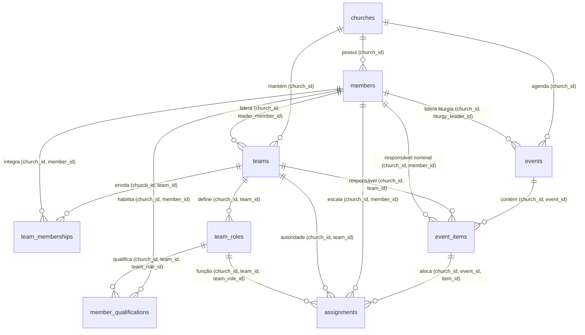

# Contrato Técnico Integrado: Fonte Real de Dependências Litúrgicas, Concorrência e Ciclo Efetivo

- **Data da Versão Integrada:** 16/10/2026
- **Status de Governança:** Desenho Técnico e Contrato Operacional do Bloco 2 (Implementação Local)
- **Documentos Normativos de Referência:** `docs/PRD.md`, `docs/arquitetura/ARQUITETURA-BANCO.md`, `docs/produto/CADASTRO-MEMBROS.md`, `docs/acesso/CONTRATO-CONVITES-ACESSO.md`, `MATRIZ-ACEITE.md`, `PARECER-CODEX.md`, `DECISAO-REVISAO.md`
- **Atendimento de Critérios da Matriz:** `M18-01`, `M18-05`, `M18-06`, `M18-07`, `M18-10`, `M18-12`
- **Limites originais do Bloco 1 (histórico):** implementação local em código e scripts versionados, então sem execução física de SQL. Os aceites físicos posteriores e a instalação autorizada no laboratório estão registrados ao final deste contrato; nenhuma dessas etapas autoriza piloto ou publicação.

---

## 1. Decisões de Produto Confirmadas pelo Responsável em 16/10/2026

1. **Regra de Liderança de Ministério Ativo:**
   - **Quem lidera um ministério/equipe ativa só pode ser excluído logicamente após transferir a liderança da equipe para outro membro ativo, mesmo que não existam cultos ou eventos futuros agendados ou em andamento.**
   - Uma equipe ativa não pode ficar acéfala nem apontar para membro inativo. A transferência de liderança é uma operação administrativa prévia obrigatória (`P0022`).
2. **Autorização para Criação de Eventos/Cultos:**
   - **Administradores e Líderes de Ministério Ativos podem criar cultos/eventos na própria igreja**, com autorização conferida no servidor via `church_access` (admin) ou `teams` (líder de equipe ativa).
   - **A designação e a troca da liderança da liturgia permanecem exclusivas do Administrador.**
   - O comando de criação (`create_church_event`), quando invocado por Líder de Ministério, **não aceita parâmetro de liturgia** (ou exige que seja nulo). Criar o evento não concede ao criador a liderança da liturgia ou o controle da condução do culto.
   - **A condução do culto e controle do cronômetro permanecem exclusivos do Líder da Liturgia designado.**

---

## 2. Estratégia Comum de Concorrência e Eliminação Global de Ciclos (Anti-Deadlock)

### 2.1 Guardião comum das dependências

O membro é bloqueado antes de criar uma nova responsabilidade, validar novamente seu estado ativo e adquirir locks de equipe/evento/item. Isso cobre criação de equipe com líder, troca de líder, criação de evento com liturgia, troca de liturgia, criação de item com responsável, alocação e substituição. No candidato 016, as três criações que antes apenas consultavam o estado passam a bloquear o membro; os escritores já corrigidos em 015 permanecem no instalador canônico.

A exclusão mantém o lock exclusivo do membro durante a consulta das dependências reais e a inativação. Não bloqueia equipes/eventos/itens/escalas: seus escritores de inclusão/troca precisam passar pelo mesmo membro; encerramentos e cancelamentos apenas liberam impedimentos. Não há inversão events → members introduzida por 016. Uma futura operação de reabertura, mudança de responsável ou alteração de datas precisa ser integrada a este protocolo antes de ser exposta.

### 2.2 Ciclo de vida, convites e continuidade administrativa

O candidato 016 usa o advisory lock transacional existente church_admin_continuity **antes de qualquer lock de linha** em exclusão, restauração, criação de membro, emissão/reemissão e decisão de solicitação. Resgates confirmando/propondo nome usam o mesmo lock após identificar a igreja e antes dos locks de domínio. Isso evita que uma decisão retenha um lock do operador enquanto aguarda um membro que está sendo excluído. O lock é por igreja, inclusive ao excluir não administradores, para manter o protocolo único; igrejas distintas não compartilham intencionalmente o mesmo lock.

O lock por (user_id, command_id), quando existente, precede o lock da igreja. A quota de criação de membros permanece depois dele. Operações de manutenção de acesso/administração devem adquirir church_admin_continuity antes de bloquear ou atualizar linhas. Os gatilhos de 009 continuam habilitados como salvaguarda; não substituem a ordem de aquisição no início da transação de manutenção. Nenhuma manutenção direta é exposta ao cliente por 016.

| Operação | Ordem de locks explícitos após serialização do comando |
| --- | --- |
| Exclusão 016 | Continuidade da igreja → acesso do alvo → membro do alvo → releitura do acesso → convites por UUID → solicitações por UUID. Autoridade completa é relida depois de todas as esperas, antes de qualquer efeito. |
| Restauração na cadeia 016 | Continuidade da igreja → acesso do alvo → membro do alvo; mantém revisão opaca, guarda P0018 e não modifica acesso/papéis. O arquivo 013 original permanece intacto. |
| Cadastro de membro e convites/decisões | Continuidade da igreja antes dos locks já existentes de igreja/operador/membro/convite/solicitação. Mantidos parâmetros, hashes, recibos, prazo e regras de identidade de 007/011. |
| Criar equipe com líder / evento com liturgia | Membro indicado exclusivo antes de inserir a dependência. Autoridade atual relida após a espera. Parâmetro opcional nulo não cria liderança implícita. |
| Criar item com responsável | Membro nominal exclusivo → equipe designada compartilhada → evento compartilhado → autoridade atual → inserção do item. |
| Demais escritores 015 | Membros por UUID → equipes → eventos → itens → vínculos/aptidões/escalas conforme a operação. Preservada a decisão final de autoridade após os locks explícitos dos quatro escritores já ensaiados. |

As dez funções substituídas em 016 são VOLATILE e exigem READ COMMITTED; não usam snapshots fixos para concluir decisões após espera. Não são concedidos privilégios diretos em app_private e nenhuma RPC nova é criada. Conta Auth, outras igrejas, UUIDs e referências históricas são preservados.

### 2.3 Dependências e resultados esperados

Equipe ativa liderada pelo alvo bloqueia com P0022 até transferência. Liturgia em evento agendado/em andamento bloqueia com P0023. Escala ativa ou responsabilidade nominal pendente/em andamento em evento aberto bloqueia com P0024. Evento agendado com fim previsto já passado e vínculo operacional do alvo exige encerramento formal (P0025). Ausência da fonte bloqueia com P0021. Horário passado, sozinho, não transforma evento aberto em histórico encerrado.

Eventos formalmente concluídos/cancelados e suas referências permanecem intactos e não impedem a exclusão. Convites abertos válidos são revogados; consumidos, revogados e expirados não são reescritos. Solicitação pending válida é cancelada com decisor; pending expirada é finalizada como expired sem decisor. Prazo original é preservado. Membro, acesso da igreja, tentativas, auditorias e recibo pertencem à mesma transação.

Em 17/10/2026, os dez grupos do ensaio reversível 016 passaram fisicamente na base descartável (r016_d9387ecd40de8c64), com ROLLBACK e comparação de dados/catálogos. Isso comprova as asserções sequenciais executadas, inclusive dependências/histórico E20/E21 e atomicidade. O lote integrado posterior aprovou **42 disputas com bloqueio real e vinte recusas de isolamento**, cobrindo dependências, convites/resgates/decisões, comandos/revisões, restauração, exclusões cruzadas de administradores e perda de autorização após espera. Os casos foram conferidos individualmente, incluindo estado final, recibos e auditoria. Fonte e gatilhos preservados, descarte identificado concluído. **Naquele checkpoint SQL, HTTP e navegador ainda estavam pendentes**; o aceite SQL não os substituía. A integração final permanece pendente. Após autorização específica, a cadeia 013/015/016 foi instalada com COMMIT único no banco postgres do laboratório HTTP existente. Ensaio prévio com ROLLBACK e comparação externa aprovados; 34 tabelas anteriores preservadas, sete tabelas novas vazias, 42 definições públicas coincidentes entre ensaio/aplicação/verificação e duas proteções administrativas habilitadas. A primeira tentativa parou antes do COMMIT por colisão de variável no wrapper de verificação; somente esse wrapper foi corrigido. Nesse checkpoint de instalação, Auth continuou parado e nenhuma conta ou fixture foi criada; HTTP e navegador ainda não haviam sido exercitados. O aceite posterior de aplicação está registrado na seção final deste contrato. Integração final e liberação no piloto não são comprovadas pelo aceite de instalação. Ver [roteiro de aceite](../sql/016_rehearsal_guide.md).

---

## 3. Integridade Relacional Composta Multi-Tenant em `app_private`

Reaproveitando a constraint composta `members_church_id_id_unique` já instalada no incremento `001_initial_access_structure.sql`, todas as novas tabelas operacionais em `app_private` amarram `church_id` e suas dependências hierárquicas:

- **`app_private.teams`:**
  - `(church_id, id)` UNIQUE.
  - `FOREIGN KEY (church_id, leader_member_id) REFERENCES app_private.members(church_id, id) ON DELETE RESTRICT`.
- **`app_private.team_memberships`:**
  - `FOREIGN KEY (church_id, team_id) REFERENCES app_private.teams(church_id, id) ON DELETE RESTRICT`.
  - `FOREIGN KEY (church_id, member_id) REFERENCES app_private.members(church_id, id) ON DELETE RESTRICT`.
  - `UNIQUE (church_id, team_id, member_id)`.
- **`app_private.team_roles`:**
  - `(church_id, team_id, id)` UNIQUE.
  - `FOREIGN KEY (church_id, team_id) REFERENCES app_private.teams(church_id, id) ON DELETE RESTRICT`.
  - `UNIQUE (church_id, team_id, name)`.
- **`app_private.member_qualifications`:**
  - `FOREIGN KEY (church_id, member_id) REFERENCES app_private.members(church_id, id) ON DELETE RESTRICT`.
  - `FOREIGN KEY (church_id, team_id, team_role_id) REFERENCES app_private.team_roles(church_id, team_id, id) ON DELETE RESTRICT`.
  - `UNIQUE (church_id, member_id, team_role_id)`.
- **`app_private.events`:**
  - `(church_id, id)` UNIQUE.
  - `timezone text not null` (herdado de `churches.timezone`).
  - `FOREIGN KEY (church_id, liturgy_leader_member_id) REFERENCES app_private.members(church_id, id) ON DELETE RESTRICT`.
- **`app_private.event_items`:**
  - `(church_id, event_id, id)` UNIQUE.
  - `planned_duration_seconds integer not null default 300 check (planned_duration_seconds > 0)`.
  - `FOREIGN KEY (church_id, event_id) REFERENCES app_private.events(church_id, id) ON DELETE CASCADE`.
  - `FOREIGN KEY (church_id, designated_team_id) REFERENCES app_private.teams(church_id, id) ON DELETE RESTRICT`.
  - `FOREIGN KEY (church_id, nominal_leader_member_id) REFERENCES app_private.members(church_id, id) ON DELETE RESTRICT`.
- **`app_private.assignments`:**
  - `FOREIGN KEY (church_id, event_id) REFERENCES app_private.events(church_id, id) ON DELETE CASCADE`.
  - `FOREIGN KEY (church_id, event_id, item_id) REFERENCES app_private.event_items(church_id, event_id, id) ON DELETE CASCADE`.
  - `FOREIGN KEY (church_id, member_id) REFERENCES app_private.members(church_id, id) ON DELETE RESTRICT`.
  - `FOREIGN KEY (church_id, team_id) REFERENCES app_private.teams(church_id, id) ON DELETE RESTRICT`.
  - `FOREIGN KEY (church_id, team_id, team_role_id) REFERENCES app_private.team_roles(church_id, team_id, id) ON DELETE RESTRICT`.

---

## 4. Contratos Operacionais das RPCs Públicas do Incremento 015

Todas as funções são qualificadas em `public`, `security definer`, `set search_path = ''`, `set statement_timeout = '5s'`, acessíveis com exclusividade pelo papel `authenticated`.

### 4.1 Gestão de Equipes e Integrantes

1. `public.create_church_team(p_church_id uuid, p_command_id uuid, p_name text, p_leader_member_id uuid)`
   - **Autorização:** Administrador ativo da igreja (`42501`).
   - **Validações:** Nome 1 a 100 caracteres NFC; se `p_leader_member_id` informado, deve ser membro ativo da mesma igreja.
   - **Retorno:** JSONB com `team_id`, `name`, `leader_member_id`, `status`.
2. `public.assign_team_leader(p_church_id uuid, p_command_id uuid, p_team_id uuid, p_expected_version integer, p_new_leader_member_id uuid)`
   - **Autorização:** Administrador ativo da igreja (`42501`).
   - **Validações:** Validação de versão otimista; `p_new_leader_member_id` deve ser membro ativo.
3. `public.add_team_member(p_church_id uuid, p_command_id uuid, p_team_id uuid, p_member_id uuid)`
   - **Autorização:** Administrador ativo OU Líder daquela equipe (`42501`).
   - **Validações:** Membro ativo; insere em `team_memberships`.
4. `public.remove_team_member(p_church_id uuid, p_command_id uuid, p_team_id uuid, p_member_id uuid)`
   - **Autorização:** Administrador ativo OU Líder daquela equipe (`42501`).
5. `public.list_church_teams(p_church_id uuid)`
   - **Autorização:** Qualquer membro ativo com acesso à igreja.
   - **Retorno:** Lista de equipes com líder atual e contagem de integrantes.

### 4.2 Funções e Aptidões (Qualificações)

1. `public.create_team_role(p_church_id uuid, p_command_id uuid, p_team_id uuid, p_name text, p_classification text)`
   - **Autorização:** Administrador ativo OU Líder daquela equipe (`42501`).
2. `public.grant_member_qualification(p_church_id uuid, p_command_id uuid, p_member_id uuid, p_team_id uuid, p_team_role_id uuid)`
   - **Autorização:** Administrador ativo OU Líder daquela equipe (`42501`).
   - **Validações:** Valida que o membro é integrante da equipe (`team_memberships`) e registra a habilitação em `member_qualifications`.
3. `public.revoke_member_qualification(p_church_id uuid, p_command_id uuid, p_member_id uuid, p_team_id uuid, p_team_role_id uuid)`
   - **Autorização:** Administrador ativo OU Líder daquela equipe (`42501`).

### 4.3 Gestão de Eventos, Cultos e Liturgia

1. `public.create_church_event(p_church_id uuid, p_command_id uuid, p_title text, p_event_type text, p_planned_start_at timestamptz, p_planned_end_at timestamptz, p_liturgy_leader_member_id uuid)`
   - **Autorização:** Administrador ativo OU Líder de Equipe ativa na igreja (`42501`).
   - **Regra Estrita de Liturgia:** Se o operador for Líder de Equipe (não-admin), `p_liturgy_leader_member_id` DEVE ser nulo (rejeita com `42501` se tentar designar). Se for Admin, pode designar membro ativo como liturgia.
   - **Timezone:** Herdado de `app_private.churches.timezone`.
2. `public.assign_event_liturgy_leader(p_church_id uuid, p_command_id uuid, p_event_id uuid, p_expected_version integer, p_new_liturgy_id uuid)`
   - **Autorização:** Exclusivo Administrador ativo (`42501`).
3. `public.start_event_service(p_church_id uuid, p_command_id uuid, p_event_id uuid, p_expected_version integer)`
   - **Autorização:** Líder da Liturgia daquele evento (`42501`). Altera status para `'in_progress'`.
4. `public.finish_event_service(p_church_id uuid, p_command_id uuid, p_event_id uuid, p_expected_version integer)`
   - **Autorização:** Líder da Liturgia daquele evento (`42501`). Altera status para `'completed'`.
5. `public.cancel_church_event(p_church_id uuid, p_command_id uuid, p_event_id uuid, p_expected_version integer, p_cancel_reason text)`
   - **Autorização:** Líder da Liturgia daquele evento OU Administrador (`42501`).

### 4.4 Alocação e Substituição de Voluntários

1. `public.assign_event_participant(p_church_id uuid, p_command_id uuid, p_event_id uuid, p_item_id uuid, p_team_id uuid, p_member_id uuid, p_team_role_id uuid, p_notes text)`
   - **Autorização:** Líder da Equipe `p_team_id` (`42501`).
   - **Validações:** Membro ativo; possui qualificação ativa em `member_qualifications` para a função; evento não concluído.
   - **Ordem de Locks:** `members` `FOR SHARE` $\rightarrow$ `teams` `FOR SHARE` $\rightarrow$ `events` `FOR UPDATE` $\rightarrow$ `event_items` `FOR UPDATE` $\rightarrow$ insert `assignments`.
2. `public.replace_event_participant(p_church_id uuid, p_command_id uuid, p_assignment_id uuid, p_replacement_member_id uuid, p_reason text)`
   - **Fronteira Temporal de Autorização:**
     - Se o item ou culto ainda não iniciou (`event_items.status = 'pending'`): Autorizado ao **Líder da Equipe**.
     - Se o item ou culto já iniciou (`event_items.status = 'in_progress'`): Autorizado com exclusividade ao **Líder da Liturgia do evento** (substituição emergencial PRD 7).
   - **Validações:** Substituto é membro ativo e qualificado; marca assignment anterior como `'replaced'` com referência a `replaced_assignment_id`.
   - **Ordem de Locks:** `members` (`ORDER BY id ASC` entre antigo e novo) $\rightarrow$ `teams` $\rightarrow$ `events` $\rightarrow$ `event_items` $\rightarrow$ `assignments`.

## Checkpoint posterior de aplicação — 17/10/2026

O lote autorizado de aplicação de 17/10/2026 aprovou A01–A14 no laboratório existente: Auth nativo, convites manuais, exclusão/restauração sem retorno de acesso, paginação, troca de igreja/conta, recuperação por comando/recibo original e recusa 42501 após perda de autoridade. A integração delimitada E20/E21 foi complementada por P0022/P0023 reais, transferência explícita de liderança, encerramento pela liturgia designada e histórico preservado. Não representa entrega da jornada de cultos. A12 usa contraprovas controladas de transporte; retenção e recarga complementam a queda de conexão que provocou reenvio automático idempotente.

A primeira tentativa permanece reprovada por isolamento de sessão: três linhas anteriores de Auth foram alteradas e três registros Auth adicionais foram criados por renovação automática de sessão antiga; registros anteriores de aplicação preservados. A causa foi corrigida somente na cópia do laboratório, com chave SDK própria. A retomada e o encerramento preservaram o baseline posterior de 214 registros, 42 funções, duas proteções e 86 entradas de segurança; isso não apaga a falha do baseline original de 211 registros. Interfaces/ponte encerradas e Auth novamente parado. Dados fictícios e histórico da prova foram retidos. Piloto e porta 3000 não foram alterados; revisão/integração final e encerramento de #12/#18 continuam pendentes.
