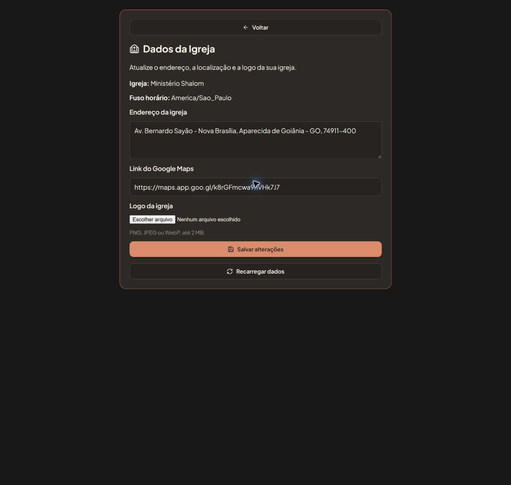

# Aplicação do cadastro da igreja no piloto

Data: 18/10/2026. Após a validação do laboratório, o responsável autorizou explicitamente aplicar o incremento 017 no Supabase do piloto, mediante conferência da estrutura. Esta autorização não inclui publicação do frontend, commit, push ou merge.

## Alvo e candidato

- Projeto Supabase **Escala do Reino**, referência `jvpctgqudvjealzileib`, banco `postgres`, PostgreSQL 17.11. Execução pelo SQL Editor autenticado, como `postgres`.
- Candidato: `docs/sql/017_church_settings.sql`, SHA256 `06e1843dbcd72dd230a4237879635fcc74fd8cdff1a7d0a3136c40617db80a08`, coincidente com o ensaiado e instalado no laboratório.
- A conferência inicial confirmou as dependências, ausência prévia do 017, RLS nativo de Storage e tabelas privadas e ausência de acesso direto dos papéis cliente ao schema privado. Não havia políticas anteriores em `storage.objects`.
- Foram registrados contagens e fingerprints de 49 tabelas e 70 funções anteriores, além de proprietários, ACLs, RLS, gatilhos e políticas anteriores. O baseline continha 223 registros no conjunto medido, incluindo uma igreja e quatro membros. Os snapshots não exportam os valores pessoais dos registros.

## Ensaio, instalação e preservação

1. O candidato exato foi executado com verificações adicionais dentro da transação e **ROLLBACK**, sem criar fixtures. Confirmou-se a ausência posterior de RPC, bucket e objetos do 017. A comparação externa coincidiu integralmente com o baseline nas 49 tabelas, funções e metadados medidos.
2. O texto integral do instalador foi conferido antes da execução. A instalação autorizada encerrou com **COMMIT**, após conferir RPCs, grants, RLS, bucket privado, limites de upload, ausência de recibos/objetos e valores iniciais das colunas novas.
3. A comparação posterior ao COMMIT preservou integralmente os fingerprints das 49 tabelas anteriores, as definições/permissões das 70 funções anteriores, ACLs de schemas/tabelas, proprietários, RLS, gatilhos e políticas anteriores. Para `churches`, foram comparadas as colunas anteriores; os campos novos iniciaram em logo `null` e revisão `0`. O bucket novo foi excluído somente da comparação dos buckets anteriores.
4. A conferência final confirmou quatro RPCs públicas, um helper privado, funções com proprietário `postgres` e `SECURITY DEFINER`, tabela de recibos com RLS, seis políticas de Storage e bucket privado de 2 MB para PNG/JPEG/WebP. Recibos e objetos novos permaneceram vazios.

Duas tentativas preliminares de consulta somente de leitura foram corrigidas antes do ensaio: uma concatenação exigia cast de `"char"` para `text`; outra consulta ficou com inserção parcial no editor. A troca do texto passou a usar seleção integral e comparação do conteúdo copiado antes de executar. Nenhuma dessas consultas realizou DDL ou alteração de dados. O candidato 017 permaneceu inalterado.

Acervo técnico local ignorado pelo Git: `node_modules/.cache/pilot017/`, incluindo preflight, snapshots antes/após ROLLBACK/após COMMIT, resultados e relatório de preservação. Esses arquivos registram esta execução e não autorizam repetir o instalador.

## Aplicação

Na sessão existente do administrador em `http://localhost:3000/`, o início apresentou **Dados da Igreja**. O botão abriu o formulário e carregou pelo servidor os dados existentes de **Ministério Shalom**, incluindo endereço e Google Maps, com seleção de logo disponível. Não foi enviado arquivo nem acionado **Salvar alterações**. Não foram criadas contas, igrejas, membros ou fixtures no piloto; nenhuma senha ou chave foi solicitada ou registrada. A renovação normal da sessão pelo aplicativo não foi tratada como alteração cadastral.

O upload real, as recusas de membro/outra igreja, o replay e a concorrência foram comprovados no [laboratório](2026-10-18-instalacao-e-validacao-cadastro-igreja-017.md). Não foram repetidos com mutações dos dados reais do piloto. Continua registrado o limite da automação do seletor de arquivo do Chrome; a prova de upload físico no laboratório foi feita por SDK/HTTP.

O backend 017 está instalado no piloto e a tela está disponível no checkout local. Não houve commit, push, PR, merge ou deploy do frontend nesta entrega. `.env.local`, porta 3000 e serviços Docker foram preservados. A aba existente foi deixada no cadastro para o responsável utilizar.
