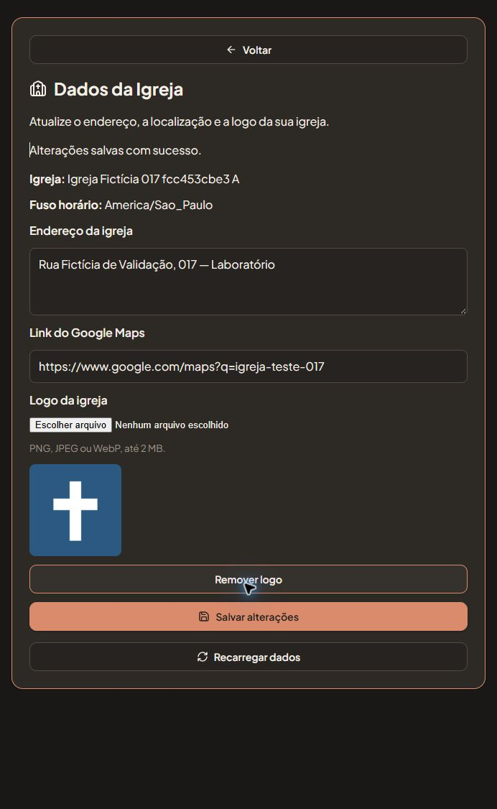

# Instalação e validação do cadastro da igreja no laboratório

Data: 18/10/2026. Escopo autorizado pelo responsável: instalar o incremento 017 no laboratório existente **EscalaReinoLab**, conferir a tela, o envio real da logo e a concorrência, preservando o piloto.

## Instalação

- Alvo: contêiner `supabase_db_EscalaReinoLab`, banco `postgres`, PostgreSQL 17.11.
- Backend HTTP: `http://127.0.0.1:54321`, com os serviços Auth e Storage já existentes. Não foram iniciados/reiniciados contêineres nem instalados os incrementos 011–016 nesse laboratório.
- Candidato: `docs/sql/017_church_settings.sql`, SHA256 `06e1843dbcd72dd230a4237879635fcc74fd8cdff1a7d0a3136c40617db80a08`, já aprovado no [ensaio descartável S01–S22](2026-10-18-ensaio-cadastro-igreja-017.md).
- Primeiro, o candidato exato foi ensaiado no alvo com **ROLLBACK**, sem fixtures, e a comparação de registros, funções e schema coincidiu integralmente.
- Em seguida, a instalação autorizada concluiu com **COMMIT**, após verificação das funções, grants, RLS, bucket privado e limite de arquivo dentro da transação.
- A conferência posterior aprovou os campos adicionais, quatro RPCs públicas, helper privado, tabela de recibos e seis políticas de Storage. As funções e os recibos novos pertencem a `postgres`. O bucket começou vazio.
- Os registros anteriores foram preservados, comparando as colunas anteriores de `churches`; logo/revisão começaram em `null`/`0`. As funções anteriores permaneceram coincidentes.

Acervo local: `node_modules/.cache/settings017-install-6b3e012c6022/`. O relatório inclui os snapshots e a saída da instalação; não é um novo instalador nem autorização para repetir o incremento.

## Fixtures e autenticação

Foram usadas quatro contas fictícias no padrão `s017_fcc453cbe3_<perfil>@example.com`, duas igrejas fictícias e membros próprios. Igreja e membros foram criados pelas RPCs de produto; os vínculos adicionais foram preparados exclusivamente para essas fixtures. Nenhum cadastro anterior foi reutilizado.

As sessões foram emitidas e verificadas pelo **Auth nativo** local. Nenhuma senha foi criada, solicitada ou registrada. Chaves e tokens permaneceram em memória e na sessão isolada do SDK no navegador, sem inclusão nos relatórios, URLs de navegação ou arquivos do projeto.

A primeira preparação do utilitário de teste falhou porque tentou verificar como `magiclink` um link cujo tipo retornado para a conta nova era `signup`. O utilitário passou a respeitar o tipo retornado. Uma conta fictícia adicional, ainda não confirmada, foi preservada; não houve alteração de configuração do Auth nem ocultação da tentativa inicial. As fixtures e seu histórico foram retidos.

## HTTP e arquivos físicos — H01–H15

Os quinze grupos, com dezoito verificações, passaram contra Auth/API/Storage reais:

- Admin consulta/edita o cadastro; membro e admin de outra igreja recebem recusa de leitura e escrita.
- PNG físico enviado pelo admin e referenciado no cadastro. Antes da referência, membro não consegue emitir URL assinada para ele.
- URLs assinadas emitidas para admin e membro autorizado após a referência. Os arquivos baixados coincidem em SHA256 com o PNG enviado.
- Download anônimo e assinatura por admin de outra igreja recusados; upload por membro recusado.
- SVG e arquivo de 2 MB + 1 byte recusados pelo Storage, independentemente do formulário.
- Replay HTTP retorna o recibo original sem duplicá-lo.
- Remover a referência impede novas assinaturas pelo membro e preserva o arquivo.
- Tentativas pela API real de sobrescrever e de excluir fisicamente a logo, inclusive pelo admin, foram recusadas; os bytes do PNG permaneceram coincidentes.

Isso não testa envio de e-mail por SMTP, OAuth Google ou expiração efetiva de uma URL assinada. Uma URL já emitida pode continuar válida até seu vencimento, conforme o contrato.

## Concorrência real — C01–C05

Cada caso usou duas conexões PostgreSQL, com PIDs distintos e bloqueio efetivamente observado em `pg_stat_activity`/`pg_blocking_pids` antes de liberar a primeira transação:

| Caso | Resultado |
|---|---|
| C01 — dois administradores editam a mesma revisão | Uma alteração confirmada; a segunda recebe 40001; sem recibo para o comando recusado. |
| C02 — mesmo comando simultâneo | Retorno idempotente, uma revisão e um registro de auditoria. |
| C03 — administração retirada durante a espera | O comando que aguardava recebe 42501 e não altera o cadastro. |
| C04 — replay aguarda enquanto a administração é retirada | 42501 mesmo existindo recibo anterior. |
| C05 — membro do administrador fica inativo durante a espera | 42501 após a espera, sem alteração do cadastro. |

Somente as fixtures foram alteradas; a elegibilidade da conta fictícia secundária foi restabelecida após os casos. As verificações não dependeram de atraso presumido para afirmar concorrência: o bloqueio entre os PIDs foi conferido no banco.

## Navegador e limite do seletor de arquivo

A aplicação de produto foi aberta no Chrome em `http://127.0.0.1:4018`, com configuração de backend sobrescrita somente no processo temporário. A porta 3000 e `.env.local` não foram alteradas. O acesso das contas fictícias usou uma ponte local de teste, com controle de origem e sessões nativas; a ponte não foi adicionada às rotas de produto nem ao build.

Conferido na tela:

1. Admin abre **Dados da Igreja** com os valores já persistidos.
2. Endereço com acentos e link do Maps são salvos; recarga dos dados e recarga completa do navegador preservam o cadastro.
3. A logo existente carrega com dimensões naturais de 96 × 96 pixels.
4. Membro não recebe o botão de acesso ao cadastro.
5. Retirada a administração da fixture com a tela aberta, o servidor recusa o salvamento e o formulário deixa de ser exibido.
6. Remoção da referência da logo pelo formulário confirma o salvamento e retira a prévia. A referência foi restabelecida na própria fixture para a captura final.

**Limitação explícita:** a automação de seleção de um novo arquivo pelo seletor do Chrome foi bloqueada porque a extensão ChatGPT não tinha **Allow access to file URLs** habilitado. Essa permissão não foi alterada. Portanto, o seletor não recebeu PASS ponta a ponta. Upload/download e controles de Storage passaram por SDK/HTTP reais; o tratamento do arquivo pelo componente é coberto pelos testes automatizados. A captura abaixo mostra a logo persistida pelo teste HTTP.

## Preservação, regressão e encerramento

- A referência anterior às fixtures mediu **214 registros**; todos foram encontrados com os mesmos hashes depois dos testes. Essa referência inclui o bucket instalado e a conta fictícia da primeira preparação. A preservação dos registros anteriores à instalação foi conferida separadamente no relatório de instalação.
- A comparação final mediu 303 registros, incluindo as novas fixtures e seu histórico. Nenhum registro anterior medido foi alterado/removido.
- Funções anteriores permaneceram coincidentes. O laboratório `escala-convites-http-lab`, usado apenas como referência anterior, permaneceu idêntico em dados e schema.
- Suíte completa: **342 testes, 39 suítes, zero falhas**. Build aprovado, mantendo o aviso conhecido de bundle acima de 500 kB.
- Aba, ponte e Vite temporários encerrados; porta 4018 sem listener. A instalação 017 permanece no `EscalaReinoLab`, com fixtures e histórico preservados.
- Nenhuma chamada de aplicação ou instalação foi feita no piloto. O frontend habitual continua configurado para o Supabase do piloto; a liberação nesse ambiente requer sua própria autorização e pré-verificação.

Acervo funcional local ignorado pelo Git: `node_modules/.cache/settings017-functional-fcc453cbe3/`, com relatório sanitizado, hashes, resultados concorrentes e capturas. Esse acervo não deve ser publicado em bloco. Não houve commit, push, PR, merge ou deploy.
