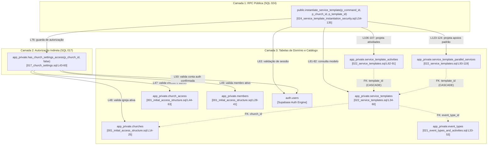

# Checkpoint de Homologação — Ensaio Sequencial Reversível do Planejamento de Eventos (023a + 023b + 025)

- **Data do Checkpoint:** 25/10/2026
- **Agentes Envolvidos:** Antigravity (Executor Principal de Implementação e Testes), Codex (Revisor Técnico Independente) e Responsável pelo Produto (Autoridade Final de Decisão)
- **Rastreabilidade:** Issues [#28](https://github.com/dgnoleto/escala-do-reino/issues/28), [#29](https://github.com/dgnoleto/escala-do-reino/issues/29), [#30](https://github.com/dgnoleto/escala-do-reino/issues/30), [#57](https://github.com/dgnoleto/escala-do-reino/issues/57) e [#58](https://github.com/dgnoleto/escala-do-reino/issues/58)
- **Delimitação de Escopo:** Ensaio transacional sequencial sob `ROLLBACK;` incondicional no banco descartável de laboratório `escala_rehearsal_024`.
- **Decisão Formal de Governança:** O aceite desta subetapa é **estritamente técnico e delimitado** ao ensaio monossessão reversível. A homologação definitiva do pacote R7, a migração permanente e o Gate 3 global permanecem em **NO-GO**.

---

## 1. Contexto e Deliberações da Rodada

1. **Revisão Técnica Independente do Codex:**
   - O Codex concluiu a auditoria sobre a execução da segunda rodada do pacote de ensaio R7 materializado.
   - Foi comprovada a execução sequencial íntegra: código de saída `0`, presença dos dez marcadores contratuais `REHEARSAL_S01_OK` a `REHEARSAL_S10_OK`, emissão do marcador `REHEARSAL_ROLLBACK_CONFIRMED`, aprovação de todas as asserções pós-rollback da própria sessão e emissão de `INDEPENDENT_INSPECTION_OK` em conexão separada.
   - Foram identificadas e saneadas divergências textuais do relatório descritivo inicial por meio da [Errata Técnica](file:///D:/Github/escala-do-reino/scratch/gate3-auditoria/20261025-145400-r7-rehearsal/ERRATA-RELATORIO-EXECUCAO-R7.md), alinhando o relato à realidade do código executado.
2. **Aceite do Responsável pelo Produto:**
   - Em 25/10/2026, o responsável pelo produto acolheu o parecer técnico e autorizou o registro deste checkpoint documental de consolidação.
   - Ratificou a preservação dos princípios de contenção: Opção B da Issue #28 (criação por administrador ou líder ministerial ativo sem dirigente), replay estrito sob a Abordagem 1 (conferência da autoridade atual exigida pela operação original), diretrizes D1–D7 e integridade dos bancos e piloto.
3. **Imutabilidade e Evidências:**
   - Não houve repetição do ensaio para fins de ajuste documental.
   - As evidências em `scratch/` são estritamente locais e voláteis do ambiente de desenvolvimento. Sua existência física na máquina do desenvolvedor não comprova publicação remota nem disponibilidade para outros membros ou instâncias. Nenhuma credencial real, segredo ou dump de dados foi copiado para a documentação permanente.
4. **Operações de Git nesta Etapa:**
   - Houve estritamente operações de leitura de metadados e diffs locais (`git status`, `git diff`).
   - Não houve qualquer mutação de Git: sem staging (`git add`), commit, push, stash, checkout ou alteração de branches.

---

## 2. Rastreabilidade das Duas Tentativas de Execução

| Parâmetro | Tentativa 1 (Interrupção) | Tentativa 2 (Conclusão Plena) |
| :--- | :--- | :--- |
| **Horário (UTC)** | `2026-10-25T17:35:04.235Z` | `2026-10-25T17:54:51.770Z` |
| **Duração** | ~737 ms | 3,068 segundos |
| **Código de Saída** | `1` (Falha) | `0` (Sucesso) |
| **Causa / Diagnóstico** | Daemon Docker Desktop inativo no host Windows (`open //./pipe/dockerDesktopLinuxEngine`). | Executável Docker Desktop iniciado após autorização expressa do responsável. Engine responsivo e contêiner alvo saudável. |
| **Comandos SQL** | Nenhum comando SQL ou conexão psql foi transmitida ao banco. | Todos os blocos transmitidos via stdin assíncrono em UTF-8 sem BOM. |
| **Transação e Rollback** | Nenhuma transação aberta no banco; banco permaneceu intocado. | Transação única `READ COMMITTED`, timeouts `statement=5s` e `lock=2s`, encerrada em `ROLLBACK;` explícito. |
| **Cenários S01–S10** | Não executados (marcadores ausentes). | Executados e aprovados integralmente. |
| **Inspeção Posterior** | Não executada. | Executada em conexão desacoplada e aprovada. |
| **Pasta de Evidências** | [`scratch/gate3-auditoria/20261025-143500-r7-rehearsal/`](file:///D:/Github/escala-do-reino/scratch/gate3-auditoria/20261025-143500-r7-rehearsal/) | [`scratch/gate3-auditoria/20261025-145400-r7-rehearsal/`](file:///D:/Github/escala-do-reino/scratch/gate3-auditoria/20261025-145400-r7-rehearsal/) |

---

## 3. Base Congelada e Hashes SHA-256 Auditados

Todos os seis arquivos mantiveram-se inalterados durante todo o processo de validação:

- `tools/run-event-planning-rehearsal.ps1`: `55A22418BDA9CB4CCE57707F78AA393C5038A3533899497B30C6AEE7E5A58628`
- `docs/sql/023_rehearsal_transactional_body.sql`: `844CF1DD1EF3371B77FA6D8745D085E202ADCED5C4180B6C70ED62BAFF375A2F`
- `docs/sql/023_independent_inspection.sql`: `C2A99B7115BDA74DEBCA854B49E4271B1BF0ED80EDA67AD6829ED598A600DB46`
- `docs/sql/023a_event_planning_structural.sql`: `279BF22D5CDED8366D77236684C777378BC488A3A296E6C94CEBB1038DEE237E`
- `docs/sql/023b_event_creation_security_hardening.sql`: `634E21DC9D448529882721F3EE83B063BC56B8B442AA80716811A7B46FCD71B6`
- `docs/sql/025_event_planning_security_hardening.sql`: `48A572FF2F1EBDD26099DEFE9EFFA6BDB24AF41E5BDC552EAC67903116E5D3BF`

---

## 4. Matriz Real dos Cenários Executados (S01–S10)

A correspondência dos cenários reflete estritamente o código de [`docs/sql/023_rehearsal_transactional_body.sql`](file:///D:/Github/escala-do-reino/docs/sql/023_rehearsal_transactional_body.sql):

- **S01 (`REHEARSAL_S01_OK`):** Chamador comum (`c_u_common`) tenta criar edição designando dirigente litúrgico (`c_m_ministerial`) em `create_church_event_edition` -> Rejeição esperada por falta de privilégio com SQLSTATE `42501`. Verificação de zero resíduos em `app_private.events`.
- **S02 (`REHEARSAL_S02_OK`):** Administrador (`c_u_admin`) tenta criar edição designando membro inativo (`c_m_inactive`) como dirigente litúrgico -> Rejeição esperada por validação de status/FK com SQLSTATE `23503`. Verificação de zero resíduos em `app_private.events`.
- **S03 (`REHEARSAL_S03_OK`):** Administrador (`c_u_admin`) cria edição autorizada com dirigente ativo (`c_m_ministerial`) sob `v_cmd_id_admin` -> Sucesso. Validação contratual dos 6 campos de retorno, recibo gravado em `app_private.event_planning_receipts`, status `scheduled`, `program_status = 'draft'`, versão `1` e auditoria única registrada.
- **S04 (`REHEARSAL_S04_OK`):** Líder ministerial ativo (`c_u_ministerial`) cria evento sem dirigente litúrgico (`null`) sob `v_cmd_id_min` -> Sucesso conforme Opção B (Issue #28), com `liturgy_leader_member_id is null` e `program_status = 'draft'`.
- **S05 (`REHEARSAL_S05_OK`):** Replay idempotente exato de `create_church_event_edition` por `c_u_admin` sob o mesmo `v_cmd_id_admin` e mesmo payload -> Sucesso. Confronto exato de todos os 6 campos contratuais contra o retorno de S03; ausência de novas linhas em `events`, `event_planning_receipts` e `audit_entries`; igualdade estrita de JSON do evento, recibo e auditoria ordenada por `occurred_at, id`.
- **S06 (`REHEARSAL_S06_OK`):** Replay recusado após perda de autoridade ministerial: inativação da equipe `c_team_id`, tentativa de replay de S04 por `c_u_ministerial` -> Rejeição com SQLSTATE `42501`; sem novas escritas e sem mutação no JSON de eventos, recibos ou auditoria; reativação de `c_team_id`.
- **S07 (`REHEARSAL_S07_OK`):** `set_event_duration_policy` por dirigente litúrgico (`c_u_ministerial`): política inválida `'strict'` rejeitada com SQLSTATE `22000`; política válida `'block'` aceita e persistida em `events.duration_policy`.
- **S08 (`REHEARSAL_S08_OK`):** Inserção de 2 itens de evento (`c_item_1_id`, `c_item_2_id`) e execução de `reorder_event_items` por `c_u_ministerial` com lock `FOR UPDATE` do evento -> Inversão da ordem para `[2, 1]` confirmada no banco.
- **S09 (`REHEARSAL_S09_OK`):** `save_event_program_draft` e `publish_event_program`: (1) salvar rascunho preserva `status = 'scheduled'`, `program_status = 'draft'` e versão `1`; (2) publicar programa (duração ocupada 900s <= 7200s planejados sob política 'block') preserva `status = 'scheduled'`, atualiza `program_status = 'published'`, incrementa versão para `2` e grava metadados (`published_at`, `published_by_member_id = c_m_ministerial`).
- **S10 (`REHEARSAL_S10_OK`):** Idempotência de conflito em `publish_event_program`: reutilização de `v_cmd_id_pub` (já associado a `v_event_id`) tentando publicar evento diferente (`v_event_id_min`).
  > [!NOTE]
  > **Esclarecimento Técnico de S10:** O SQLSTATE `23505` capturado foi emitido **explicitamente pela lógica de guarda da RPC** (`v_existing_receipt.params <> v_params_hash`) antes de qualquer instrução `INSERT`, e não decorreu de colisão física de chave primária na tabela de recibos.

---

## 5. Alcance e Limites Efetivos das Verificações

1. **Guarda de Transação e Timeouts:**
   - Isolamento: `READ COMMITTED` em transação única monossessão.
   - Timeouts estritos: `statement_timeout = '5s'` e `lock_timeout = '2s'`.
2. **Snapshot Anterior de Eventos:**
   - O snapshot inicial de linhas em `app_private.events` projetando dez atributos de planejamento estava **completamente vazio** (`SELECT 0` na base descartável). A verificação pós-rollback comprovou delta zero de eventos residuais.
3. **Advisory Locks Pós-Rollback:**
   - Verificação restrita à própria sessão: `pg_locks where locktype = 'advisory' and pid = pg_backend_pid()`. Confirmou zero locks retidos na conexão. Não faz inferência sobre locks globais mantidos por outras conexões.
4. **Catálogo Bidirecional:**
   - Compara o snapshot pré-ensaio contra o estado pós-rollback exclusivamente para:
     - `table`: nos esquemas `public` e `app_private`.
     - `routine`: nos esquemas `public` e `app_private`.
     - `column`: exclusivamente na tabela `app_private.events`.
   - Não compara triggers genéricos, views, índices ou políticas de RLS.
5. **Contagens de Domínio:**
   - Contagem estrita pré/pós das seguintes **oito tabelas de domínio**: `auth.users`, `app_private.churches`, `app_private.members`, `app_private.church_access`, `app_private.teams`, `app_private.events`, `app_private.event_items` e `app_private.audit_entries`. O esquema `app` não é consultado.
6. **Inspeção Independente em Conexão Separada:**
   - Conexão desacoplada contra [`docs/sql/023_independent_inspection.sql`](file:///D:/Github/escala-do-reino/docs/sql/023_independent_inspection.sql) auditou:
     - Ausência das 5 RPCs dos candidatos em `public`.
     - Ausência persistida da tabela `app_private.event_planning_receipts`.
     - Ausência das 5 colunas de planejamento em `app_private.events`.
     - Ausência de registros residuais das fixtures canônicas (`c_church_id`, `c_u_*`, `c_m_*`, `c_team_id`, `c_item_*`).
     - Pinning criptográfico da **função preexistente preservada** `public.instantiate_service_template` (versão original do SQL 022 restaurada pelo rollback do Gate 2, OID `200297`, proprietário `postgres`, hash MD5 `913c68a50c7035aef49c33f70a0b0177`, `search_path=""` e `statement_timeout=5s`), comprovando que o hardening do SQL 024 **NÃO está instalado permanentemente** no banco descartável.
   - Não verifica ausência global de tabelas temporárias (que possuem escopo de sessão) nem locks de outras sessões.
7. **Limites de Não-Execução:**
   - **Instalação Permanente:** Nenhuma migration foi aplicada com `COMMIT`.
   - **Validação HTTP / PostgREST:** Não executada nesta rodada.
   - **Concorrência Multissessão:** Não exercitada nesta rodada monossessão.

---

## 6. Matriz Residual da Issue #58

Reconciliação detalhada entre os critérios de aceite vigentes da [Issue #58](https://github.com/dgnoleto/escala-do-reino/issues/58) e o conjunto de evidências disponível, com a separação formal das verificações de planejamento das pendências de catálogo preexistente e a precisão do executor comprovado:

| Critério Vigente (#58) | Evidência Existente | Status | Lacuna Concreta | Menor Próxima Ação | Autorização Necessária |
| :--- | :--- | :--- | :--- | :--- | :--- |
| **1. Matriz de reconciliação por objeto (017 a 020 e 023)** | Inventário preliminar em `evidencias-inventario/` (22/27 tabelas, 22/39 assinaturas); ensaio sequencial reversível validou 023a, 023b e 025. | **Parcial** | Falta formalizar a matriz objeto a objeto classificando PRESERVAR / CRIAR / SUBSTITUIR / INVESTIGAR para 017–020. | Consolidar a tabela de reconciliação de 017 a 020 em documento analítico de baseline. | Autorização documental para matriz de reconciliação. |
| **2A. Verificações de corpos/metadados, colunas, recibos e ACLs de R1–R5 (planejamento)** | Pareceres R1–R5 aprovados documentalmente pelo Codex; ensaio sequencial reversível comprovou exitosamente o comportamento em S01–S10 e as asserções delimitadas pós-rollback e de inspeção independente. | **Parcial** | O ensaio comprovou os fluxos de S01–S10 e as verificações delimitadas que foram implementadas; não comprovou a totalidade das asserções de catálogo sobre corpos/metadados, estruturas colunares, constraints e ACLs de R1–R5. O critério permanece parcial, sem invalidar o ensaio aceito. | Preservar os candidatos congelados com seus hashes, delimitando que as verificações completas de catálogo de R1–R5 exigirão roteiro específico quando houver autorização para instalação durável. | Autorização para eventual instalação durável e conferência integral de catálogo. |
| **2B. Reconciliação dos objetos preexistentes de 021/022 no banco descartável** | Presença registrada no inventário preliminar de catálogo (`evidencias-inventario/` com contagem de tabelas e rotinas). | **Pendente de comprovação de conformidade** | A mera presença no catálogo não comprova equivalência de corpos (`prosrc`), configurações (`proconfig`), gatilhos e permissões de 021/022 contra os DDLs canônicos. Não tratar a presença desses objetos como substituta das verificações de R1–R5. | Propor consulta estática mínima somente-leitura ao `pg_catalog` (sem executar) para inspecionar corpos e atributos de 021/022. | Autorização para consulta somente-leitura no banco descartável. |
| **3. Participação e cadeia do Supabase Storage** | Análise topológica em `LABORATORIOS.md` e ensaio 017 histórico. | **Delimitado documentalmente** | A RPC `instantiate_service_template` não consome Storage. Contudo, a ausência de chamada direta a Storage não dispensa automaticamente os requisitos ambientais do Gate 3 (já que o baseline inclui 017). | Registrar a nota técnica demonstrando a independência da RPC 024 e preservando os requisitos de ambiente. | Homologação da nota técnica de dependências. |
| **4. Plano de recuperação (backup lógico completo e restore verificável)** | Ensaio R7 comprovou reversão por `ROLLBACK;` em ~3s. Para instalação durável, plano de restore permanece teórico. | **Pendente** | Ausência de procedimento testado de `pg_dump`/`pg_restore` do banco descartável sem afetar o banco principal `postgres`. | Desenhar o roteiro passo a passo de backup lógico e restauração controlada de `escala_rehearsal_024`. | Autorização para elaboração do plano de backup/restore. |
| **5. Composição do ensaio e comandos transacionais em instaladores canônicos** | Candidatos 023a, 023b e 025 foram concatenados em sessão única com transação externa (`BEGIN; ... ROLLBACK;`), viabilizada pela ausência de comandos `BEGIN/COMMIT` próprios nesses arquivos. Nenhuma solução foi aplicada aos instaladores 017–020. | **Parcial (resolvido para 023a/023b/025 / Pendente para instaladores 017–020)** | Os instaladores canônicos 017–020 contêm comandos `BEGIN/COMMIT` internos. Não prescrever execução "arquivo a arquivo" como estratégia aprovada; qualquer estratégia para 017–020 exige prévia análise de atomicidade e plano de recuperação contra falhas parciais. | Elaborar análise formal de atomicidade e plano de recuperação para os instaladores 017–020 antes de qualquer proposta de saneamento. | Decisão e autorização do responsável sobre a estratégia de saneamento dos instaladores. |
| **6. Compatibilidade de ambiente (Windows PowerShell 5.1 / UTF-8)** | `run-event-planning-rehearsal.ps1` comprovou execução perfeita sob **Windows PowerShell 5.1** (`5.1.26100.9711`) com streams assíncronos e UTF-8 sem BOM. | **Comprovado exclusivamente no executor R7 e fluxo textual / Pendente para outras ferramentas** | A compatibilidade comprovada é restrita ao executor `run-event-planning-rehearsal.ps1` e ao fluxo de streams textuais UTF-8 assíncronos. Retirar qualquer adoção automática como padrão global para outros scripts, coletores ou backups binários (`pg_dump`/`pg_restore`), que permanecem sem validação empírica nesse shell. | Manter a delimitação do PowerShell 5.1 ao escopo do executor R7; analisar isoladamente requisitos de ambiente para coletores e ferramentas de backup. | Nenhuma para delimitação documental. |
| **7. Dependência com SQL 023 e hardening 025 (#57)** | Ensaio sequencial R7 executou com sucesso a composição atômica `023a + 023b + 025` sem expor funções vulneráveis. | **Atendido para ensaio sob ROLLBACK / Pendente para instalação permanente** | A cadeia conjunta não está aplicada de forma persistente nem exposta a chamadas via PostgREST. | Preservar os candidatos congelados com seus hashes comprovados até autorização de aplicação. | Autorização de instalação durável. |
| **8. Validação HTTP/PostgREST (Gate 3, snapshots T0–T3)** | Arquitetura de PostgREST temporário (porta 55355) descrita no Roteiro Consolidado B01. | **Pendente** | Contêiner PostgREST efêmero não iniciado, chamadas HTTP (H01–H10) não disparadas e snapshots T0–T3 não coletados. | Elaborar manifesto de execução HTTP quando as pendências de banco estiverem resolvidas. | Autorização expressa para a Fase B (Gate 3 HTTP). |
| **9. Rastreabilidade e publicação de evidências** | Checkpoints em `docs/historico/`, status em `ESTADO-ATUAL.md` e logs locais em `scratch/`. | **Atendido no âmbito local / Parcial em relação a publicações remotas** | Evidências brutas permanecem locais em `scratch/` (ignorado pelo git); sua presença não comprova disponibilidade remota. | Manter a política de checkpoints formais versionados em `docs/` e logs brutos isolados em `scratch/`. | Nenhuma (política já ativa). |

---

## 7. Nota Técnica — Mapa Estático de Dependências do SQL 024 (`public.instantiate_service_template`)

Esta nota técnica estabelece o mapa estático de dependências diretas e indiretas da RPC `public.instantiate_service_template(uuid, uuid, uuid)` (objeto central da Issue [#27](https://github.com/dgnoleto/escala-do-reino/issues/27) e do Gate 3), analisando os arquivos canônicos, as fixtures do Gate 3 e as evidências de catálogo disponíveis no repositório.

### 7.1 Mapeamento Estruturado de Dependências por Camada



#### 1. Camada 1: RPC `public.instantiate_service_template`
- **Arquivo canônico:** [`docs/sql/024_service_template_instantiation_security.sql:L54-140`](file:///d:/Github/escala-do-reino/docs/sql/024_service_template_instantiation_security.sql#L54-L140).
- **Funções chamadas diretamente:**
  - `auth.uid()` (L63): leitura do identificador do usuário autenticado a partir do contexto da sessão/token JWT.
  - `app_private.has_church_settings_access(p_church_id, false)` (L76): guarda estrita de autorização adicionada pelo SQL 024 para mitigar a vulnerabilidade da Issue #27. O parâmetro booleano `false` indica que administradores ou membros ativos autorizados possuem permissão de consulta (não exige estritamente `is_admin = true`).
  - `gen_random_uuid()` (L92, L113): geração em tempo de execução de identificadores efêmeros de atividades (`'act-' || gen_random_uuid()`) e de serviços paralelos (`'serv-' || gen_random_uuid()`) para a projeção desacoplada em memória.
  - Funções padrão do motor: `coalesce()`, `jsonb_agg()`, `jsonb_build_object()`.
- **Tabelas diretamente consultadas:**
  - `app_private.service_templates` (L64, L81-82): leitura da linha correspondente ao modelo solicitado, aplicando o filtro composto de isolamento multi-tenant: `where id = p_template_id and church_id = p_church_id`.
  - `app_private.service_template_activities` (L106-107): projeção ordenada de atividades litúrgicas do modelo via `where sta.template_id = p_template_id order by sta.display_order asc`.
  - `app_private.service_template_parallel_services` (L123-124): projeção ordenada de apoios padrão ativos via `where stps.template_id = p_template_id and stps.is_default_active = true order by stps.display_order asc`.
- **Propriedades e Atributos da RPC:**
  - `LANGUAGE plpgsql STABLE SECURITY DEFINER` (L60).
  - Configurações de tempo de execução (`proconfig`): `SET search_path = ''` e `SET statement_timeout = '5s'` (L60).
  - Proprietário (`proowner`): `postgres` (L140).
  - Privilégios: `REVOKE ALL FROM public, anon, service_role` (L138); `GRANT EXECUTE TO authenticated` (L139).
- **Referências a Storage nesta camada:** Rigorosamente **zero**. Nenhuma menção a buckets, objetos ou APIs de arquivo.
- **Referências a 023/025 (Planejamento de Eventos) nesta camada:** Rigorosamente **zero**. Não há chamada a RPCs de criação de edição (`create_church_event_edition`), não há inserção em `app_private.events` nem gravação em `event_planning_receipts`. Trata-se estritamente de preview em memória para desacoplamento do cliente.

#### 2. Camada 2: Helper Indireto `app_private.has_church_settings_access`
- **Arquivo canônico:** [`docs/sql/017_church_settings.sql:L43-60`](file:///d:/Github/escala-do-reino/docs/sql/017_church_settings.sql#L43-L60).
- **Funções chamadas indiretamente:**
  - `auth.uid()` (L51): extrai a identidade da conta chamadora.
  - `statement_timestamp()` (L57): confere se a conta não está banida (`u.banned_until is null or u.banned_until <= statement_timestamp()`).
- **Tabelas indiretamente consultadas:**
  - `app_private.church_access ca` (L47): validação de vínculo ativo (`ca.status = 'active'`), onboarding concluído (`ca.onboarding_completed_at is not null`) e prerrogativa administrativa quando exigida (`not p_require_admin or ca.is_admin`).
  - `app_private.churches c` (L48): validação de que a igreja alvo está com status ativo (`c.status = 'active'`).
  - `app_private.members m` (L49): validação de integridade do membro vinculado (`m.status = 'active'` e `m.church_id = ca.church_id`).
  - `auth.users u` (L50): validação de integridade da conta Auth (`u.email_confirmed_at is not null`, `u.deleted_at is null`, não anônimo e sem banimento ativo).
- **Propriedades e Atributos do Helper:**
  - `LANGUAGE sql STABLE SECURITY DEFINER SET search_path = ''` (L44).
  - Proprietário: `postgres` ([`017_church_settings.sql:L211`](file:///d:/Github/escala-do-reino/docs/sql/017_church_settings.sql#L211)).
  - Privilégios: `REVOKE ALL FROM public, anon, authenticated, service_role` ([`017_church_settings.sql:L60`](file:///d:/Github/escala-do-reino/docs/sql/017_church_settings.sql#L60)). Executável estritamente pelo proprietário `postgres` no contexto de RPCs `SECURITY DEFINER`.
- **Referências a Storage nesta camada:** Rigorosamente **zero**. Embora o instalador 017 configure Storage para logos de igreja em outras seções do arquivo, a função auxiliar `has_church_settings_access` é puramente relacional sobre tabelas de identidade e acesso.
- **Referências a 023/025 nesta camada:** Rigorosamente **zero**.

#### 3. Camada 3: Requisitos Estruturais, Foreign Keys e Catálogo de Suporte
- **Tabelas do Modelo de Culto (`022_service_templates.sql`):**
  - `app_private.service_templates` (L34-60): PK `id uuid`, FK `church_id` referenciando `app_private.churches(id) ON DELETE RESTRICT`, FK opcional `event_type_id` referenciando `app_private.event_types(id) ON DELETE SET NULL`. Check constraints de formato textual (`st_name_clean`, `st_desc_clean`). RLS habilitado e privilégios revogados de todas as roles da API.
  - `app_private.service_template_activities` (L62-91): PK `id uuid`, FK `church_id` referenciando `churches(id) ON DELETE RESTRICT`, FK `template_id` referenciando `service_templates(id) ON DELETE CASCADE`. Restrições de duração planejada entre 1 e 720 minutos (`sta_duration_range`). RLS habilitado e revogado da API.
  - `app_private.service_template_parallel_services` (L93-119): PK `id uuid`, FK `church_id` referenciando `churches(id) ON DELETE RESTRICT`, FK `template_id` referenciando `service_templates(id) ON DELETE CASCADE`. Restrições de preparação entre 0 e 180 minutos (`stps_prep_range`). RLS habilitado e revogado da API.
- **Tabelas Base de Acesso e Entidades:**
  - `app_private.churches`, `app_private.members`, `app_private.church_access` ([`001_initial_access_structure.sql:L14-63`](file:///d:/Github/escala-do-reino/docs/sql/001_initial_access_structure.sql#L14-L63)).
  - `app_private.event_types` ([`021_event_types_and_activities.sql:L33-53`](file:///d:/Github/escala-do-reino/docs/sql/021_event_types_and_activities.sql#L33-L53)).
  - `auth.users` (motor nativo Supabase Auth).
- **Referências a Storage nesta camada:** Rigorosamente **zero**.
- **Referências a 023/025 nesta camada:** Rigorosamente **zero**.

#### 4. Camada 4: Fixtures e Verificadores do Gate 3
- **Fixtures canônicas previstas (F01–F31):**
  - Mapeadas no Roteiro Consolidado B01 ([`scratch/gate3-auditoria/ROTEIRO-CONSOLIDADO-GATE3-SQL024.md:L420-458`](file:///d:/Github/escala-do-reino/scratch/gate3-auditoria/ROTEIRO-CONSOLIDADO-GATE3-SQL024.md#L420-L458)) e em [`docs/sql/024_rehearsal_cases.sql:L81-136`](file:///d:/Github/escala-do-reino/docs/sql/024_rehearsal_cases.sql#L81-L136):
    - 6 contas de usuário em `auth.users` (F01 a F06).
    - 2 igrejas em `app_private.churches` (F07 Igreja 100, F08 Igreja 200).
    - 5 membros em `app_private.members` (F09 admin 100, F10 membro 100, F11 admin 200, F12 revogado 100, F13 líder liturgia 100).
    - 5 vínculos em `app_private.church_access` (F14 admin 100, F15 membro 100, F16 admin 200, F17 revogado 100, F18 líder 100).
    - 2 tipos de evento em `app_private.event_types` (F19 culto 100, F20 culto 200).
    - 2 modelos de culto em `app_private.service_templates` (F21 mod 70 da igreja 100, F22 mod 79 da igreja 200).
    - 2 atividades em `app_private.service_template_activities` (F23 abertura 71, F24 louvor 72).
    - 2 apoios em `app_private.service_template_parallel_services` (F25 ativo 81, F26 inativo 82).
    - Fixtures estruturais adicionais F27 a F31 (`teams`, `team_roles`, `team_memberships`, `member_qualifications`) para suportar a integridade relacional do banco descartável.
- **Verificadores contratuais:**
  - `024_preflight.sql:L69-130`: confere a existência prévia da assinatura da RPC e do helper.
  - `024_verify.sql:L81-200`: bloco imperativo `DO` que confere `SECURITY DEFINER`, `search_path=''`, `statement_timeout=5s`, presença do teste `has_church_settings_access(p_church_id, false)`, formatação camelCase da chave `parallelServices` e concessões de execução.
  - Casos HTTP H01 a H10 na porta 55355 do PostgREST efêmero.
- **Referências a Storage nas fixtures e verificadores:** Rigorosamente **zero**. Nenhuma fixture insere registros em tabelas do esquema `storage`, e nenhum caso de teste HTTP ou asserção do verificador interage com o serviço de Storage.
- **Referências a 023/025 nas fixtures e verificadores:** Rigorosamente **zero**. Nenhuma fixture do SQL 024 cria ou consulta eventos na tabela `app_private.events` ou recibos de planejamento.

---

### 7.2 Classificação nos Quatro Quadrantes Obrigatórios

```
+-------------------------------------------------------------+-------------------------------------------------------------+
| A. O QUE A FONTE CANÔNICA EFETIVAMENTE EXIGE                | B. O QUE AS EVIDÊNCIAS EXISTENTES DEMONSTRAM INSTALADO      |
|                                                             |                                                             |
| - Tabelas de acesso (001), tipos (021) e modelos (022).     | - Inventário preliminar: 22/27 tabelas e 22/39 rotinas.     |
| - Helper has_church_settings_access (017) como SECDEF.      | - Inspeção independente: função preexistente preservada     |
| - RPC 024 com SECDEF, search_path='', timeout 5s,          |   (SQL 022, OID 200297, owner postgres, MD5 913c68a5...).   |
|   EXECUTE concedido exclusivamente a authenticated.         |   O hardening SQL 024 NÃO está instalado permanentemente.   |
| - PostgREST dedicado com claim sub e aud='authenticated'.   | - Ensaio Gate 2: C01–C10 executados com ROLLBACK sob       |
|                                                             |   PostgreSQL 17.11 no banco escala_rehearsal_024.           |
+-------------------------------------------------------------+-------------------------------------------------------------+
| C. O QUE PERMANECE NÃO COMPROVADO                           | D. O QUE SERIA MUDANÇA DE CRITÉRIOS OU ARQUITETURA          |
|                                                             |                                                             |
| - Conformidade dos corpos (prosrc) e ACLs de 021/022        | - Exigir persistência de eventos em instantiate (escopo #29).|
|   contra DDLs canônicos no banco descartável.               | - Tratar presença de 021/022 como substituta de R1–R5.      |
| - Corpo real de has_church_settings_access na base atual.   | - Dispensar requisitos ambientais de Gate 3 pela ausência   |
| - Subida do contêiner PostgREST e snapshots T0–T3.          |   de chamada direta a Storage no corpo da RPC.              |
| - Ressalva: ausência de chamada direta a Storage na RPC     | - Prescrever execução "arquivo a arquivo" para 017–020      |
|   NÃO dispensa requisitos ambientais de Gate 3.             |   sem análise prévia de atomicidade e plano de restore.     |
+-------------------------------------------------------------+-------------------------------------------------------------+
```

1. **A. O que a fonte canônica efetivamente exige:**
   - Existência e integridade relacional estrita das tabelas de acesso básico (`churches`, `members`, `church_access`, `auth.users`), tipos de evento (`event_types`) e modelos reutilizáveis de culto (`service_templates`, `service_template_activities`, `service_template_parallel_services`).
   - Existência e integridade comportamental do helper `app_private.has_church_settings_access(uuid, boolean)` com `SECURITY DEFINER` e proprietário `postgres`.
   - Concessão de privilégio `EXECUTE` da RPC `public.instantiate_service_template` exclusivamente para o papel `authenticated` e revogação das demais roles da API (`public`, `anon`, `service_role`).
   - Para a validação HTTP do Gate 3: daemon PostgREST apontando para a base `escala_rehearsal_024`, segredo JWT efêmero carregado por arquivo com claims `sub` e `aud = 'authenticated'`, e sinalização de reload de schema cache (`NOTIFY pgrst, 'reload schema'`).

2. **B. O que as evidências existentes demonstram instalado:**
   - No banco descartável `escala_rehearsal_024`:
     - O inventário preliminar de catálogo (`evidencias-inventario/`) comprovou a existência física de 22/27 tabelas e 22/39 funções catalogadas.
     - A inspeção independente em conexão desacoplada realizada em 25/10 ([`docs/sql/023_independent_inspection.sql:L123-134`](file:///d:/Github/escala-do-reino/docs/sql/023_independent_inspection.sql#L123-L134)) auditou a presença da **função preexistente preservada** `public.instantiate_service_template` correspondente à versão original do SQL 022 (OID `200297`, proprietário `postgres`, hash MD5 `913c68a50c7035aef49c33f70a0b0177`, `search_path=""` e `statement_timeout=5s`). Isso comprova a reversão fiel do ensaio anterior e atesta formalmente que o hardening do SQL 024 **NÃO está instalado permanentemente** no banco descartável. Sua instalação protegida permanece como pendência prévia obrigatória a ser aplicada antes de qualquer ensaio HTTP.
     - O ensaio Gate 2 executou com sucesso o script `024_rehearsal_consolidated.sql` sob `ROLLBACK;` em C01–C10 no motor PostgreSQL 17.11 em 20/10/2026.

3. **C. O que permanece não comprovado:**
   - A conformidade estrita dos corpos (`prosrc`), configurações de tempo de execução (`proconfig`), gatilhos e permissões de tabelas dos objetos preexistentes de 021 (`event_types`) e 022 (`service_templates`) contra as fontes canônicas em `escala_rehearsal_024`. A mera presença no catálogo não comprova equivalência de corpos e atributos.
   - O corpo e o comportamento do helper `app_private.has_church_settings_access(uuid, boolean)` instalado atualmente em `escala_rehearsal_024` não foram inspecionados estaticamente linha a linha nesta rodada.
   - A subida do contêiner PostgREST temporário (porta 55355), as chamadas HTTP (H01–H10) e os quatro snapshots determinísticos (T0–T3) permanecem não executados.
   - *Ressalva de Governança:* A ausência de chamada direta a Storage no código da RPC **não autoriza transformar essa constatação em dispensa automática dos requisitos ambientais do Gate 3**, visto que a base descartável foi construída a partir de um baseline que incorpora o instalador 017 (onde a infraestrutura de Storage foi configurada).

4. **D. O que configuraria alteração de critérios ou da arquitetura anteriormente aprovados:**
   - Exigir que a RPC `instantiate_service_template` persista registros na tabela de eventos `app_private.events` (a persistência permanente de eventos litúrgicos pertence exclusivamente à Issue [#29](https://github.com/dgnoleto/escala-do-reino/issues/29); a RPC 024 foi concebida e aprovada estritamente para preview desacoplado em memória).
   - Tratar a reconciliação dos objetos preexistentes de 021/022 como substituta da validação de R1–R5 do planejamento (são frentes distintas: 021/022 pertence ao baseline de tipos/modelos; R1–R5 pertence à suíte de planejamento de eventos 023a/023b/025).
   - Dispensar o isolamento de rede, o segredo JWT efêmero ou as asserções de isolamento multi-tenant do Gate 3 sob a alegação de que o ensaio PostgreSQL puro (Gate 2) já foi aceito com ressalvas.
   - Prescrever execução "arquivo a arquivo" ou qualquer alteração persistente dos instaladores canônicos 017–020 sem análise prévia de atomicidade e plano de recuperação testado contra falhas parciais.

---

### 7.3 Roteiro Completo de Coleta de Metadados Somente-Leitura (Execução Final Documentada em 25/10/2026)

Este roteiro operacional especifica a extração estrita de metadados de catálogo no banco descartável `escala_rehearsal_024`, limitada exclusivamente aos objetos que compõem o caminho de suporte e autorização da RPC `public.instantiate_service_template(uuid, uuid, uuid)`.

> [!IMPORTANT]
> **STATUS DO ROTEIRO: EXECUÇÃO FINAL DOCUMENTADA.**
> O roteiro, inicialmente preparado como proposta documental, teve execução final documentada sob READ ONLY com ROLLBACK em 25/10/2026 às 20:07:02Z, após autorização do responsável. A coleta foi aceita como evidência com ressalva de rastreabilidade: o alcance das tentativas intermediárias permanece NÃO COMPROVADO. A execução não autoriza alterações no banco, instalação do SQL 024 ou abertura da frente HTTP. Ver seção 7.4.

#### 1. Delimitação Estrita de Escopo
- **Rotinas Inspecionadas (3) — Resolução por Assinatura Exata:**
  1. `public.instantiate_service_template(uuid, uuid, uuid)` (RPC sob análise).
  2. `app_private.has_church_settings_access(uuid, boolean)` (helper de autorização de vínculo).
  3. `auth.uid()` (função de contexto de sessão).
  *Regra:* O roteiro gera exatamente um resultado por assinatura esperada. Overloads e rotinas alheias não são capturados. Ausência gera registro explícito (`is_present: false`, `status: 'ABSENT'`), impedindo que retorno de zero objetos seja confundido com coleta completa.
- **Tabelas Inspecionadas (8) — Resolução por Lista Nominal Esperada:**
  1. `auth.users` (tabela de contas Auth consultada pelo helper).
  2. `app_private.churches` (tabela de igrejas consultada pelo helper e referenciada pelo modelo).
  3. `app_private.members` (tabela de membros consultada pelo helper).
  4. `app_private.church_access` (tabela de vínculos e privilégios consultada pelo helper).
  5. `app_private.event_types` (tabela de tipos de evento referenciada pelo modelo).
  6. `app_private.service_templates` (tabela principal do modelo consultada pela RPC).
  7. `app_private.service_template_activities` (tabela de atividades projetadas pela RPC).
  8. `app_private.service_template_parallel_services` (tabela de apoios padrão projetados pela RPC).
  *Regra:* O roteiro gera exatamente um resultado por tabela esperada (`status: 'PRESENT'` ou `'ABSENT'`).
- **Roles Inspecionadas (7) — Atributos e Vínculos de Herança Direta:**
  - `anon`, `authenticated`, `authenticator`, `service_role`, `postgres`, `supabase_admin`, `dashboard_user`.
- **Metadados Coletados Exclusivamente:**
  - Presença ou ausência explícita no catálogo para cada objeto esperado.
  - Rotinas: OID, proprietário, linguagem, atributos (`prosecdef`, `proisstrict`, `provolatile`), argumentos de identidade, tipo de retorno, configurações (`proconfig`), `proacl`, e definição completa (`pg_get_functiondef`).
  - Tabelas: OID, proprietário, status de RLS (`relrowsecurity`, `relforcerowsecurity`), `relacl`, colunas com tipo, nulabilidade, defaults e `attacl` (`pg_attribute`), constraints completas com validação (`pg_constraint`), políticas RLS ativas (`pg_policy`) e gatilhos habilitados (`pg_trigger`).
  - Roles: OID, atributos (`rolsuper`, `rolinherit`, `rolcreaterole`, `rolcreatedb`, `rolcanlogin`, `rolbypassrls`, `rolconnlimit`) e vínculos diretos de associação (`member_of` via `pg_auth_members` com `admin_option`, `inherit_option` e `set_option`).
- **Garantias Anti-Exposição e Não-Invasão:**
  - Proibida qualquer consulta a linhas de negócio (`SELECT * FROM app_private.*` é terminantemente vedado).
  - Proibida qualquer leitura de valores ou colunas de contas de usuários em `auth.users` (apenas `pg_attribute` de catálogo é consultado).
  - Proibida qualquer consulta a senhas de roles (`rolpassword` nunca é selecionado) ou configurações gerais de roles (`rolconfig` omitido).
  - Proibida a inclusão de rotinas de 021/022 externas a este caminho.

#### 2. Envelope SQL com Guardas Estritas e Transação READ ONLY

O script SQL abaixo foi projetado para executar sob transação estritamente somente-leitura, com guardas triplas de identificação que abortam a execução antes de qualquer consulta de metadados caso haja divergência de ambiente:

```sql
-- =============================================================================
-- ROTEIRO DE INSPEÇÃO DE CATÁLOGO — SUPORTE SQL 024 (EXECUÇÃO FINAL DOCUMENTADA SOB READ ONLY)
-- Alvo Exclusivo: escala_rehearsal_024 (Porta 55332)
-- Transação: READ ONLY com ROLLBACK incondicional obrigatório
-- =============================================================================
\set ON_ERROR_STOP on

BEGIN READ ONLY;

SET LOCAL statement_timeout = '10s';
SET LOCAL lock_timeout = '2s';

-- 1. Guardas Estritas Anti-Divergência de Alvo
do $catalog_guard$
declare
  v_db text := current_database();
  v_db_oid oid;
  v_system_id text;
begin
  -- Guarda A: Nome do banco de dados
  if v_db is distinct from 'escala_rehearsal_024' then
    raise exception 'GUARDA FATAL: Conexão direcionada ao banco "%". O alvo obrigatório é "escala_rehearsal_024". Abortando.',
      v_db using errcode = '55000';
  end if;

  -- Guarda B: OID do banco de dados
  select oid into v_db_oid from pg_database where datname = v_db;
  if v_db_oid is distinct from 198690 then
    raise exception 'GUARDA FATAL: OID do banco "%" é %, esperava-se 198690. Abortando.',
      v_db, v_db_oid using errcode = '55000';
  end if;

  -- Guarda C: Identificador de cluster PostgreSQL (system_identifier)
  select system_identifier::text into v_system_id from pg_control_system();
  if v_system_id is distinct from '7695064938894594085' then
    raise exception 'GUARDA FATAL: System identifier do cluster é %, esperava-se 7695064938894594085. Abortando.',
      v_system_id using errcode = '55000';
  end if;

  raise notice 'GUARDAS APROVADAS: Banco escala_rehearsal_024 (OID 198690) no cluster 7695064938894594085 confirmado.';
end;
$catalog_guard$;

-- 2. Coleta de Metadados das 3 Rotinas Delimitadas (Assinaturas Exatas e Ausência Explícita)
with expected_routines(target_schema, target_name, target_signature) as (
  values
    ('public', 'instantiate_service_template', 'public.instantiate_service_template(uuid,uuid,uuid)'),
    ('app_private', 'has_church_settings_access', 'app_private.has_church_settings_access(uuid,boolean)'),
    ('auth', 'uid', 'auth.uid()')
)
select jsonb_pretty(jsonb_agg(
  jsonb_build_object(
    'target_schema', er.target_schema,
    'target_name', er.target_name,
    'target_signature', er.target_signature,
    'is_present', (p.oid is not null),
    'status', case when p.oid is not null then 'PRESENT' else 'ABSENT' end,
    'routine_oid', p.oid,
    'identity_arguments', case when p.oid is not null then pg_get_function_identity_arguments(p.oid) else null end,
    'return_type', case when p.oid is not null then pg_get_function_result(p.oid) else null end,
    'language', l.lanname,
    'owner', case when p.oid is not null then pg_get_userbyid(p.proowner) else null end,
    'security_definer', p.prosecdef,
    'is_strict', p.proisstrict,
    'volatility', p.provolatile,
    'runtime_config', p.proconfig,
    'proacl', p.proacl::text,
    'function_def', case when p.oid is not null then pg_get_functiondef(p.oid) else null end
  ) order by er.target_schema, er.target_name
)) as routines_metadata
from expected_routines er
left join (
  pg_catalog.pg_proc p
  join pg_catalog.pg_namespace n on n.oid = p.pronamespace
  left join pg_catalog.pg_language l on l.oid = p.prolang
) on n.nspname = er.target_schema
 and p.proname = er.target_name
 and p.oid = to_regprocedure(er.target_signature);

-- 3. Coleta de Metadados das 8 Tabelas Delimitadas (Estrutura, relacl, attacl, RLS, Constraints, Triggers)
with expected_tables(target_schema, target_name) as (
  values
    ('auth', 'users'),
    ('app_private', 'churches'),
    ('app_private', 'members'),
    ('app_private', 'church_access'),
    ('app_private', 'event_types'),
    ('app_private', 'service_templates'),
    ('app_private', 'service_template_activities'),
    ('app_private', 'service_template_parallel_services')
)
select jsonb_pretty(jsonb_agg(
  jsonb_build_object(
    'target_schema', et.target_schema,
    'target_name', et.target_name,
    'is_present', (c.oid is not null),
    'status', case when c.oid is not null then 'PRESENT' else 'ABSENT' end,
    'table_oid', c.oid,
    'owner', case when c.oid is not null then pg_get_userbyid(c.relowner) else null end,
    'row_security_enabled', c.relrowsecurity,
    'row_security_forced', c.relforcerowsecurity,
    'relacl', c.relacl::text,
    'columns', case when c.oid is not null then (
      select jsonb_agg(
        jsonb_build_object(
          'column_num', a.attnum,
          'column_name', a.attname,
          'data_type', format_type(a.atttypid, a.atttypmod),
          'not_null', a.attnotnull,
          'default_expr', pg_get_expr(ad.adbin, ad.adrelid),
          'attacl', a.attacl::text
        ) order by a.attnum
      )
      from pg_catalog.pg_attribute a
      left join pg_catalog.pg_attrdef ad on ad.adrelid = a.attrelid and ad.adnum = a.attnum
      where a.attrelid = c.oid and a.attnum > 0 and not a.attisdropped
    ) else null end,
    'constraints', case when c.oid is not null then (
      select jsonb_agg(
        jsonb_build_object(
          'constraint_name', con.conname,
          'constraint_type', con.contype,
          'is_validated', con.convalidated,
          'definition', pg_get_constraintdef(con.oid)
        ) order by con.conname
      )
      from pg_catalog.pg_constraint con
      where con.conrelid = c.oid
    ) else null end,
    'policies', case when c.oid is not null then (
      select jsonb_agg(
        jsonb_build_object(
          'policy_name', pol.polname,
          'command', pol.polcmd,
          'roles', pol.polroles::regrole[],
          'using_qual', pg_get_expr(pol.polqual, pol.polrelid),
          'with_check', pg_get_expr(pol.polwithcheck, pol.polrelid)
        ) order by pol.polname
      )
      from pg_catalog.pg_policy pol
      where pol.polrelid = c.oid
    ) else null end,
    'triggers', case when c.oid is not null then (
      select jsonb_agg(
        jsonb_build_object(
          'trigger_name', trg.tgname,
          'is_enabled', trg.tgenabled,
          'definition', pg_get_triggerdef(trg.oid)
        ) order by trg.tgname
      )
      from pg_catalog.pg_trigger trg
      where trg.tgrelid = c.oid and not trg.tgisinternal
    ) else null end
  ) order by et.target_schema, et.target_name
)) as tables_metadata
from expected_tables et
left join (
  pg_catalog.pg_class c
  join pg_catalog.pg_namespace n on n.oid = c.relnamespace
) on n.nspname = et.target_schema and c.relname = et.target_name;

-- 4. Coleta de Atributos de Roles e Vínculos de Herança Direta (Roles de API e Proprietário)
with expected_roles(target_role) as (
  values
    ('anon'),
    ('authenticated'),
    ('authenticator'),
    ('service_role'),
    ('postgres'),
    ('supabase_admin'),
    ('dashboard_user')
)
select jsonb_pretty(jsonb_agg(
  jsonb_build_object(
    'target_role', er.target_role,
    'is_present', (r.oid is not null),
    'status', case when r.oid is not null then 'PRESENT' else 'ABSENT' end,
    'role_oid', r.oid,
    'is_superuser', r.rolsuper,
    'can_inherit', r.rolinherit,
    'can_create_role', r.rolcreaterole,
    'can_create_db', r.rolcreatedb,
    'can_login', r.rolcanlogin,
    'can_replication', r.rolreplication,
    'bypass_rls', r.rolbypassrls,
    'connection_limit', r.rolconnlimit,
    'member_of', case when r.oid is not null then (
      select jsonb_agg(
        jsonb_build_object(
          'parent_role', m_parent.rolname,
          'admin_option', m.admin_option,
          'inherit_option', m.inherit_option,
          'set_option', m.set_option
        ) order by m_parent.rolname
      )
      from pg_catalog.pg_auth_members m
      join pg_catalog.pg_roles m_parent on m_parent.oid = m.roleid
      where m.member = r.oid
    ) else null end
  ) order by er.target_role
)) as roles_metadata
from expected_roles er
left join pg_catalog.pg_roles r on r.rolname = er.target_role;

ROLLBACK;
```

#### 3. Especificação do Procedimento de Execução no Host (PowerShell)
Para execução quando autorizada pelo responsável:
1. **Comando Base com Flag `-X`:**
   ```powershell
   # Execução via contêiner oficial do laboratório direcionada estritamente ao banco descartável:
   docker exec -i supabase_db_escala-convites-http-lab psql -X -U postgres -d escala_rehearsal_024 -v ON_ERROR_STOP=1
   ```
   *Nota Técnica:* A inclusão explícita de `-X` desabilita a leitura de arquivos de inicialização (`~/.psqlrc`), assegurando execução determinística e isolada.
2. **Codificação e Transporte:**
   - O payload SQL é transmitido exclusivamente via streams assíncronos (`RedirectStandardInput` com `System.Diagnostics.ProcessStartInfo`), gravado em memória como UTF-8 sem BOM.
   - Isso evita contaminação de metacomandos e garante execução confiável em Windows PowerShell 5.1.
3. **Captura e Isolamento de Saída:**
   - A saída padronizada (`StandardOutput`) e os erros (`StandardError`) são capturados separadamente para arquivos físicos em `scratch/gate3-auditoria/YYYYMMDD-HHMMSS-coleta-catalogo-024/`.
   - Nenhuma linha de saída de credenciais ou dados de usuários existe, pois o script extrai exclusivamente `pg_catalog`.
4. **Validação do Código de Saída:**
   - O processo do runner valida estritamente `$Process.ExitCode -eq 0`.
   - Qualquer saída diferente de zero aborta a operação sem tentativas cegas de repetição.

#### 4. Normas de Interpretação de Privilégios e Metodologia de Confronto

1. **Interpretação Normativa de ACLs Nulas:**
   - **Rotinas (`proacl` IS NULL):** Por padrão no PostgreSQL, quando `proacl` é `NULL`, vigoram os privilégios implícitos de sistema para funções: o privilégio `EXECUTE` é concedido tacitamente a `PUBLIC`, e controle total pertence ao `owner`. Caso `proacl` esteja preenchido (não nulo), os privilégios implícitos cessam e vigoram exclusivamente as entradas explícitas (ex.: `REVOKE ALL ON FUNCTION ... FROM PUBLIC` seguido de `GRANT EXECUTE ON FUNCTION ... TO authenticated`).
   - **Tabelas (`relacl` IS NULL):** Por padrão no PostgreSQL, quando `relacl` é `NULL`, aplicam-se os privilégios padrão: apenas o proprietário da tabela (`c.relowner`) e superusuários possuem acesso (`SELECT`, `INSERT`, `UPDATE`, `DELETE`). O papel `PUBLIC` e roles de API não possuem qualquer acesso concedido por padrão. Concessões a `anon` ou `authenticated` exigem entradas explícitas em `relacl`.
   - **Colunas (`attacl`):** No modelo de segurança do PostgreSQL, ACLs de coluna não negam nem revogam privilégios já concedidos em nível de tabela (`relacl`). As concessões na tabela continuam plenamente aplicáveis a todas as colunas; entradas explícitas em `attacl` atuam exclusivamente acrescentando acessos pontuais em colunas específicas. Privilégios efetivos não devem ser classificados sem avaliar conjuntamente todos os caminhos pertinentes (tabela, colunas, roles herdadas e concessões à role `PUBLIC`).

2. **Atributos de Roles e Vínculos de Herança Direta:**
   - A camada de API PostgREST conecta-se como `authenticator` (role que possui `can_login: true`), comutando para a role `anon` ou `authenticated` com base nas claims do token JWT.
   - O atributo `member_of` audita exclusivamente os vínculos diretos de associação na tabela `pg_auth_members`, capturando `admin_option`, `inherit_option` e `set_option` (não constituindo árvore recursiva completa de herança).
   - O privilégio efetivo durante as chamadas HTTP depende de:
     - `can_inherit: true` e da associação direta em `pg_auth_members` (respeitando `inherit_option`);
     - `bypass_rls: false` em `anon` e `authenticated` para garantir que as políticas de RLS sejam imperativamente aplicadas;
     - Privilégios concedidos à pseudo-role `PUBLIC`, herdados por todos os papéis.

3. **Regra de Classificação de Privilégios Indeterminados:**
   - Se qualquer privilégio efetivo não puder ser conclusivamente comprovado com o recorte coletado (por exemplo, privilégios default alterados via `ALTER DEFAULT PRIVILEGES` no schema ou permissões dinâmicas de conexão não capturadas), esse privilégio **NÃO deve ser presumido como concedido ou revogado**. Ele deve ser expressamente classificado como **NÃO COMPROVADO**.

4. **Metodologia de Confronto Analítico (Coleta vs. Conformidade):**
   - **Distinção Epistêmica:** A coleta de evidência é a extração determinística do estado bruto do catálogo. A aprovação de conformidade é o parecer analítico decorrente do confronto linha a linha contra os arquivos canônicos do repositório.
   - **Limitação de Hashes Isolados:** A verificação por hash MD5 isolado (como `913c68a50c7035aef49c33f70a0b0177`) não comprova paridade se não houver a referência canônica comparável gerada pelas mesmas funções do catálogo (`pg_get_functiondef`). A conformidade exige a extração do código completo (`function_def`) e a elaboração de diff textual contra a versão de referência.
   - **Matriz de Confronto a Aplicar:**
     1. `public.instantiate_service_template`: confrontar o `function_def` extraído contra a versão 022 (`022_service_templates.sql:L770-838`) para confirmar o estado atual preservado, e contra o DDL 024 (`024_service_template_instantiation_security.sql:L54-135`) para demonstrar a necessidade de sua aplicação no Gate 3.
     2. `app_private.has_church_settings_access`: confrontar o `function_def` extraído contra [`017_church_settings.sql:L43-60`](file:///d:/Github/escala-do-reino/docs/sql/017_church_settings.sql#L43-L60) para assegurar que a guarda de autorização exigida por 024 está íntegra no banco de ensaio.
     3. Tabelas de suporte: confrontar colunas, `attacl`, constraints e RLS de `service_templates`, `activities` e `parallel_services` contra [`022_service_templates.sql:L34-119`](file:///d:/Github/escala-do-reino/docs/sql/022_service_templates.sql#L34-L119).

#### 5. Delimitação de Alcance
- Este roteiro verifica exclusivamente os pré-requisitos relacionais e permissões de suporte ao SQL 024.
- **NÃO encerra nem homologa:**
  - A totalidade dos objetos das migrações 021 e 022 (rotinas não chamadas por `instantiate_service_template` permanecem fora da análise);
  - Os critérios R1–R5 do planejamento de eventos (Issue #58);
  - A aprovação global do Gate 3 (que depende da execução e validação da Fase HTTP/PostgREST).

---

### 7.4 Registro da Coleta de Metadados de Catálogo (25/10/2026) e Reconciliação

Em 25/10/2026, com execução final documentada às 20:07:02Z, foi concluída a coleta de metadados somente-leitura sob `BEGIN READ ONLY; ... ROLLBACK;` via `psql -X` no contêiner `supabase_db_escala-convites-http-lab` direcionada ao banco `escala_rehearsal_024` (OID `198690`, system_identifier `7695064938894594085`), registrando código de saída 0 e duração de 187 ms. Evidências arquivadas em `scratch/gate3-auditoria/20261025-170343-coleta-catalogo-024/`.

**Conclusões Técnicas e Errata Factual de Catálogo:**
1. **Atributos de Roles:** A role `postgres` (OID 16384) possui `is_superuser = false` e `bypass_rls = true`; o superusuário estrito do cluster gerenciado é `supabase_admin` (OID 10, `is_superuser = true`). Os vínculos de `authenticator` em `pg_auth_members` atestam autorização estática de `SET ROLE`, sem constituir evidência de conexão efetiva do PostgREST.
2. **Rotina Auxiliar (`app_private.has_church_settings_access`):** A função possui `is_strict = false` e `proacl: null`. Na semântica do PostgreSQL, `proacl = NULL` confere tacitamente `EXECUTE` a `PUBLIC`, divergindo do canônico `docs/sql/017_church_settings.sql:L60` (`REVOKE ALL ... FROM public, anon, authenticated, service_role`). Sua reconciliação deve ocorrer na mesma transação atômica da preparação do SQL 024.
3. **Metadados de Tabelas Coletadas:** Foram inspecionados exclusivamente os metadados de 8 tabelas nominais (`auth.users`, `app_private.churches`, `app_private.members`, `app_private.church_access`, `app_private.event_types`, `app_private.service_templates`, `app_private.service_template_activities`, `app_private.service_template_parallel_services`). Em `app_private.churches`, as colunas `logo_path` e `profile_revision` estão ausentes, lacuna restrita ao módulo de configurações da igreja (script SQL 017) que não afeta o caminho do SQL 024. A coleta parcial não comprova ausência de corrupção ou dados espúrios nem transforma 021/022 em baseline integralmente aprovado.
4. **Definição da RPC Pública (`public.instantiate_service_template`):** A função instalada é deterministamente a versão original do SQL 022 (sem a guarda de verificação de membro ativo da igreja), atestando que o hardening do SQL 024 não está aplicado permanentemente.
5. **Rastreabilidade Operacional do Runner:** Os logs preservados cobrem a execução final documentada às 20:07:02Z. Como não há logs de eventuais tentativas intermediárias de inicialização no host PowerShell, se essas tentativas alcançaram o contêiner ou falharam localmente é formalmente classificado como NÃO COMPROVADO.
6. **Protocolo Operacional Concreto de Preparação:**
   - **Fase A+B (Banco):** Reconciliação da ACL do helper e aplicação de `024_service_template_instantiation_security.sql` na mesma transação atômica (`BEGIN ... COMMIT`), com rollback integral em caso de falha pré-commit.
   - **Contenção Pós-Commit:** Caso ocorra incidente pós-commit, a ação é de contenção proposta via `REVOKE EXECUTE ... FROM authenticated, anon, public;` sujeita a autorização expressa prévia (sem restauração automática da versão vulnerável 022 e sem dispensar o plano de recuperação da Issue #58).
   - **Fase C (HTTP):** Homologação no PostgREST efêmero conforme a matriz canônica (H08 com 200 OK; H09A e H09B com HTTP 500 e code `P0002`; H02–H06 com HTTP 403 e code `42501`). A preservação dos snapshots T0–T3 não autoriza o trecho antigo de teardown que restaurava a função 022, incompatibilidade que deverá ser resolvida antes do início dos testes de rede.

**Limites preservados:** os aceites do Gate 2 e do ensaio sequencial permanecem nos seus escopos. A linha 2A segue Parcial; R7 integral e Gate 3 global permanecem em NO-GO. As pendências da matriz da seção 6 não são dispensadas por esta coleta, especialmente recuperação verificável (critério 4), reconciliação e requisitos de ambiente.

---

## 8. Recomendação Técnica de Próxima Ação

- **Estado confirmado:** coleta de catálogo concluída na execução final documentada e aceita como evidência, com ressalva de rastreabilidade. O SQL 024 permanece sem instalação permanente. A coleta não demonstra conformidade integral do baseline nem ausência de corrupção ou dados espúrios.
- **Próxima ação documental recomendada:** elaborar o plano delimitado de backup lógico e restauração verificável exigido pelo critério 4 da matriz residual, preservando as demais pendências e sem executar utilitários, iniciar serviços ou criar recursos. A incompatibilidade do teardown antigo de T0–T3 deve ser resolvida antes da frente HTTP.
- **Limites de autorização:** este registro não autoriza nova coleta, DDL/DCL, instalação com COMMIT, backup/restore, criação ou descarte de bancos, alterações de serviços ou chamadas HTTP. Cada intervenção permanece sujeita à autorização expressa e delimitada do responsável; eventual contenção pós-COMMIT também deverá ser delimitada.
